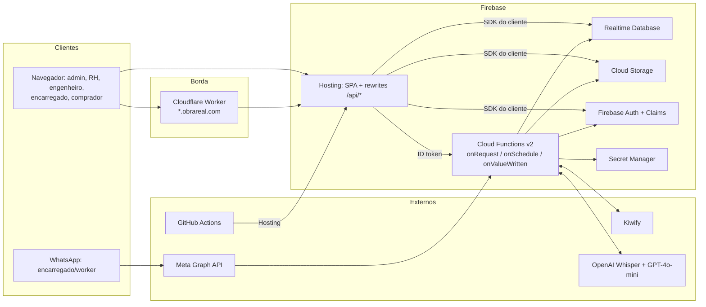
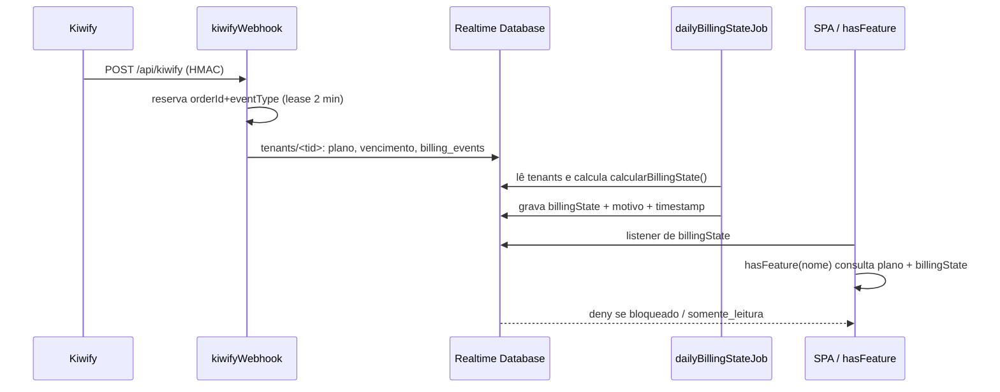
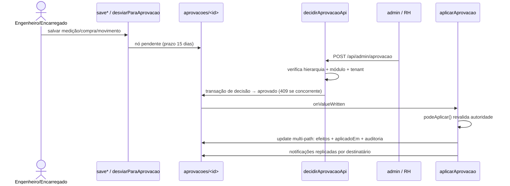
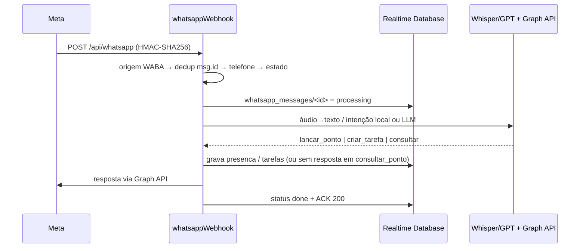

# Arquitetura — Obra Real (`gestaodeobras`)

> Gerado pelo **Arquiteto** (Fase 3, `doc_level = completo`) a partir de 21 fluxogramas, `code-analysis.md`, `data-dictionary.md`, `domain.md`, `state-machines.md`, `permissions.md`, 14 ADRs, `inventory.md`, `dependencies.md` e `.reversa/context/*`.
> 🟢 CONFIRMADO · 🟡 INFERIDO · 🔴 LACUNA.

## 1. Visão geral

Obra Real é um **SaaS multi-tenant de gestão de obras** entregue como SPA estática sobre Firebase, com lógica sensível em Cloud Functions e roteamento de subdomínios na borda (Cloudflare). O tenant é o limite de isolamento: seu ID é o slug e seus dados ficam sob `tenants/<slug>/`. Toda autoridade é decidida no servidor e propagada por Custom Claims, porque o Cloud Storage não consegue consultar o Realtime Database.



## 2. Princípios arquiteturais observados

| # | Princípio | Evidência |
|---|---|---|
| P1 | **Tenant é a fronteira de isolamento** — `profiles/<uid>/tenantId` define o acesso; nada vem do cliente. | 🟢 `docs/security/tenant-isolation.md`; `database.rules.json:30-161` |
| P2 | **Servidor é a única autoridade** — `verifyIdToken(token, true)` + reconfirmação no banco. | 🟢 `super_admin.js:46-91`; `cargos.js:50-97` |
| P3 | **Claims como contrato de autorização para Storage** — `role`, `tenantId`, módulos e obras de RH. | 🟢 `index.js:762-809`; `storage.rules:7-22` |
| P4 | **Efeitos sensíveis passam por aprovação e transação** — votos, reservas e `update()` multi-path. | 🟢 `functions/aprovacoes.js`, `auditoria.js`, `kiwify.js` |
| P5 | **Idempotência por chave canônica** — `orderId+eventType`, `msg.id`, `requestId`. | 🟢 `ADR-004` |
| P6 | **Estado de cobrança é função pura aplicada por job** — sem lógica espalhada. | 🟢 `billing.js:39-175`; `ADR-003` |
| P7 | **Feature flags com paridade front/back** — matriz única e teste de paridade. | 🟢 `docs/plans/features.md:1-11` |
| P8 | **Fail-closed** — auditoria obrigatória, telefone ambíguo, plano desconhecido, slug reservado. | 🟢 `ADR-004`, `ADR-011` |
| P9 | **Derivar em leitura em vez de persistir estado redundante** — atraso, estoque, status financeiro. | 🟢 `ADR-008` |
| P10 | **Deploy de front separado do back** — Hosting automático; functions/rules manuais. | 🟢 `ADR-014` |

## 3. Mapa de módulos (21) por camada

| Camada | Módulos | Papel agregado |
|---|---|---|
| Identidade e acesso | `auth`, `tenants-e-slug`, `admin-e-super-admin`, `usuarios-e-cargos`, `seguranca-e-rbac` | Login, onboarding, papéis, claims, allowlist, auditoria e retenção |
| Governança | `aprovacoes` | Porta única de efeitos sensíveis |
| Domínio da obra | `obras`, `tarefas`, `trabalhadores`, `presenca-e-ponto`, `almocos`, `fotos` | Execução, pessoal, evidência e custo direto |
| Suprimentos e custo | `compras`, `estoque`, `financeiro-e-pix`, `orcamento`, `medicao` | Aquisição, saldo, pagamento, previsão e medição |
| Observabilidade de negócio | `relatorios-e-dashboard`, `whatsapp-bot` | Consolidação e interação conversacional |
| Monetização | `billing-e-planos` | Kiwify, planos, limites e `billingState` |
| Entrega | `infra-e-deploy` | Hosting, Worker, CI, segredos e CORS/CSP |

## 4. Componentes principais e responsabilidades

| Container | Componente | Responsabilidade | Origem |
|---|---|---|---|
| SPA (`public/`) | `auth_core.js` | Login cross-tenant, onboarding, espera de claims, signOut em divergência | 🟢 `auth_core.js:306-439` |
| SPA | `data_core.js` | Carregamento do tenant, `hasFeature`, `billingStateRef`, campos protegidos, `detectSubdomain` | 🟢 `data_core.js:53,263-294,384-455,645-659` |
| SPA | `app_core.js` | Shell, navegação, dashboard, alertas, grande parte dos `save*` | 🟢 `app_core.js` |
| SPA | Módulos de UI (`obras`, `tarefas`, `presenca`, `almocos`, `compras`, `estoque`, `financeiro`, `orcamento`, `medicao`, `relatorios`, `aprovacoes`, `fotos`, `planos`) | Telas, modais e desvio para aprovação | 🟢 `public/js/*.js` |
| Edge | `cloudflare-worker/worker.js` | Proxy wildcard, CORS, preflight, cache por tipo de arquivo | 🟢 `worker.js:1-143` |
| Hosting | `firebase.json` | 6 rewrites `/api/*`, fallback SPA, CSP/COOP | 🟢 `firebase.json:11-55` |
| Functions | `index.js` | Exporta `onRequest`, `onSchedule`, `onValueWritten`; secrets | 🟢 `functions/index.js` |
| Functions | Webhooks `kiwifyWebhook`, `whatsappWebhook` | Ingestão externa com validação e dedup | 🟢 `kiwify.js`, `whatsapp_auth.js` |
| Functions | APIs admin (`adminAccountApi`, `gerenciarCargo`, `decidirAprovacaoApi`, `criarUsuarioTenant`) | Operações via Admin SDK | 🟢 `super_admin.js`, `cargos.js`, `aprovacoes-api.js`, `usuarios.js` |
| Functions | Triggers (`syncCustomClaims`, `aplicarAprovacao`, `enforce*`) | Reagir a escritas e manter integridade | 🟢 `index.js`, `aprovacoes.js` |
| Functions | Jobs (`dailyBillingStateJob`, `aprovacoesPrazosJob`, `retencaoSegurancaJob`, `dailyReport`) | Cobrança, SLA, limpeza, relatório | 🟢 `index.js:448,905-924` |
| Functions | Bibliotecas (`claims`, `abuso`, `auditoria`, `billing`, `plan_catalog`, `plan_features`, `kiwify_api`, `retencao`) | Lógica reutilizável e determinística | 🟢 `functions/*.js` |
| Dados | Realtime Database | Árvore `tenants/<tid>/**`, `profiles`, `users`, `invites`, nós de sistema | 🟢 `database.rules.json` |
| Dados | Cloud Storage | Fotos/PDFs sob `tenants/<tid>/` | 🟢 `storage.rules` |
| Dados | Firebase Auth | Identidade, disabled, Custom Claims, revogação | 🟢 Admin SDK |

## 5. Fluxos críticos ponta a ponta

### 5.1 Login e isolamento

```mermaid
sequenceDiagram
    actor U as Usuário
    participant C as SPA (auth_core)
    participant F as Firebase Auth
    participant DB as Realtime Database
    participant T as syncCustomClaims
    U->>C: abre slug.obrareal.com
    C->>C: detectSubdomain() → CURRENT_TENANT_ID
    C->>F: signInWithPopup / redirect
    F-->>C: ID token + claims
    C->>DB: profiles/<uid>
    DB-->>C: role, tenantId, status
    alt tenant diferente e não master
        C->>F: signOut(); erro "sem acesso a esta empresa"
    else status pendente
        C->>F: signOut(); erro "aguarda aprovação"
    else ok
        C->>F: getIdTokenResult(true) até 6 tentativas
        C->>U: libera app com módulos do perfil
    end
    DB->>T: onValueWritten(profile)
    T->>F: setCustomUserClaims(role, tenantId, módulos/obras)
```

### 5.2 Cobrança e feature gate



### 5.3 Aprovação de efeito sensível



### 5.4 WhatsApp



## 6. Fronteiras de confiança

| Fronteira | O que cruza | Controle |
|---|---|---|
| Navegador → RTDB/Storage | Leituras/escritas diretas do SDK | Security Rules + claims + tenant + billingState |
| Navegador → Functions | ID token no header `Authorization` | `verifyIdToken(token, true)` + reconfirmação no banco |
| Meta/Kiwify → Functions | Webhooks HTTP | HMAC do corpo cru + allowlist + dedup transacional |
| Cloudflare → Firebase | Proxy de subdomínio | `X-Forwarded-Host`, CORS allowlist, reservados |
| GitHub Actions → Firebase | Service account | Secret `FIREBASE_SERVICE_ACCOUNT_*` |
| Admin SDK → Auth/RTDB | Operações privilegiadas | `admin_ops` + `admin_audit` + service account local |
| Secret Manager → Functions | Tokens e credenciais | `defineSecret`, nunca enviados ao cliente |

## 7. Persistência (resumo)

- **Realtime Database** é o banco principal, com árvore por tenant e nós globais de identidade/auditoria/cobrança.
- **Cloud Storage** guarda fotos/PDFs; não consulta o RTDB — depende das claims.
- **Firebase Auth** guarda identidade, `disabled` e claims; revogação é explícita.
- Detalhe completo com cardinalidades em [`erd-complete.md`](erd-complete.md).

## 8. Integrações externas

| Sistema | Direção | Protocolo / formato | Segredos | Origem |
|---|---|---|---|---|
| Kiwify | webhook de entrada + API de leitura | HTTP POST assinado HMAC-SHA1; REST OAuth/token | `KIWIFY_TOKEN`, `CLIENT_ID`, `CLIENT_SECRET`, `ACCOUNT_ID`, `API_TOKEN` | 🟢 `kiwify.js`, `kiwify_api.js` |
| Meta WhatsApp Cloud API | webhook + envio | HMAC-SHA256; Graph API v20.0 | `META_ACCESS_TOKEN`, `PHONE_NUMBER_ID`, `VERIFY_TOKEN`, `APP_SECRET`, `WABA_ID` | 🟢 `whatsapp_auth.js`, `index.js` |
| OpenAI | saída (transcrição/extração) | Whisper-1 + GPT-4o-mini | `OPENAI_KEY` | 🟢 `index.js` |
| Cloudflare | entrada (proxy) | HTTPS wildcard + `X-Forwarded-Host` | — (config de zona) | 🟢 `worker.js` |
| GitHub Actions | deploy/test | Firebase CLI action | `FIREBASE_SERVICE_ACCOUNT_CONTROLE_OBRAS_C889D` | 🟢 `.github/workflows/` |
| gcloud/gsutil | CORS do bucket | comando manual | credenciais locais | 🟢 `docs/security/cors.md` |

## 9. Atributos de qualidade

| Atributo | Situação | Evidência |
|---|---|---|
| Segurança | Forte em profundidade; exceções legadas e histórico Git sujo | 🟢 `ADR-002`, `ADR-006`; 🔴 chave Web no histórico |
| Isolamento multi-tenant | Consistente no servidor/rules; UI ainda filtra localmente em alguns pontos | 🟢 `ADR-001`; 🟡 `renderCompras` |
| Determinismo | Funções puras para billing, cálculos e efeitos de aprovação | 🟢 `ADR-003`, `ADR-008` |
| Idempotência | Webhooks e operações destrutivas; Graph API sem retry | 🟢 `ADR-004`; 🔴 `index.js:437-446` |
| Testabilidade | 40 arquivos Vitest/jsdom; emulador de rules quebrado | 🟢 `test.yml`; 🟡 `hardening.md:176-179` |
| Observabilidade | Logs do Functions + auditoria; sem alertas automáticos | 🟢 `auditoria.js`; 🟡 `ADR-014` |
| Deploy | Front simples; back manual e passível de defasagem | 🟢 `ADR-014`; 🔴 risco front/back |
| Manutenibilidade | Módulos bem separados; dois fluxos de WhatsApp e regras duplicadas | 🟢 módulos; 🔴 fato: `parser-tarefas.js` desconectado; 🟢 decisão P2 de ativação |

## 10. Dívidas técnicas priorizadas

| Pri | Dívida | Impacto | Origem |
|---|---|---|---|
| 1 | 🔴 `deploy.yml` publica só Hosting — functions/rules manuais | Front novo com back antigo | `ADR-014` |
| 2 | 🔴 Fato: fluxo WhatsApp duplo (parser desconectado) e `consultar_ponto` sem resposta; 🟢 decisões P1/P2 | Perda de funcionalidade mitigada por decisão humana; implementação pendente | `ADR-011`, `questions.md` P1/P2 |
| 3 | 🔴 Fato: `dailyReport` lê `ponto/` enquanto bot grava `presenca`; 🟢 decisão P3 (`presenca` canônico) | Relatório zerado até ajuste do job | `domain.md` RN-053; `questions.md` P3 |
| 4 | 🔴 Graph API sem retry/fila/dead-letter | Mensagem perdida silenciosamente | `ADR-004` |
| 5 | 🔴 Histórico Git com `node_modules` e chave Web pública | Exposição de segredo público | `ADR-006` |
| 6 | 🟡 `status` × `billingState` divergentes | Banner e acesso inconsistentes | `ADR-003` |
| 7 | 🟡 Regras de CORS duplicadas, Wrangler duplicado, Node 20/24 | Divergência de config | `ADR-010`, `ADR-014` |
| 8 | 🟡 Emulador de rules inoperante | Segurança validada só por asserção estática | `ADR-006` |
| 9 | 🟡 `mestre`/`EMAIL_MESTRA` legados | Superfície de autorização maior | `ADR-002` |
| 10 | 🟡 `syncCustomClaims` sem retry e `admin_ops` sem lease curto | Claims/reservas presas | `ADR-002`, `ADR-004` |

## 11. Índice de artefatos

- Visão de contexto: [`c4-context.md`](c4-context.md) · Containers: [`c4-containers.md`](c4-containers.md) · Componentes: [`c4-components.md`](c4-components.md)
- Dados: [`erd-complete.md`](erd-complete.md) · Rastreabilidade: [`traceability/spec-impact-matrix.md`](traceability/spec-impact-matrix.md)
- Negócio: [`domain.md`](domain.md) · Estados: [`state-machines.md`](state-machines.md) · Permissões: [`permissions.md`](permissions.md) · Decisões: [`adrs/`](adrs/)
- Escavação: [`code-analysis.md`](code-analysis.md) · [`data-dictionary.md`](data-dictionary.md) · [`flowcharts/`](flowcharts/)
