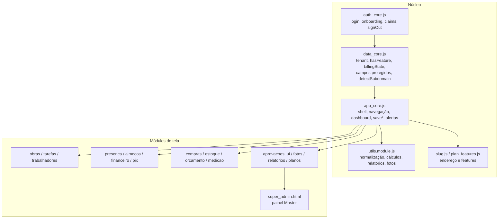

# C4 — Nível 3: Componentes

> Gerado pelo **Arquiteto** (Fase 3). `doc_level = completo`. 🟢 CONFIRMADO · 🟡 INFERIDO · 🔴 LACUNA.
> Foco nos containers mais relevantes: **Cloud Functions** e **SPA**. Worker e dados são resumidos no final.

## 1. Componentes das Cloud Functions

```mermaid
flowchart TB
    subgraph HTTP["onRequest — funções HTTP"]
        W1["whatsappWebhook<br/>HMAC, origem, dedup,.processar"]
        W2["kiwifyWebhook<br/>HMAC, identifyTenant, mapProductToPlan"]
        A1["adminAccountApi<br/>ações master + leitura Kiwify"]
        A2["gerenciarCargo<br/>definir_cargo/remover_usuario"]
        A3["decidirAprovacaoApi<br/>hierarquia + módulo + transação"]
        A4["criarUsuarioTenant<br/>convite via Admin SDK"]
    end

    subgraph TRIG["onValueWritten / triggers"]
        T1["syncCustomClaims<br/>normaliza role, bloqueia escalação,<br/>assentos e claims de RH"]
        T2["aplicarAprovacao<br/>podeAplicar + efeitos idempotentes"]
        T3["enforceSubdomainPlan /<br/>enforceObrasLimit /<br/>enforceUsuariosLimit"]
    end

    subgraph JOBS["onSchedule — America/Sao_Paulo"]
        J1["dailyBillingStateJob 04:00"]
        J2["aprovacoesPrazosJob 06:00"]
        J3["retencaoSegurancaJob 03:30"]
        J4["dailyReport (gate: relatorio.whatsapp.diario)"]
    end

    subgraph LIB["Bibliotecas de domínio"]
        L1["claims.js — avaliarSuperAdmin"]
        L2["abuso.js — validarCorpo, hashIp, consumirCota"]
        L3["auditoria.js — registrar, reservarOperacao"]
        L4["billing.js — calcularBillingState"]
        L5["plan_catalog + plan_features — hasFeature"]
        L6["kiwify.js / kiwify_api.js — inbox e API"]
        L7["whatsapp_auth.js — defesa em camadas"]
        L8["aprovacoes.js — 8 tipos de efeito"]
        L9["retencao.js — 4 políticas de limpeza"]
    end

    W1 --> L7 --> L2
    W2 --> L6 --> L5
    A1 --> L2 & L3 & L5
    A2 --> L1 & L3
    A3 --> L8 & L3
    A4 --> L2
    T1 --> L1 & L5
    T2 --> L8 & L3
    J1 --> L4
    J2 --> L8
    J3 --> L9
    J4 --> L5
```

| Componente | Responsabilidade | Entrada | Saída | Origem |
|---|---|---|---|---|
| `whatsappWebhook` | Validar e processar mensagens | POST assinado | Resposta Graph API + gravação em `presenca`/`tarefas` | 🟢 `index.js:129-446` |
| `kiwifyWebhook` | Ingerir eventos de cobrança com dedup | POST HMAC-SHA1 | `billing_events`, plano/vencimento do tenant | 🟢 `kiwify.js:227-493` |
| `adminAccountApi` | Ações de super admin e consulta Kiwify | POST `{acao}` / GET `?tipo=` | 200/401/403/429/503 com `requestId` | 🟢 `super_admin.js:348-474` |
| `gerenciarCargo` | Trocar cargo/tenant sem confiar no cliente | POST `{acao}` | Perfil + passaporte + convite atualizados | 🟢 `cargos.js:340` |
| `decidirAprovacaoApi` | Decidir solicitação com hierarquia efetiva | POST `{id,decisao}` | `aprovado`/`rejeitado` + auditoria | 🟢 `aprovacoes-api.js` |
| `criarUsuarioTenant` | Criar usuário a partir de convite | POST `{email,...}` | Auth user + perfis | 🟢 `usuarios.js` |
| `syncCustomClaims` | Sincronizar claims e conter escalação | Escrita em `profiles/{uid}` | Claims no Auth (role/tenant/módulos/obras) | 🟢 `index.js:680-817` |
| `aplicarAprovacao` | Aplicar efeitos de aprovações aprovadas | Escrita em `aprovacoes/{id}` | `update()` multi-path + notificações | 🟢 `aprovacoes.js:523-650` |
| Jobs | Cobrança, SLA, retenção e relatório | Schedule | Escrita em vários nós | 🟢 `index.js:448,905-924` |
| `claims.js` | Avaliar autoridade de master | `{uid,email,currentClaims,db}` | `{autorizado,motivo}` | 🟢 `claims.js:35-71` |
| `abuso.js` | Validação barata e cotas | `req`, chave, limites | `413`/`429` ou corpo | 🟢 `abuso.js` |
| `auditoria.js` | Trilha e idempotência destrutiva | contexto, ação, alvo | `admin_audit`, `admin_ops` | 🟢 `auditoria.js` |
| `billing.js` | Máquina de estados de cobrança | tenant, `agora` | `{billingState,motivo}` | 🟢 `billing.js:39-137` |
| `plan_features.js` | Matriz de capacidades | nome, plano, tenant | boolean | 🟢 `functions/plan_features.js` |
| `kiwify.js` | Inbox de eventos + identificação do tenant | payload, query, db | tenantId, plano, status do evento | 🟢 `kiwify.js` |
| `whatsapp_auth.js` | Defesa em camadas do webhook | req, secrets, db | autorização ou erro | 🟢 `whatsapp_auth.js` |
| `aprovacoes.js` | Cálculo puro dos 8 efeitos | tipo, payload, estado | `{updates,antes,depois,resumo}` | 🟢 `aprovacoes.js:167-421` |
| `retencao.js` | Limpeza isolada por nó | db, `agora` | resumo por nó | 🟢 `retencao.js:54-65` |

## 2. Componentes da SPA

| Componente | Responsabilidade | Acoplamentos críticos | Origem |
|---|---|---|---|
| `auth_core.js` | Autenticar e impedir cross-tenant | `data_core.js`, Firebase Auth, `syncCustomClaims` | 🟢 `auth_core.js:396-439` |
| `data_core.js` | Estado do tenant, features, proteção de campos | Todas as telas; `billingStateRef` | 🟢 `data_core.js:53,645-659` |
| `app_core.js` | Shell, salvamentos e desvios | Todos os módulos de UI; API de aprovação | 🟢 `app_core.js` |
| `utils.module.js` | Cálculos e derivações | Relatórios, dashboard, presença, orçamento | 🟢 `utils.module.js:1006-1216` |
| `aprovacoes_ui.js` | Solicitar/decidir e redacionar payloads | `save*` do app + `/api/admin/aprovacao` | 🟢 `aprovacoes_ui.js:221-348` |
| `slug.js` | Onboarding e URL do tenant | `auth_core.js`, `tenants_public` | 🟢 `slug.js` |
| `plan_features.js` (front) | Espelho da matriz de features | `hasFeature` em `data_core.js` | 🟢 `tests/plan-features.test.js` |
| `super_admin.html` | Painel Master | `/api/admin/conta`, `/api/admin/cargo` | 🟢 `docs/security/super-admin.md` |

🔴 Fato confirmado: `functions/whatsapp/parser-tarefas.js` existe com fluxo de prévia/confirmação, mas **não é importado** pelo webhook ativo. 🟢 Decisão P2: ativar o fluxo no webhook (integração pendente).
🟡 `saveEstoque` usa normalizador local em vez do `window.normalizarNome` testado.

## 3. Componentes do Worker e do Express local

| Componente (`worker.js`) | Responsabilidade | Origem |
|---|---|---|
| `fetch` | Despachar preflight, slug, proxy | 🟢 `worker.js:53-86` |
| `extractSlug` | Derivar slug do hostname | 🟢 `worker.js:88-99` |
| `isAllowedOrigin` / `applyCors` | Allowlist e `Vary: Origin` | 🟢 `worker.js:29-50` |
| `proxyToFirebase` | Repassar path/query e headers, aplicar cache | 🟢 `worker.js:105-142` |

| Componente (`server.js`) | Responsabilidade | Origem |
|---|---|---|
| `express.static('public')` | Servir SPA localmente | 🟢 `server.js:8` |
| `app.get('*')` | Fallback SPA | 🟢 `server.js:11-13` |

## 4. Acoplamentos e riscos de componente

| Acoplamento | Tipo | Risco | Origem |
|---|---|---|---|
| `billing.js` ↔ `plan_features.js` ↔ rules de RTDB | lógica replicada | 🟡 divergência de níveis/estados | `ADR-003` |
| `claims.js` ↔ `syncCustomClaims` ↔ Storage Rules | contrato de claims | 🟡 revogação depende de `revokeRefreshTokens` | `ADR-002` |
| `aprovacoes.js` ↔ todos os `save*` | desvio de escrita | 🟡 UI pode mostrar botões que as rules negam | `ADR-005` |
| `whatsapp_auth.js` ↔ `index.js` ↔ `dailyReport` | dois fluxos de ponto | 🔴 nomes de nó divergentes | `ADR-011` |
| `slug.js` ↔ `worker.js` | listas de reservados | 🟡 35 vs 5 nomes | `ADR-013` |
| `cors.json` ↔ `worker.js` | allowing de origens | 🟡 atualização manual dupla | `ADR-010` |

**Próximo artefato:** [`erd-complete.md`](erd-complete.md) · [`traceability/spec-impact-matrix.md`](traceability/spec-impact-matrix.md)
