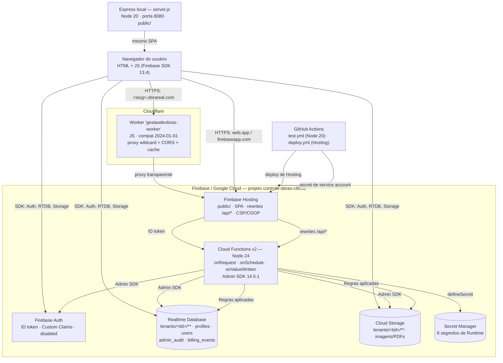
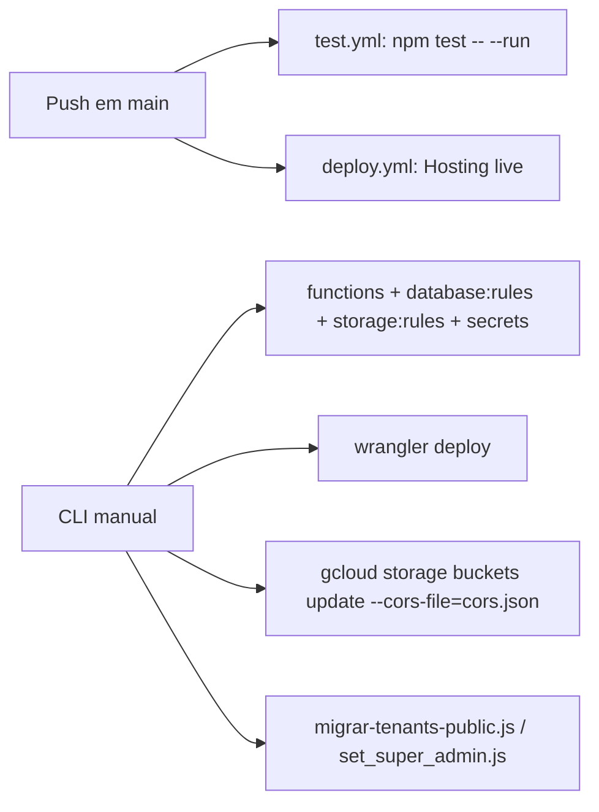

# C4 — Nível 2: Containers

> Gerado pelo **Arquiteto** (Fase 3). `doc_level = completo`. 🟢 CONFIRMADO · 🟡 INFERIDO · 🔴 LACUNA.

## 1. Diagrama de containers

## 2. Inventário de containers

| Container | Tecnologia | Responsabilidade | Escala / config | Origem |
|---|---|---|---|---|
| SPA no navegador | HTML + JS ES modules, Firebase SDK 13.4.0 | UI, carregamento de dados, `hasFeature`, sanitização, desvio para aprovação | 43 HTML, ~80 JS | 🟢 `surface.json`, `public/` |
| Cloudflare Worker | JS, Wrangler, compat `2024-01-01` | Proxy `*.obrareal.com`, CORS allowlist, preflight 204, cache 1 h | `obrareal.com/*`, `*.obrareal.com/*` | 🟢 `worker.js`, `wrangler.jsonc` |
| Firebase Hosting | Estático + rewrites | Entregar SPA e rotear 6 rotas `/api/*` | `public/`, `** → /index.html`, CSP/COOP | 🟢 `firebase.json` |
| Cloud Functions v2 | Node 24, `firebase-functions 7.4`, Admin SDK 14.5.1 | Webhooks, APIs admin, triggers, jobs | 256 MiB, timeouts 60/120 s, `maxInstances` 3/5 | 🟢 `functions/index.js` |
| Realtime Database | JSON tree + Security Rules | Persistência de domínio, identidade, auditoria, cotas | `.indexOn` em vários nós | 🟢 `database.rules.json` |
| Cloud Storage | Buckets + Rules | Fotos e PDFs por tenant | 1 byte–10 MB, `image/*`/PDF | 🟢 `storage.rules` |
| Firebase Auth | ID tokens + claims | Identidade e autorização para Storage | `verifyIdToken(..., true)` | 🟢 `auth_core.js`, Admin SDK |
| Secret Manager | `defineSecret` | Tokens e credenciais Kiwify/Meta/OpenAI | 8 segredos | 🟢 `index.js`, `dependencies.md` |
| Express local | Node 20, Express 4.22 | Servir `public/` em desenvolvimento | `PORT || 8080` | 🟢 `server.js` |
| GitHub Actions | `ubuntu-latest`, Node 20/24 | Testes (push/PR) e deploy de Hosting (push main) | `channelId: live` | 🟢 `.github/workflows/` |

## 3. Comunicação entre containers

| De → Para | Protocolo | Autenticação | Observações |
|---|---|---|---|
| Navegador → Auth/RTDB/Storage | Firebase SDK (WebSocket/HTTPS) | ID token + claims + Security Rules | Storage não lê RTDB |
| Navegador → Worker → Hosting | HTTPS proxy | `X-Forwarded-Host`, CORS allowlist | Host original preservado |
| Hosting → Functions | Rewrite `/api/*` | ID token no header | `cors:false` nas funções |
| Functions → RTDB/Storage/Auth | Admin SDK | Service account | Bypassa rules — exige validação própria |
| Kiwify → Functions | Webhook HMAC-SHA1 | Assinatura do raw body | `/api/kiwify` |
| Meta → Functions | Webhook HMAC-SHA256 | Assinatura + token de verificação + WABA | `/api/whatsapp` |
| Functions → OpenAI/Meta | HTTPS REST | Secrets | Sem retry na Graph API 🔴 |
| Worker → Hosting | HTTPS | — | Cache por extensão de arquivo |
| Actions → Hosting | Firebase CLI | Service account | Somente Hosting |
| gcloud → Storage | CLI | Credenciais locais | Aplicação manual de `cors.json` |

## 4. Decisões de deployment

🟢 `deploy.yml` publica apenas o container de Hosting; os demais dependem de comandos manuais documentados (`ADR-014`). 🔴 Isso permite front novo com back/rules antigos. 🟡 `apphosting.yaml` (1 CPU / 512 MiB) não é usado no pipeline observado. 🟡 Node 20 na raiz × Node 24 em `functions/`.

## 5. Observabilidade e limites

- Logs: `firebase functions:log`, verificações pós-deploy em `docs/security/hardening.md:158-164`. 🔴 sem alerta automático.
- Auditoria: `admin_audit` com `requestId`, `ipHash`, `userAgent`, `duracaoMs`; retenção 90 dias.
- Limites: `maxInstances:3` em APIs admin/Kiwify, `5` no webhook WhatsApp; timeouts 60 s (HTTP) e 120 s (jobs).
- Segurança de borda: CSP/COOP no Hosting; CORS duplicado em `cors.json` e worker.

**Próximo nível:** [`c4-components.md`](c4-components.md)
