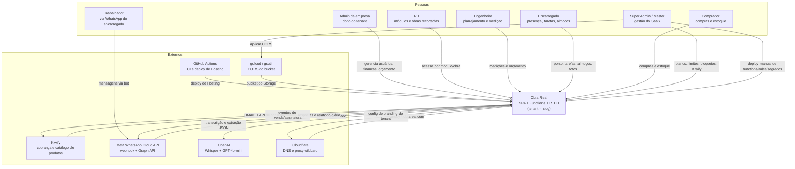

# C4 — Nível 1: Contexto do Sistema

> Gerado pelo **Arquiteto** (Fase 3). `doc_level = completo`. 🟢 CONFIRMADO · 🟡 INFERIDO · 🔴 LACUNA.
> Sistema: **Obra Real** — SaaS multi-tenant de gestão de obras (projeto Firebase `controle-obras-c889d`).

## 1. Diagrama de contexto

## 2. Personas e necessidades

| Persona | Necessidade principal | Superfície | Origem |
|---|---|---|---|
| Admin da empresa | Configurar a empresa, usuários, finanças e orçamento | SPA `/app.html` | 🟢 `permissions.md §1` |
| RH | Gerir perfis com escopo de módulos e obras | SPA + `/api/admin/cargo` | 🟢 `cargos.js` |
| Engenheiro | Medir, orçar e preparar movimentações | SPA + `/api/admin/aprovacao` | 🟢 `permissions.md §4` |
| Encarregado | Registrar presença, tarefas, almoços e fotos | SPA + WhatsApp | 🟢 `permissions.md §2` |
| Comprador | Compras e estoque com dados comerciais separados | SPA | 🟢 `data-dictionary.md §53` |
| Super Admin | Plano, limites, bloqueio, allowlist, Kiwify | Painel master + CLI | 🟢 `docs/security/super-admin.md` |
| Trabalhador | Receber registro de ponto e folha via bot | WhatsApp (indireto) | 🟢 `functions/index.js` |

## 3. Sistemas externos e contratos

| Sistema | Tipo | Contrato | Dados trafegados | Confiança |
|---|---|---|---|---|
| Kiwify | Pagamento | Webhook HMAC-SHA1 + REST | `orderId`, `eventType`, produto, status, assinatura | 🟢 |
| Meta Graph API | Mensageria | Webhook HMAC-SHA256 + REST v20.0 | `msg.id`, `from`, texto/áudio, WABA | 🟢 |
| OpenAI | IA | SDK `whisper-1` + `gpt-4o-mini` | áudio (≤8 MB), prompt de intenção, JSON | 🟢 |
| Cloudflare | Borda | Proxy wildcard + CORS | `Host`, `X-Forwarded-Host`, assets | 🟢 |
| GitHub Actions | CI/CD | Firebase CLI action | service account, artefatos estáticos | 🟢 |
| Secret Manager | Config | `defineSecret` | 8 segredos de Runtime + Kiwify | 🟢 |

## 4. Eventos de negócio no contexto

| Evento | Origem | Efeito no sistema | Origem |
|---|---|---|---|
| Venda/assinatura paga | Kiwify | Plano e vencimento do tenant; eventual desbloqueio | 🟢 `kiwify.js` |
| Mensagem de ponto/tarefa | Meta | Registro em `presenca`/`tarefas` do tenant | 🟢 `index.js` |
| Aprovação decidida | Admin/RH | Efeito em compra, estoque, financeiro, orçamento ou medição | 🟢 `aprovacoes.js` |
| Vencimento do trial/plano | Job interno | `billingState` → `somente_leitura`/`bloqueado` | 🟢 `billing.js` |
| Novo tenant | Self-signup | `tenants`, `tenants_public`, `users` em `update()` atômico | 🟢 `slug.js` |
| Deploy de front | GitHub | Hosting `live` + rewrites `/api/*` | 🟢 `deploy.yml` |

## 5. Limitações do contexto

- 🔴 O Master ainda depende de **comandos manuais** para functions, rules, segredos, CORS e worker (`ADR-014`).
- 🟡 O bot tem um plano legado em `docs/wiki/whatsapp-bot/` que descreve confirmação de tarefas não implementada no fluxo ativo (`ADR-011`).
- 🟡 O worker e o app têm listas de subdomínios reservados diferentes — o contexto de entrada não é totalmente coerente.
- 🟡 `apphosting.yaml` sugere uma plataforma de execução não usada no pipeline observado.

**Próximo nível:** [`c4-containers.md`](c4-containers.md)
