# ERD — Firebase Realtime Database (obra-real)

> 🟡 **INFERIDO** de `database.rules.json`, `functions/` e `public/js/` — não há DDL, migrations nem conexão direta ao banco. 🔴 Nenhuma inspeção de dados em produção foi feita.
> Fonte canônica detalhada: [`../erd-complete.md`](../erd-complete.md) (30 entidades físicas + 14 derivadas). Este arquivo é o recorte de banco do Data Master.

## Domínios

| Domínio | Nós RTDB | Confiança |
|---|---|---|
| Identidade e acesso | `profiles/`, `users/`, `invites/`, `super_admins/`, `tenants_public/` | 🟡 |
| Tenant e cobrança | `tenants/<slug>/`, `billing_events/` | 🟡 |
| Operação | `tenants/<tid>/obras`, `tarefas`, `trabalhadores`, `presenca`, `almocos`, `medicao`, `estoque`, `movEstoque`, `compras`, `financeiro`, `orcamento` | 🟡 |
| Aprovação e auditoria | `tenants/<tid>/aprovacoes`, `auditoria/`, `notificacoes/`, `admin_audit/`, `admin_ops/` | 🟡 |
| Integrações e sistema | `billing_events/`, `whatsapp_messages/`, `rate_limits/`, `webhook_debug/`, `tarefas_pendentes/` | 🟡 |

## ERD geral (Mermaid)

```mermaid
erDiagram
    AUTH_USER ||--|| PROFILE : "uid"
    AUTH_USER ||--|| CUSTOM_CLAIMS : "uid"
    AUTH_USER ||--o| SUPER_ADMIN : "uid"
    TENANT ||--o{ PROFILE : "tenantId"
    TENANT ||--|| TENANT_PUBLIC : "slug"
    TENANT ||--o{ INVITE : "tenantId"
    TENANT ||--o{ OBRA : "tenantId implícito"
    TENANT ||--o{ BILLING_EVENT : "tenantId"
    TENANT ||--o{ APROVACAO : "tenantId"
    OBRA ||--o{ TAREFA : "obra = cod"
    OBRA ||--o{ PRESENCA : "obra = cod"
    OBRA ||--o{ ALMOCO : "obra = cod"
    OBRA ||--o{ COMPRA : "obra = cod"
    OBRA ||--o{ MOV_ESTOQUE : "obraDestino"
    OBRA ||--o{ LANCAMENTO : "obra"
    OBRA ||--o{ ORCAMENTO_SERVICO : "obra"
    OBRA ||--o{ MEDICAO : "obra"
    TRABALHADOR ||--o{ PRESENCA : "trab ou nome"
    TRABALHADOR }o--o{ OBRA : "obras[]"
    ESTOQUE_ITEM ||--o{ MOV_ESTOQUE : "codMat"
    ORCAMENTO_SERVICO ||--o{ MEDICAO : "serviceId"
    ORCAMENTO_SERVICO ||--o{ LANCAMENTO : "serviceId"
    COMPRA ||--|| COMPRA_PRIVADA : "compraId"
    APROVACAO ||--o| AUDITORIA : "aprovacaoId"
    APROVACAO ||--o{ NOTIFICACAO : "aprovacaoId"
    ADMIN_OPS ||--o| ADMIN_AUDIT : "requestId"
    WHATSAPP_MESSAGE ||--o{ TAREFA : "msgId resolvido"
    WHATSAPP_MESSAGE ||--o{ PRESENCA : "msgId resolvido"
    TAREFA_PENDENTE ||--o{ TAREFA : "parser desconectado"

    AUTH_USER {
        string uid PK
        string email
        object customClaims
    }
    PROFILE {
        string uid PK
        string role "admin|rh|engenheiro|encarregado|comprador|pendente|desativado"
        string tenantId FK
        string status
        object modulosPermitidos
    }
    SUPER_ADMIN {
        string uid PK
        string email
        boolean ativo
    }
    TENANT {
        string slug PK
        string plano
        string billingState "ativo|carencia|somente_leitura|bloqueado"
        string status
        object config
    }
    TENANT_PUBLIC {
        string slug PK
        string tenantId
        object branding
    }
    INVITE {
        string emailKey PK
        string tenantId FK
        number usos
    }
    OBRA {
        string cod PK
        string status
        number orc
    }
    TAREFA {
        string cod PK
        string obra FK
        string status
        string prazo
        array photos
    }
    TRABALHADOR {
        string cod PK
        number diaria
        string vinculo
        array obras FK
    }
    PRESENCA {
        string data PK
        string trab FK
        string obra FK
        string presenca "Presente|Falta|Meio período"
        number hnorm
        number total
        string pgtoStatus
    }
    ALMOCO {
        string data PK
        string obra FK
        number qtd
        number vtotal
    }
    COMPRA {
        string id PK
        string mat
        number qtd
        string status
    }
    COMPRA_PRIVADA {
        string compraId PK
        string forn
        string pixkey
    }
    ESTOQUE_ITEM {
        string cod PK
        string mat
        number entrada
        number saida
        number min
    }
    MOV_ESTOQUE {
        string pushId PK
        string codMat FK
        string tipo
        number qtd
        string obraDestino FK
    }
    LANCAMENTO {
        string pushId PK
        string source "pre|pix|manual"
        number prev
        number real
        string status
    }
    ORCAMENTO_SERVICO {
        string id PK
        string etapa
        number qtd
        number vunit
    }
    MEDICAO {
        string pushId PK
        string serviceId FK
        number qreal
        number vtotal
        array photos
    }
    APROVACAO {
        string id PK
        string tipo
        string status
        number expiraEm
        object payload
    }
    AUDITORIA {
        string pushId PK
        string aprovacaoId FK
        string acao
    }
    NOTIFICACAO {
        string pushId PK
        string uid FK
        string aprovacaoId FK
        boolean lido
    }
    ADMIN_OPS {
        string requestId PK
        string acao
        number reservadoEm
    }
    ADMIN_AUDIT {
        string pushId PK
        string requestId FK
        string acao
        number timestamp
    }
    BILLING_EVENT {
        string orderId PK
        string eventType PK
        string status
        string tenantId FK
    }
    WHATSAPP_MESSAGE {
        string chaveDedup PK
        string status "processing|done|rejected"
        number recebidaEm
        number concluidaEm
    }
    TAREFA_PENDENTE {
        string fromKey PK
        array tarefas
        string caminho "raiz ou tenants/tid - divergente"
    }
```

## Notas de modelagem

- 🟡 RTDB não tem FK: integridade é garantida por validação no cliente, `.validate` nas rules e Cloud Functions. As cardinalidades acima vêm de [`relationships.md`](relationships.md).
- 🟢 `obras`, `tarefas`, `presenca` etc. são **arrays dentro de `tenants/<tid>`**, não coleções de primeira classe; o ERD usa entidades lógicas.
- 🟢 14 contratos de leitura são derivados e não persistidos (`StatusEfetivo`, `DashboardResumo`, `FinanceEntry`, `GaleriaFotos`, …) — ver `../erd-complete.md` §2.
- 🔴 `tarefas_pendentes` tem contrato na raiz e escrita sob `tenants/<tid>/` — relacionamento não validado (GAP-04).
- 🟡 `whatsapp_messages` usa `chaveDedup = msg.id` sanitizado (`whatsapp_auth.js:156-164`); `msgId`/`from` não são gravados.

## Lacunas 🔴

- 🔴 Nenhuma inspeção de dados reais: contagens, cardinalidades efetivas e registros órfãos não foram medidos.
- 🔴 Rim/TTL de nós de sistema só é declarado em specs; não foi verificado em produção (`admin_audit` 90 dias, `whatsapp_messages`/`admin_ops`/`rate_limits` 24 h/2 h).
