# ERD Completo — Obra Real (`gestaodeobras`)

> Gerado pelo **Arquiteto** (Fase 3, `doc_level = completo`) a partir de `_reversa_sdd/data-dictionary.md` (117 seções), `code-analysis.md` (21 módulos), `domain.md`, `state-machines.md`, `permissions.md`, `database.rules.json`, `storage.rules` e `.reversa/context/*`.
> 🟢 CONFIRMADO (código/rules/testes) · 🟡 INFERIDO (padrão/documento) · 🔴 LACUNA (contradição ou ausência).
> **Nota importante:** o Realtime Database é um banco de documentos em árvore, não relacional. As "entidades" abaixo são **entidades lógicas**; `PK` é a chave do nó/índice do array, e `FK` é uma referência por valor (`cod`, `uid`, `serviceId`, `slug`) **sem constraints do banco**. Integridade referencial é responsabilidade das funções, das rules e do cliente. Onde há array embutido (`tarefas[]`, `presenca[]`, ...), cada elemento é tratado como uma tabela lógica filha do tenant.

## 1. Diagrama entidade-relacionamento

```mermaid
erDiagram
    AUTH_USER ||--|| PROFILE : "autoridade por uid"
    AUTH_USER ||--|| CUSTOM_CLAIM : "espelha role/tenant"
    AUTH_USER |o--o| SUPER_ADMIN_ALLOWLIST : "allowlist global"
    AUTH_USER ||--o{ USER_PASSPORT : "passaporte legado por e-mail"
    TENANT ||--o{ PROFILE : "membros"
    TENANT ||--|| TENANT_PUBLIC : "branding por slug"
    TENANT ||--o{ INVITE : "convites"
    TENANT ||--o{ OBRA : "obras do tenant"
    TENANT ||--o{ APROVACAO : "fila de decisoes"
    TENANT |o--o{ BILLING_EVENT : "eventos de cobranca"
    TENANT ||--o{ TAREFA_PENDENTE : "rascunho do bot"

    OBRA ||--o{ TAREFA : "tarefas da obra"
    OBRA }o--o{ TRABALHADOR : "escopo por cod/CSV"
    OBRA ||--o{ PRESENCA : "ponto da obra"
    OBRA ||--o{ ALMOCO : "almocos da obra"
    OBRA ||--o{ COMPRA : "compras da obra"
    OBRA ||--o{ ESTOQUE_ITEM : "material por obra"
    OBRA ||--o{ MOV_ESTOQUE : "movimentacoes"
    OBRA ||--o{ LANCAMENTO : "lancamentos"
    OBRA ||--o{ ORCAMENTO_SERVICO : "servicos previstos"
    OBRA ||--o{ MEDICAO : "medicoes"

    TRABALHADOR ||--o{ PRESENCA : "registros por cod ou nome"
    TRABALHADOR |o--o{ ALMOCO : "empreiteiro por nome/cod"
    COMPRA ||--|| COMPRA_PRIVADA : "dados comerciais segregados"
    ESTOQUE_ITEM ||--o{ MOV_ESTOQUE : "codMat"
    ORCAMENTO_SERVICO |o--o{ MEDICAO : "serviceId / orcKey"
    ORCAMENTO_SERVICO |o--o{ LANCAMENTO : "serviceId"
    APROVACAO ||--o| APROVACAO_AUDIT : "antes/depois"
    APROVACAO ||--o{ NOTIFICACAO : "avisos por destinatario"
    PROFILE ||--o{ APROVACAO : "solicita e decide"
    PROFILE ||--o{ NOTIFICACAO : "recebe"
    PROFILE ||--o{ ADMIN_AUDIT : "ator"
    ADMIN_OPS ||--o| ADMIN_AUDIT : "idempotencia por requestId"
    WHATSAPP_MESSAGE |o--o{ TAREFA : "intencao criar_tarefa"
    WHATSAPP_MESSAGE |o--o{ PRESENCA : "intencao lancar_ponto"
    TAREFA_PENDENTE |o--o{ TAREFA : "confirmacao do parser"
    FOTO }o--o| TAREFA : "photos[]"
    FOTO }o--o| MEDICAO : "photos[]"

    AUTH_USER {
        string uid PK
        string email
        boolean disabled
    }
    CUSTOM_CLAIM {
        string uid PK "FK -> AUTH_USER.uid"
        string role
        string tenantId "null para pendente/bloqueado; MASTER_SYSTEM para master"
        string modulosPermitidos "somente rh"
        string acessoObras "todas|especificas"
        string obrasPermitidas "array ate 50"
    }
    PROFILE {
        string uid PK "FK -> AUTH_USER.uid"
        string tenantId FK "slug; imutavel para o cliente"
        string email
        string name
        string role "admin|rh|engenheiro|encarregado|comprador|super_admin|pendente|bloqueado"
        string status "ativo|pendente|bloqueado"
        string modulosPermitidos
        string acessoObras
        string obrasPermitidas
        number lastLogin
    }
    USER_PASSPORT {
        string email_key PK "email com ponto trocado por virgula"
        string role "preserva super_admin antigo; nao promove"
        string tenantId
        string nome
        boolean bloqueado
    }
    INVITE {
        string email_key PK
        string tenantId FK
        string role
        number usos "consumido por transacao"
    }
    SUPER_ADMIN_ALLOWLIST {
        string uid PK "FK -> AUTH_USER.uid"
        string email
        string role "super_admin"
        boolean ativo "false revoga"
        number migradoEm
    }
    TENANT {
        string slug PK "3-30 chars a-z0-9"
        string emailAdmin
        string nomeEmpresa
        string status "ativo|bloqueado_pagamento|inativo"
        string plano "free_trial|start|pro|ilimitado"
        string billingState "ativo|carencia|somente_leitura|bloqueado"
        string billingStateMotivo
        number planoVencimento
        number trialExpiracao "now + 30 dias"
        number config_limiteObras
        number config_limiteUsuarios
        number config_limiteTrabalhadores
    }
    TENANT_PUBLIC {
        string slug PK "FK -> TENANT.slug"
        string tenantId
        string nomeEmpresa
        string esquemaCores
        string logoUrl
    }
    OBRA {
        string cod PK "unico por tenant"
        string tenantId FK
        string nome
        string tipo "Casa|Sobrado|Comercial|Reforma"
        string status "Planejada|Em andamento|Concluida|Pausada"
        string prazo
        number orc
        string mestre
        string eng
    }
    TAREFA {
        string cod PK "TF-<seq>"
        string tenantId FK
        string obraCod FK
        string desc
        string status "A fazer|Em andamento|Concluida|Pausada|Pendente legado"
        string prazo
        number perc
        string photos "array de URLs; Atrasada e derivado"
    }
    TRABALHADOR {
        string cod PK "unico por tenant"
        string tenantId FK
        string nome
        string cpf
        string vinculo "CLT|Informal|Empreiteiro"
        number diaria
        string status "Ativo|Inativo|Afastado"
        string obras "CSV ou array; N:M com OBRA"
    }
    PRESENCA {
        string tenantId FK
        string obraCod FK
        string trabCod FK "pode ser vazio em registro legado"
        string data PK "YYYY-MM-DD"
        string presenca "Presente|Falta|Meio periodo"
        number total
        string pgtoStatus "Pendente|Pago|Parcial|Atrasado"
        number valpago
    }
    ALMOCO {
        string tenantId FK
        string obraCod FK
        string data PK
        string empreiteiro PK "nome ou cod"
        number qtd
        number vtotal "qtd * vunit"
        string pgtoStatus
        number valpago
    }
    COMPRA {
        string id PK "CP-<epoch> ou num"
        string tenantId FK
        string obraCod FK
        string num
        string mat
        number qtd
        string status "Aguardando|Aprovada|Pedido Feito|Entregue|Reprovada|Divergencia"
        string receb
    }
    COMPRA_PRIVADA {
        string compraId PK "FK -> COMPRA.id"
        string tenantId FK
        string aprovacaoId FK
        string forn
        string pixkey
        number vunit
        number vtotal
        number vorc
        string prazo
    }
    ESTOQUE_ITEM {
        string cod PK "MAT-<epoch> no legado"
        string tenantId FK
        string obraCod FK
        string mat
        number min
        number entrada
        number saida
        number custo
    }
    MOV_ESTOQUE {
        string id PK "pushId"
        string tenantId FK
        string codMat FK
        string obraCod FK
        string tipo "Entrada| Saida| Retorno| Ajuste| Transferencia"
        number qtd
        string data
        string obraDestino
    }
    LANCAMENTO {
        string id PK "pushId"
        string tenantId FK
        string obraCod FK
        string serviceId FK "pode ser nulo"
        string tipo
        number prev
        number real
        string status "Pago|Parcial|Pendente|Atrasado"
        number valpago
        string source "pre para folha"
    }
    ORCAMENTO_SERVICO {
        string id PK "uuid ou svc-<base36>"
        string tenantId FK
        string obraCod FK
        string etapa
        string desc
        number qtd
        number vunit
        number vtotal "qtd * vunit"
        string aprovacao
    }
    MEDICAO {
        string id PK "pushId"
        string tenantId FK
        string obraCod FK
        string serviceId FK "ou orcKey legado"
        string semana
        string servico
        number qreal
        number vtotal "qreal * vunit"
        string aprovacao
        string photos
    }
    APROVACAO {
        string id PK "pushId"
        string tenantId FK
        string tipo "8 tipos"
        string status "pendente|aprovado|rejeitado|expirado|erro"
        string solicitadoPor FK
        string decididoPor FK
        string payload
        number expiraEm "15 dias"
        number aplicadoEm
    }
    APROVACAO_AUDIT {
        string id PK "pushId em auditoria/<tid>"
        string aprovacaoId FK
        string acao
        string ator
        string antes
        string depois
        number criadoEm
    }
    NOTIFICACAO {
        string id PK "pushId sob uid"
        string tenantId FK
        string uid FK
        string aprovacaoId FK
        string tipo
        boolean lido
        number criadoEm
    }
    ADMIN_AUDIT {
        string id PK "pushId"
        string requestId
        string atorUid FK
        string acao
        string ipHash "sha256 com salt; sem IP em claro"
        boolean sucesso
        number timestamp
    }
    ADMIN_OPS {
        string requestId PK
        string acao
        string alvo
        string atorUid FK
        number reservadoEm
    }
    BILLING_EVENT {
        string chave PK "orderId|eventType sanitizados"
        string tenantId FK "pode ser null -> pending_tenant"
        string status "processing|success|pending_tenant|failed"
        number claimedAt "lease de 2 min"
        string payloadHash "sem order_status"
        number processedAt
    }
    WHATSAPP_MESSAGE {
        string chaveDedup PK "msg.id sanitizado (máx. 128)"
        string status "processing|done|rejected"
        number recebidaEm
        number concluidaEm
    }
    TAREFA_PENDENTE {
        string fromKey PK "remetente"
        string tenantId FK
        string transcricao
        string tarefas "array de rascunho"
        number timestamp
    }
    FOTO {
        string path PK "tenants/<tid>/evidencias/<arquivo>"
        string tenantId FK
        string targetKind "tarefa|medicao|obra|tenant"
        string targetId
        string url
        string contentType "image/*|application/pdf"
    }
```

## 2. Entidades e origem (inventário)

| # | Entidade lógica | Caminho / chave | PK | Campos-chave | Confiança | Dicionário |
|---|---|---|---|---|---|---|
| 1 | `AuthUser` | Firebase Auth `users/<uid>` | `uid` | `email`, `disabled` | 🟢 | §4, §107 |
| 2 | `CustomClaims` | `auth.token` por uid | `uid` | `role`, `tenantId`, módulos/obras de RH | 🟢 | §4, §107 |
| 3 | `Profile` | `profiles/<uid>` | `uid` | `role`, `tenantId`, `status` | 🟢 | §1, §16-17 |
| 4 | `UserPassport` | `users/<emailKey>` | `emailKey` | `role` legado, `tenantId`, `bloqueado` | 🟢 | §2 |
| 5 | `Invite` | `invites/<emailKey>` | `emailKey` | `tenantId`, `usos` | 🟢 | §3, §18 |
| 6 | `SuperAdminAllowlist` | `super_admins/<uid>` | `uid` | `email`, `ativo`, `migradoEm` | 🟢 | §5, §106 |
| 7 | `Tenant` | `tenants/<slug>` | `slug` | plano, `billingState`, limites | 🟢 | §7, §13, §86-89 |
| 8 | `TenantPublic` | `tenants_public/<slug>` | `slug` | branding pré-login, `tenantId` | 🟢 | §8 |
| 9 | `Obra` | `tenants/<tid>/obras[]` | `cod` | `status`, `orc`, datas | 🟢 | §27-30 |
| 10 | `Tarefa` | `tenants/<tid>/tarefas[]` | `cod` | `obra`, `status`, `prazo`, `photos` | 🟢 | §31-36 |
| 11 | `Trabalhador` | `tenants/<tid>/trabalhadores[]` | `cod` | `diaria`, `vinculo`, `obras` | 🟢 | §37-41 |
| 12 | `Presenca` | `tenants/<tid>/presenca[]` | `data + trab/nome + obra` | `presenca`, `total`, `pgtoStatus` | 🟢 | §42-47 |
| 13 | `Almoco` | `tenants/<tid>/almocos[]` | `data + empreiteiro + obra` | `qtd`, `vtotal`, `pgtoStatus` | 🟢 | §48-51 |
| 14 | `Compra` | `tenants/<tid>/compras[]` | `id` | `mat`, `qtd`, `status` | 🟢 | §52, §55 |
| 15 | `CompraPrivada` | `comprasPrivadas/<tid>/<id>` | `compraId` | `forn`, `pixkey`, valores, `prazo` | 🟢 | §25, §53 |
| 16 | `EstoqueItem` | `tenants/<tid>/estoque[]` | `cod` | `mat`, `entrada`, `saida`, `min` | 🟢 | §56 |
| 17 | `MovEstoque` | `tenants/<tid>/movEstoque[]` | `pushId` | `codMat`, `tipo`, `qtd`, `obraDestino` | 🟢 | §57-59 |
| 18 | `LancamentoFinanceiro` | `tenants/<tid>/financeiro[]` | `pushId` | `prev`, `real`, `status`, `source` | 🟢 | §60-64 |
| 19 | `OrcamentoServico` | `tenants/<tid>/orcamento[]` | `id` | `etapa`, `qtd`, `vunit`, `vtotal` | 🟢 | §65-69 |
| 20 | `Medicao` | `tenants/<tid>/medicao[]` | `pushId` | `serviceId`, `qreal`, `vtotal`, `photos` | 🟢 | §70-74 |
| 21 | `Aprovacao` | `tenants/<tid>/aprovacoes/<id>` | `id` | `tipo`, `status`, `payload`, `expiraEm` | 🟢 | §21-22 |
| 22 | `AprovacaoAudit` | `auditoria/<tid>/<pushId>` | `pushId` | `acao`, `antes`, `depois`, `ator` | 🟢 | §24 |
| 23 | `Notificacao` | `notificacoes/<tid>/<uid>/<pushId>` | `pushId` | `tipo`, `aprovacaoId`, `lido` | 🟢 | §23 |
| 24 | `AdminAudit` | `admin_audit/<pushId>` | `pushId` | `requestId`, `ipHash`, `acao`, `timestamp` | 🟢 | §10, §108 |
| 25 | `AdminOps` | `admin_ops/<requestId>` | `requestId` | `acao`, `alvo`, `reservadoEm` | 🟢 | §11, §109 |
| 26 | `RateLimit` | `rate_limits/<chave>/<bucket>` | `chave + bucket` | contador por janela | 🟢 | §110 |
| 27 | `BillingEvent` | `billing_events/<orderId>/<eventType>` | par sanitizado | `status`, `payloadHash`, `tenantId` | 🟢 | §90 |
| 28 | `WhatsappMessage` | `whatsapp_messages/<chaveDedup>` | `chaveDedup` | `status`, `recebidaEm`, `concluidaEm` | 🟢 | §99 |
| 29 | `TarefaPendente` | `tenants/<tid>/tarefas_pendentes/<from>` | `from` | `transcricao`, `tarefas[]` | 🔴 | §32, §104 |
| 30 | `Foto` | `tenants/<tid>/evidencias/<arquivo>` | `path` | URL, `contentType`, alvo | 🟢 | §33, §80-85 |

Entidades **derivadas e não persistidas** — não entram no ERD físico, mas são contratos de leitura usados em specs: `StatusEfetivo`, `TarefaResumo`, `DashboardResumo`, `AlertaDashboard`, `ObraMetrics`, `TrabalhadorIndicadores`, `PresencaResumo`, `AlmocoSemana`, `LinhaOrcamento`, `GrupoOrcamento`, `ServicoMedicaoResumo`, `FinanceEntry`, `FotoItem`, `GaleriaFotos` (`data-dictionary.md §29, §34-35, §39, §45, §50, §61, §66, §71, §75-85`).

## 3. Relacionamentos, cardinalidades e integridade referencial

| Relação | Cardinalidade | Chave no filho | Pai | Quem garante | Confiança |
|---|---|---|---|---|---|
| `AuthUser` → `Profile` | 1:1 | `uid` | Auth UID | trigger `syncCustomClaims` + rules | 🟢 |
| `AuthUser` → `CustomClaims` | 1:1 | `uid` | Auth UID | `setCustomUserClaims` (substitui objeto inteiro) | 🟢 |
| `AuthUser` → `SuperAdminAllowlist` | 0..1:1 | `uid` | Auth UID | allowlist + e-mail mestre + migração | 🟢 |
| `Tenant` → `Profile` | 1:N | `profiles[].tenantId` | `tenants/<slug>` | rules comparam com `auth.token.tenantId` | 🟢 |
| `Tenant` → `TenantPublic` | 1:1 | `slug` | `tenants/<slug>.slug` | `.validate slug === $slug` + criação atômica | 🟢 |
| `Tenant` → `Invite` | 1:N | `invites[].tenantId` | `tenants/<slug>` | API `criarUsuarioTenant` consome `usos` por transação | 🟢 |
| `Tenant` → `Obra` | 1:N | `obras[].tenantId` implícito | `tenants/<slug>` | rules por nó + `enforceObrasLimit` | 🟢 |
| `Obra` → `Tarefa` / `Presenca` / `Almoco` / `Compra` / `MovEstoque` / `Lancamento` / `OrcamentoServico` / `Medicao` | 1:N | `<entidade>[].obra = cod` | `obras[].cod` | validação no save + `filterDbByObras` no cliente | 🟢 |
| `Obra` ↔ `Trabalhador` | N:M | `trabalhadores[].obras` (CSV/array) | `obras[].cod` | `trabNaObra` no cliente; 🟡 rules não filtram por obra | 🟢/🟡 |
| `Trabalhador` → `Presenca` | 1:N | `presenca[].trab` ou `nome` | `trabalhadores[].cod` / `nome` | dedupe por data; recálculo retroativo após mudança de diária | 🟢 |
| `Compra` → `CompraPrivada` | 1:1 | `compraId` | `compras[].id` | redaction no cliente + trigger de aprovação | 🟢 |
| `EstoqueItem` → `MovEstoque` | 1:N | `movEstoque[].codMat` | `estoque[].cod` | `efeitosMovimentacao` valida saldo e grava `antes/depois` | 🟢 |
| `OrcamentoServico` → `Medicao` | 1:N (ou 0) | `medicao[].serviceId` ou `orcKey` | `orcamento[].id` | `migrateServiceIds`, `confirmMedicaoVinculo`, `serviceIdReview` | 🟢 |
| `OrcamentoServico` → `LancamentoFinanceiro` | 1:N (ou 0) | `financeiro[].serviceId` | `orcamento[].id` | `buildFinanceEntries` agrupa em `pago`/`aPagar` | 🟢 |
| `Profile` → `Aprovacao` | N:M (solicita/decide) | `solicitadoPor`, `decididoPor` | `profiles[].uid` | `verificarChamador` + transação de decisão | 🟢 |
| `Aprovacao` → `AprovacaoAudit` | 1:0..1 | `aprovacaoId` | `aprovacoes[].id` | `update()` multi-path no trigger | 🟢 |
| `Aprovacao` → `Notificacao` | 1:N | `aprovacaoId` + `uid` no caminho | `aprovacoes[].id` | uma cópia por destinatário para as rules autorizarem | 🟢 |
| `AdminOps` → `AdminAudit` | 1:0..1 | `requestId` | `admin_ops/<requestId>` | auditoria obrigatória fail-closed (`503`) | 🟢 |
| `Tenant` → `BillingEvent` | 1:N (pode estar sem tenant) | `billing_events[].tenantId` | `tenants/<slug>` | `identifyTenant` + `payloadHash` sem status | 🟢 |
| `WhatsappMessage` → `Tarefa` / `Presenca` | 1:0..N (ou 0) | `tenantId` resolvido no processamento | `whatsapp_messages/<chaveDedup>` | dedup transacional; ACK após efeito | 🟢 |
| `TarefaPendente` → `Tarefa` | 0..1:N | `tarefas_pendentes/<from>` | `tarefas[].cod` | 🔴 parser desconectado do fluxo ativo | 🔴 |
| `Tarefa` / `Medicao` → `Foto` | 1:N (até 6) | `photos[]` (URLs) | Storage `tenants/<tid>/evidencias/` | `uploadEvidenceFile` + sanitização de URL | 🟢 |

**Regras de integridade que o ERD não consegue expressar no RTDB:**

1. 🟢 `role` e `tenantId` de `Profile` são imutáveis para o cliente; promoção só via Admin SDK.
2. 🟢 `users/<email>` não promove ninguém — só preserva `super_admin` já existente nas claims.
3. 🟢 `emailAdmin` do tenant equivale a admin nas rules e na API de aprovação, mas não cria `ehAdmin` no cliente.
4. 🟢 `comprasPrivadas` fica fora de `tenants/<tid>` porque uma rule de pai não pode revogar `.read` de filho.
5. 🟢 Nós de sistema (`admin_audit`, `admin_ops`, `rate_limits`, `billing_events`, `webhook_debug`, `whatsapp_messages`, `super_admins`) têm `.write:false`.
6. 🟢 `estoque._saldo`/`_status`, `tarefa.Atrasada` e `finDerivedStatus` são **derivados em leitura** — não gravar.
7. 🟡 `obrasPermitidas` é recortado a 50 no cliente/RH; não há validação equivalente na rule de todas as entidades.
8. 🔴 Fato: `tarefas_pendentes` tem contrato na raiz e gravação sob `tenants/<tid>/`. 🟢 Decisão P4: nó removido em favor de `tarefas`.
9. 🔴 Fato: `dailyReport` lê `tenants/<tid>/ponto/<hoje>`, entidade que não existe no fluxo ativo. 🟢 Decisão P3: `presenca` canônico (ajuste pendente).
10. 🟡 `LancamentoFinanceiro.trab` e `Presenca.nome` são strings, não FKs: a reconciliação de folha é por `forn = nome` e `source='pre'`.

## 4. Chaves, índices e isolamento

| Nó | Chave | Indexação / leitura | Isolamento |
|---|---|---|---|
| `tenants/<slug>` | slug | leitura direta por slug | `profiles/<uid>.tenantId === slug` ou `emailAdmin` |
| `tenants_public/<slug>` | slug | **leitura direta obrigatória** (sem `orderByChild`) | pública; escrita restrita |
| `profiles/<uid>` | UID do Auth | varredura por `tenantId` no painel/RH | `role`/`tenantId` imutáveis |
| `super_admins/<uid>` | UID do Auth | leitura por uid | `.write:false` |
| `billing_events/<orderId>/<eventType>` | chave sanitizada | leitura filtrada por `tenantId`/`status` | `.write:false`; Admin SDK |
| `whatsapp_messages/<chaveDedup>` | chaveDedup | leitura por id | `.write:false`; retenção 24 h |
| `admin_audit/<pushId>` | pushId | `.indexOn: timestamp, atorEmail` | `.write:false`; retenção 90 dias |
| `admin_ops/<requestId>` | requestId | `.indexOn: reservadoEm` | `.write:false`; retenção 24 h |
| `rate_limits/<chave>/<bucket>` | chave temporal | leitura por chave | `.write:false`; retenção 2 h |
| `aprovacoes/<id>` | pushId | leitura por tenant | criação permitida; decisão só Admin SDK |
| arrays sob `tenants/<tid>/` | `cod`/`id`/`pushId` | leitura do nó inteiro + filtro no cliente | tenant por `auth.token.tenantId` |

## 5. Identificadores externos (chaves naturais de integração)

| Sistema | Identificador | Onde fica no modelo | Dedupe / idempotência | Confiança |
|---|---|---|---|---|
| Kiwify | `orderId + eventType` | `billing_events.chave`, `Tenant.plano/planoVencimento` | `payloadHash` ignora `order_status`; lease 2 min | 🟢 |
| Meta WhatsApp | `msg.id` | `whatsapp_messages.chaveDedup`, `TarefaPendente.fromKey` | reserva transacional; ACK após processar | 🟢 |
| Firebase Auth | `uid`, `email` | `AuthUser`, `Profile`, `Allowlist`, claims | `revokeRefreshTokens` em bloqueio/rebaixamento | 🟢 |
| Cloud Storage | path `tenants/<tid>/...` | `Foto.path`, `photos[]` | sanitização de nome e URL antes de exibir | 🟢 |
| Domínio | `slug` | `Tenant.slug`, `TenantPublic.slug`, hostname | `isSlugTaken` por chave direta | 🟢 |

**Artefatos relacionados:** [`architecture.md`](architecture.md) · [`c4-containers.md`](c4-containers.md) · [`c4-components.md`](c4-components.md) · [`domain.md`](domain.md) · [`permissions.md`](permissions.md) · [`data-dictionary.md`](data-dictionary.md) · [`traceability/spec-impact-matrix.md`](traceability/spec-impact-matrix.md)
