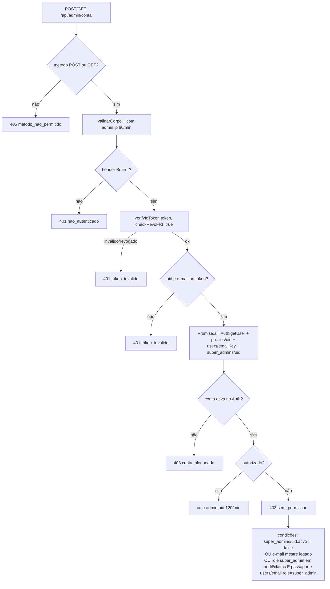
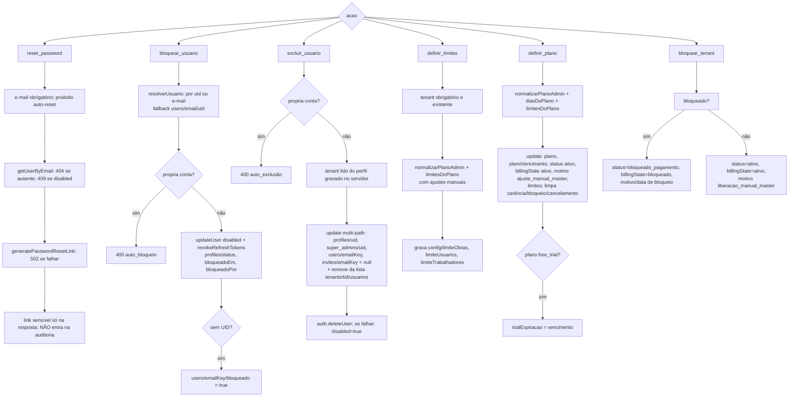
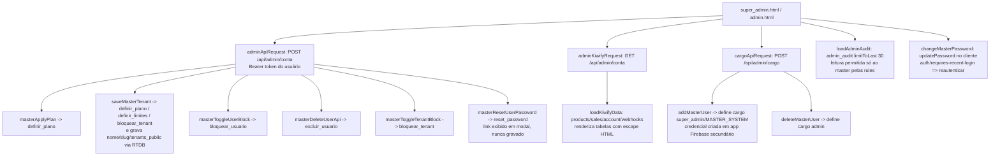
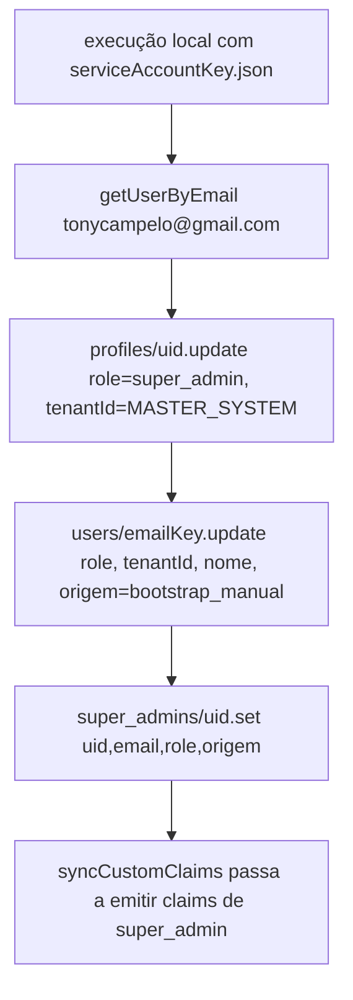

# Fluxograma — Módulo `admin-e-super-admin`

> 🟢 CONFIRMADO — `functions/super_admin.js`, `functions/auditoria.js`, `functions/plan_catalog.js`, `functions/cargos.js`, `functions/set_super_admin.js`, `functions/index.js`, `public/js/app_core.js`, `database.rules.json`, `firebase.json`.

## 1. Autorização da API (`verificarSuperAdmin`)



## 2. Dispatch POST — idempotência e auditoria fail-closed

```mermaid
flowchart TD
    A[POST autorizado] --> B[cota admin:acao 30/min]
    B --> C[acao em ACOES?]
    C -- não --> C1[400 acao_invalida]
    C -- sim --> D{acao em ACOES_DESTRUTIVAS?}
    D -- sim --> E[reservarOperacao admin_ops/requestId via transaction]
    E --> F{reserva committed?}
    F -- não, mesmo requestId --> F1[200 ok idempotente=true<br/>não reaplica]
    F -- sim --> G[executa ACOES[acao]]
    D -- não --> G
    G --> H[marca efeitoAplicado]
    G -- erro --> I[libera reserva somente se efeito NÃO aplicado]
    I --> I1[registra auditoria sucesso=false<br/>ator pode ser null]
    I1 --> I2{auditoria obrigatória falhou?}
    I2 -- sim --> I3[503 auditoria_falhou]
    I2 -- não --> I4[status do erro + requestId + idempotente]
    H --> J[registrar auditoria sucesso=true<br/>obrigatoria= true se destrutiva]
    J -- falha --> J1[503 auditoria_falhou; reserva mantida]
    J -- ok --> K[200 ok + resultado + requestId]
```

## 3. Ações disponíveis (`ACOES`)



## 4. Leitura da Kiwify (`GET`)

```mermaid
flowchart TD
    A[GET /api/admin/conta?recurso=kiwify&tipo=...] --> B[cota admin:kiwify 30/min]
    B --> C{tipo em RECURSOS? products|sales|account|webhooks}
    C -- não --> C1[400 tipo_invalido]
    C -- sim --> D[params explícitos: page_size<=100,<br/>page_number<=1000, status, product_id]
    D --> E[credenciaisKiwify: OAuth preferido, token legado opcional]
    E --> F[consultarKiwify com cache de token + http do Admin SDK]
    F --> G[registra auditoria kiwify_tipo]
    G --> H[200 ok + resultado + catalogoLocal de PLANOS]
    F -- credenciais ausentes --> I[resposta configurado=false + mensagem]
```

## 5. Cliente do painel (`public/js/app_core.js`)



## 6. Bootstrap one-time (`functions/set_super_admin.js`)


