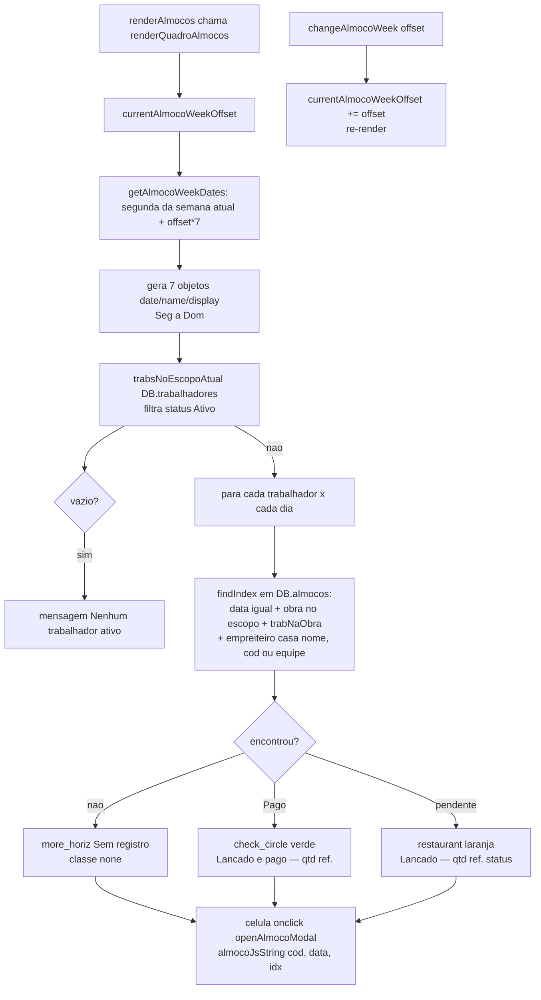
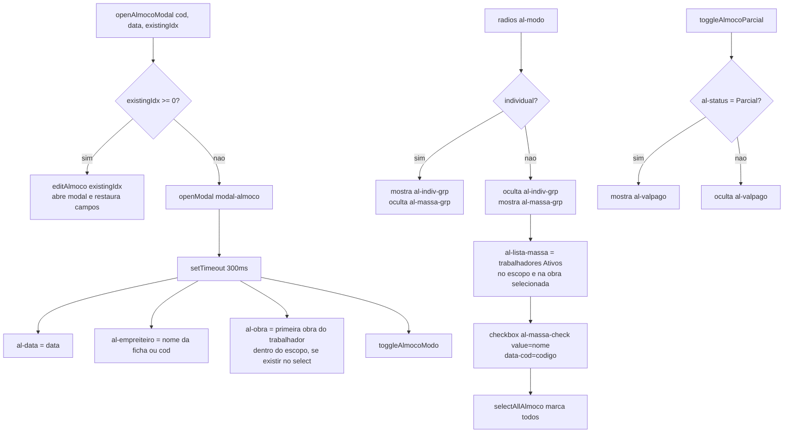
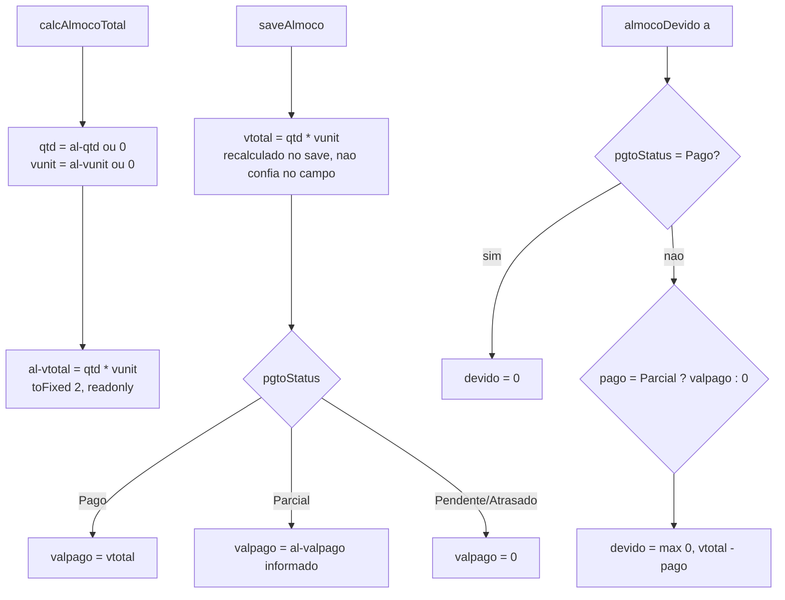
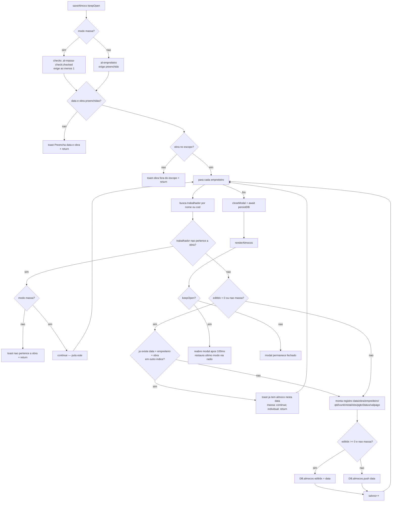
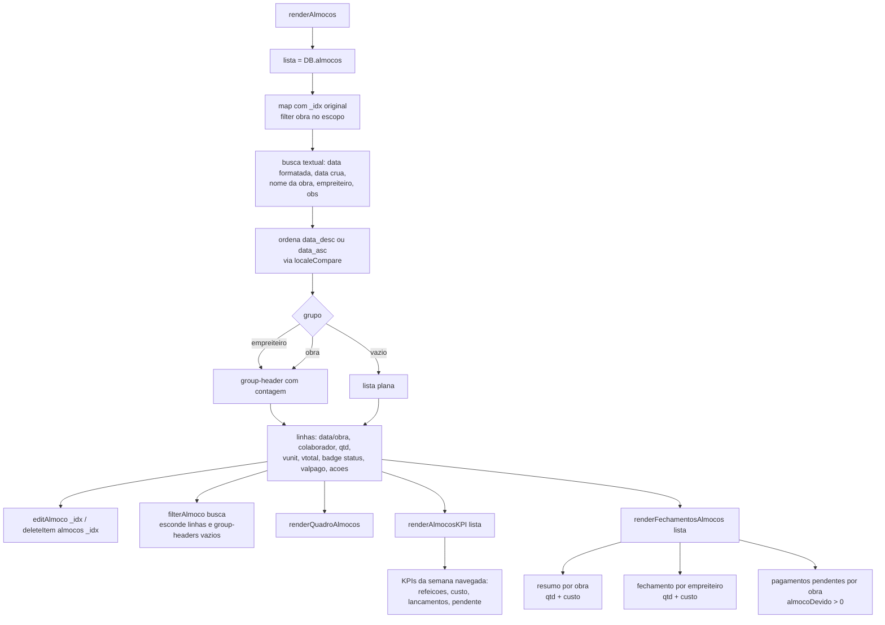
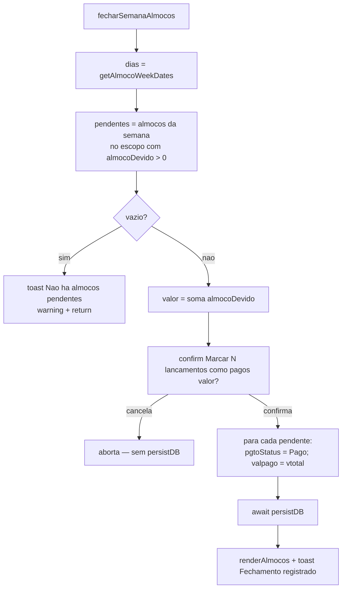
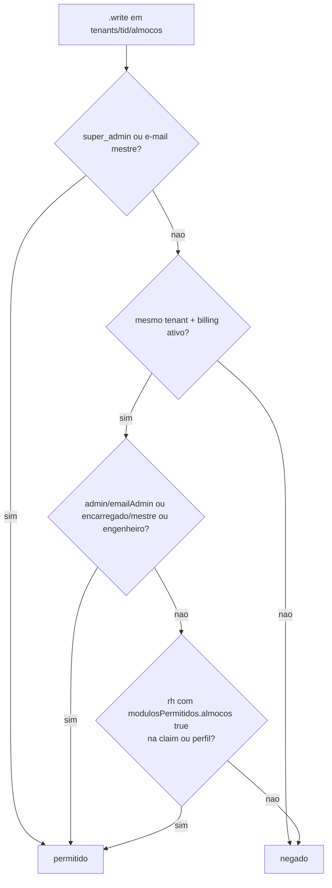

# Fluxograma — Módulo `almocos`

> 🟢 CONFIRMADO — `public/pages/almocos.html`, `public/modals/modal-almoco.html`, `public/js/app_core.js` (bloco 1050–1465), `public/js/utils.module.js`, `database.rules.json:84-85`, `tests/almocos-usabilidade.test.js`, `tests/security/rules.test.js`.

## 1. Quadro semanal (espelho de Presença)

🟡 `getAlmocoWeekDates` usa `new Date()` local do navegador (`getDay`, `getMonth`, `setDate`), não `getTodayBR()` (`America/Sao_Paulo`).

## 2. Clique na célula e modal

🟡 O preenchimento da célula depende de `setTimeout(..., 300)`: em dispositivos lentos o modal pode aparecer antes dos valores.

## 3. Cálculo e regras de pagamento

## 4. Salvamento (individual e em lote)

🔴 Não há toast de confirmação de salvamento (ao contrário de presença/trabalhadores); a quantidade `salvos` é incrementada mas nunca exibida.

## 5. Lista, busca e fechamentos

`renderAlmocosKPI` e `renderFechamentosAlmocos` filtram `a.data >= dias[0].date && a.data <= dias[6].date` — a **semana navegada**, não o mês corrente nem o dia de hoje.

## 6. Fechamento em lote da semana

🔴 O fechamento **não gera lançamento separado em `financeiro`** — ele apenas altera o status e o `valpago` dos registros de almoço. Ao contrário de presença, almoços não têm PIX em lote.

## 7. Autorização nas rules

🟢 O módulo do RH aqui se chama `almocos` (diferente de `trabalhadores`, que usa `funcionarios`). O filtro por obra é aplicado apenas no cliente; as rules autorizam a escrita em todo o nó `almocos` do tenant.
