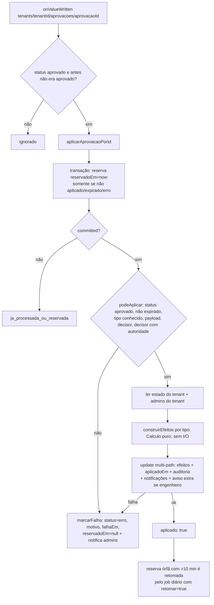
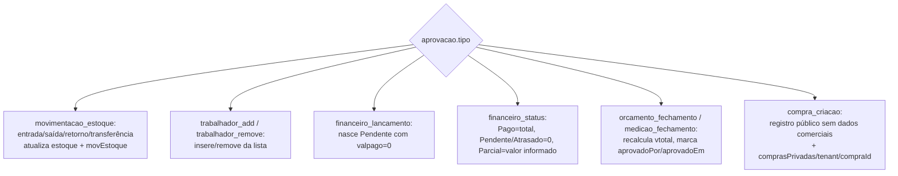
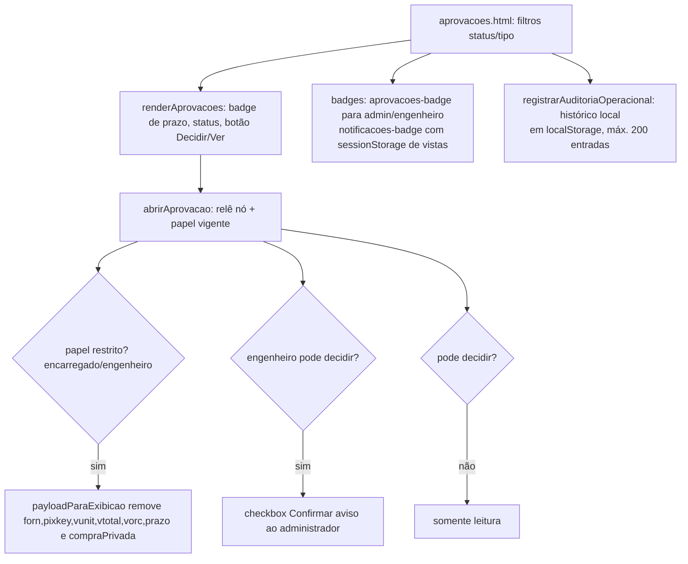

# Fluxograma — Módulo `aprovacoes`

> 🟢 CONFIRMADO — `functions/aprovacoes.js`, `functions/aprovacoes-api.js`, `functions/index.js`, `public/js/aprovacoes_ui.js`, `public/pages/aprovacoes.html`, `public/modals/modal-aprovacao.html`, `database.rules.json`, `tests/aprovacoes*.test.js`.

## 1. Solicitação (cliente)

```mermaid
flowchart TD
    A[save* do app: estoque/trabalhador/financeiro/compra/orçamento/medição] --> B{requerAprovacao?<br/>papel encarregado/engenheiro/rh}
    B -- não --> C[escrita direta pelo admin/comprador]
    B -- sim --> D[desviarParaAprovacao tipo,payload,descrição,alvo]
    D --> E{solicitação idêntica pendente nos últimos 60s<br/>mesmo solicitante/tipo/descrição/payload?}
    E -- sim --> E1[toast: já enviada; reusa id]
    E -- não --> F[push em tenants/tenantId/aprovacoes]
    F --> G[status=pendente, solicitadoPor, solicitadoEm=now,<br/>expiraEm=now+15 dias, payload, descricao, alvo]
    G --> H{rules: mesmo tenant, billing ativo,<br/>papel permite o tipo, expiraEm exato, sem alertas/aplicadoEm?}
    H -- não --> H1[PERMISSION_DENIED]
    H -- sim --> I[listener on('value') atualiza cache, DB.aprovacoes,<br/>tabela e badge]
```

## 2. Decisão (`POST /api/admin/aprovacao`)

```mermaid
flowchart TD
    A[abrirAprovacao: relê nó, atualiza claim/perfil,<br/>mostra payload sem campos sensíveis] --> B[decidirAprovacao id, aprovado|rejeitado]
    B --> C{podeDecidir no cliente?} -- não --> C1[toast: cargo não permite]
    C -- sim --> D{rejeição sem motivo?} -- sim --> D1[toast: informe o motivo]
    D -- não --> E[POST com Bearer token]
    E --> F{POST + Bearer + token válido checkRevoked?} -- não --> F1[401]
    F --> G[verificarChamador: Auth + profiles + super_admins + users/<email>]
    G --> H{conta ativa?} -- não --> H1[403 conta_bloqueada]
    H --> I[papelEfetivo = maior entre claim e perfil na hierarquia]
    I --> J{cotas IP/UID 60/min ok?} -- não --> J1[429]
    J --> K{dados válidos, decisão aprovado/rejeitado,<br/>motivo se rejeitado?} -- não --> K1[400]
    K --> L{apovação pendente, não expirada/aplicada,<br/>tipo e payload válidos?} -- não --> L1[404/409/400]
    L --> M{billingState ativo?} -- não --> M1[403 plano_bloqueado]
    M --> N{tenant do perfil casa<br/>(master pode operar outro tenant)?} -- não --> N1[403 tenant_invalido]
    N --> O{papelPodeDecidir: admin/super_admin/emailAdmin<br/>OU rh com módulos aprovacoes+tipo<br/>OU engenheiro em movimentacao_estoque com notificarAdmin}
    O -- não --> O1[403 sem_permissao + diagnóstico papel/claim/perfil]
    O -- sim --> P[transação no nó: só o primeiro decide pendente]
    P --> Q{committed?} -- não --> Q1[409 ja_decidida]
    Q -- sim --> R[status, decididoPor, decididoEm, decididoPorPapel,<br/>motivo se rejeitado, notificarAdmin se engenheiro,<br/>decididoPorModulos se rh]
    R --> S[auditoria decidir_aprovacao + 200 ok]
```

## 3. Aplicação da operação (trigger + idempotência)



## 4. Efeitos aplicados por tipo



## 5. Job diário de prazos (`06:00 America/Sao_Paulo`)

```mermaid
flowchart TD
    A[processarAprovacoesJob] --> B[varre todos os tenants]
    B --> C{aprovado com reservadoEm e sem aplicadoEm?} -- sim --> C1[retoma aplicação se reserva com >10 min]
    B --> D{status pendente?} -- não --> D1[ignora]
    D --> E{expiraEm <= agora?} -- sim --> E1[status=expirado + expiradoEm<br/>+ notifica solicitante e admins]
    D --> F[alertasDevidos: 7, 12 e 15 dias]
    F --> G[transação grava alertas[dia]=now<br/>e envia notificação uma única vez]
    C1 & E1 & G --> H[resultado: tenants, alertas, expiradas, retomadas, erros]
```

## 6. UI e privacidade


