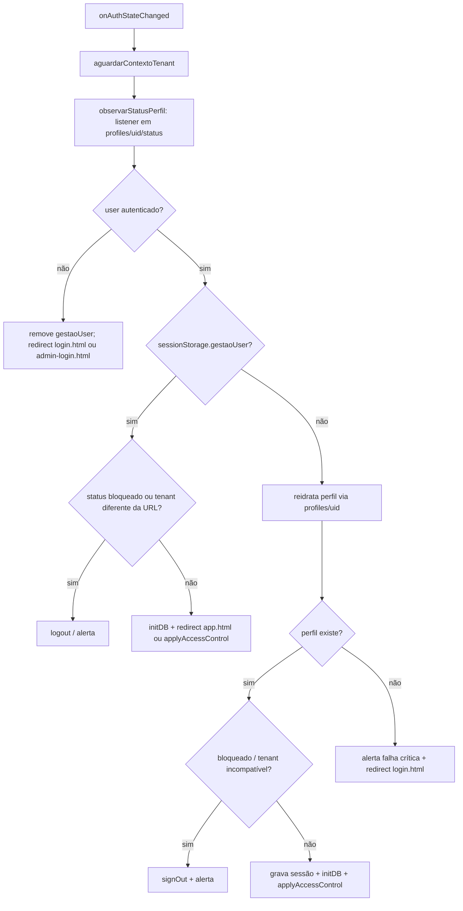
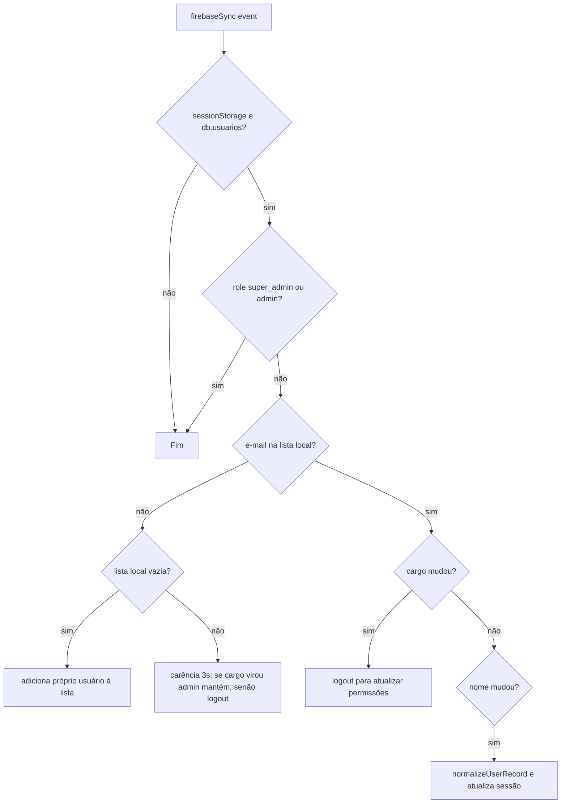
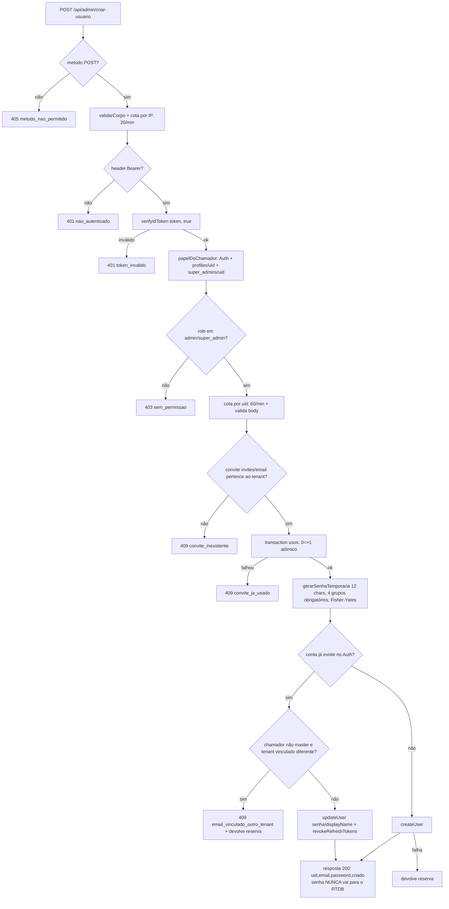
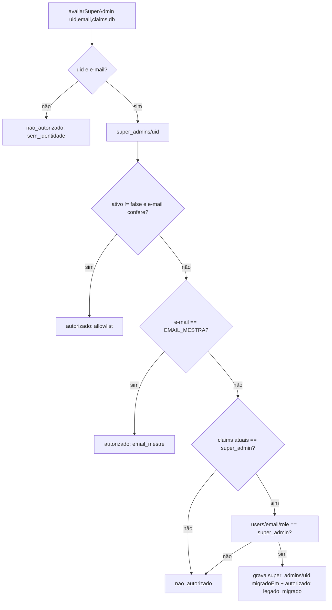

# Fluxograma — Módulo `auth`

> 🟢 CONFIRMADO — extraído de `public/js/auth_core.js`, `functions/claims.js`, `functions/usuarios.js` e `functions/index.js`.

## 1. Login / cadastro (`handleAuthSuccess`)

```mermaid
flowchart TD
    A[doEmailLogin / doGoogleLogin / doEmailSignup] --> B[handleAuthSuccess firebaseUser]
    B --> C[extrai email minúsculo e uid]
    C --> D{email presente?}
    D -- não --> E[Erro: Google não forneceu e-mail] --> Z[Fim]
    D -- sim --> F[aguardarContextoTenant: window.subdomainContextPromise]
    F -- falha --> F1[signOut + remove gestaoUser + erro de URL] --> Z
    F -- ok --> G[_leitura profiles/uid_]
    G --> H[users/email com pontos trocados por vírgula]
    H --> I[invites/email]
    I --> J{globalData?}
    J -- sim --> K[Self-healing: role/tenant do passaporte global<br/>super_admin=>MASTER_SYSTEM senão admin]
    K --> K1{snapshot do perfil existe?}
    K1 -- não --> K2[profileRef.set ... status ativo]
    K1 -- sim --> K3[profileRef.update somente name]
    J -- não --> L{inviteData?}
    L -- sim --> M[role do convite ou engenheiro; tenantId do convite<br/>update não-destrutivo; remove convite]
    L -- não --> N{sem perfil, sem guard admin, página de login?}
    N -- sim --> N1{CURRENT_TENANT_ID?}
    N1 -- sim --> N2[signOut: conta não pertence à empresa]
    N1 -- não --> N3[promptSlugOnboarding => cria tenant + perfil admin]
    N3 -- cancelado --> N4[signOut, nada criado]
    N -- não --> O[userProfile vazio]
    K2 & K3 & M & N3 --> P[touch lastLogin no perfil<br/>dispara syncCustomClaims]
    P --> Q{perfil.status == pendente?}
    Q -- sim --> Q1[signOut: limite de usuários do plano]
    Q -- não --> R{globalData.bloqueado ou status bloqueado?}
    R -- sim --> R1[encerrarSessaoBloqueada]
    R -- não --> S{userProfile nulo?}
    S -- sim --> S1[signOut: sem acesso cadastrado]
    S -- não --> T{CURRENT_TENANT_ID e tenant diferente e não super_admin?}
    T -- sim --> T1[signOut: acesso negado ao subdomínio]
    T -- não --> U{role == pendente?}
    U -- sim --> U1[signOut: aguarda aprovação]
    U -- não --> V{novo tenant em origem cruzada?}
    V -- sim --> V1[signOut + redirect welcome no subdomínio]
    V -- não --> W[sessionStorage.gestaoUser = userProfile<br/>initDB tenantId]
    W --> X[loop 6x getIdTokenResult(true)<br/>espera claims.tenantId ou role super_admin]
    X -- timeout --> X1[avança com aviso: Storage pode falhar]
    X -- ok & super_admin --> X2[promove role/tenant na sessão]
    X1 & X2 --> Y{_adminLoginGuard e não super_admin?}
    Y -- sim --> Y1[signOut: sem autorização de Super Admin]
    Y -- não --> Y2[redirect app.html ou URL do tenant]
```

## 2. Sessão persistida (`checkAuth` / `onAuthStateChanged`)





## 3. Criação de credencial (`POST /api/admin/criar-usuario`)



## 4. Autorização de super_admin (`avaliarSuperAdmin`)


