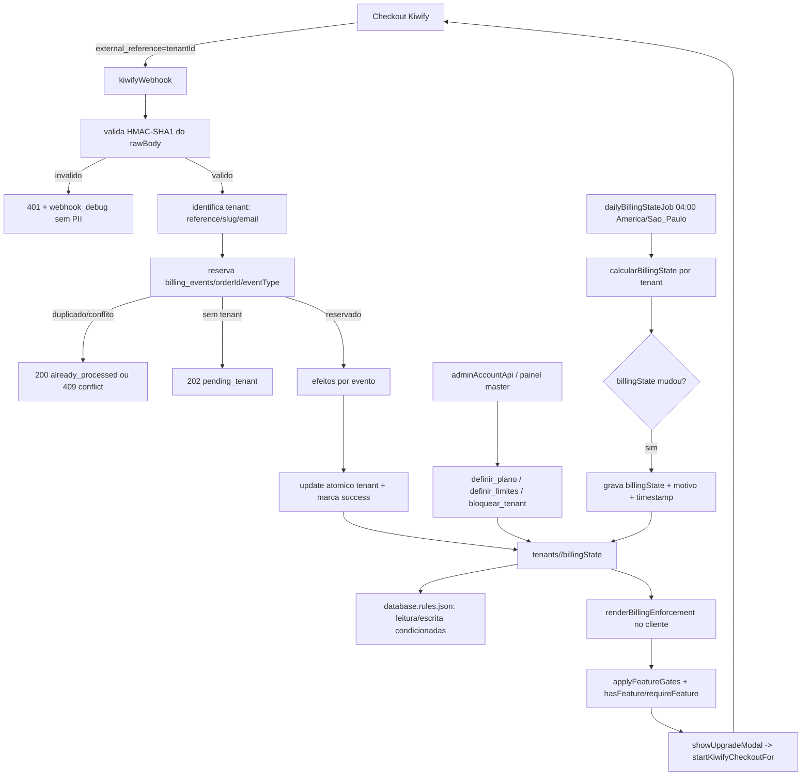
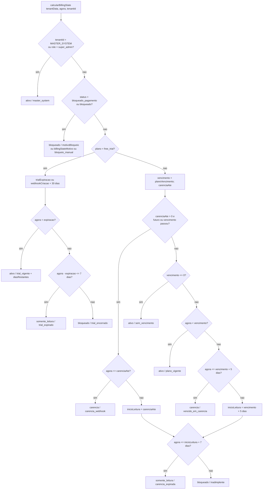
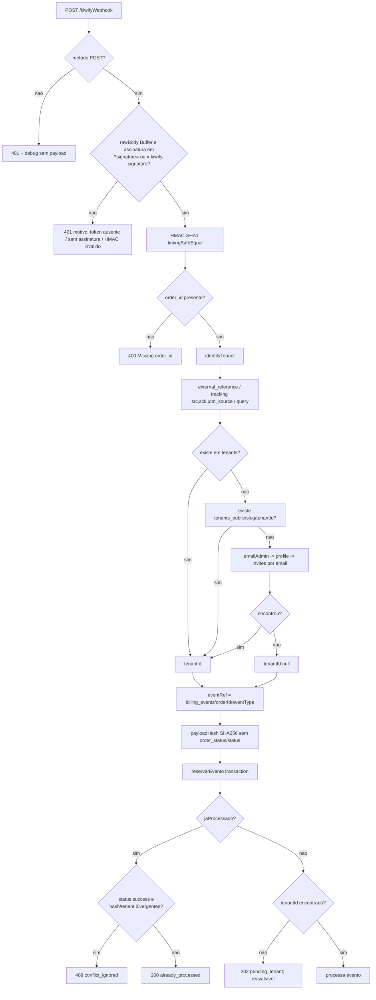
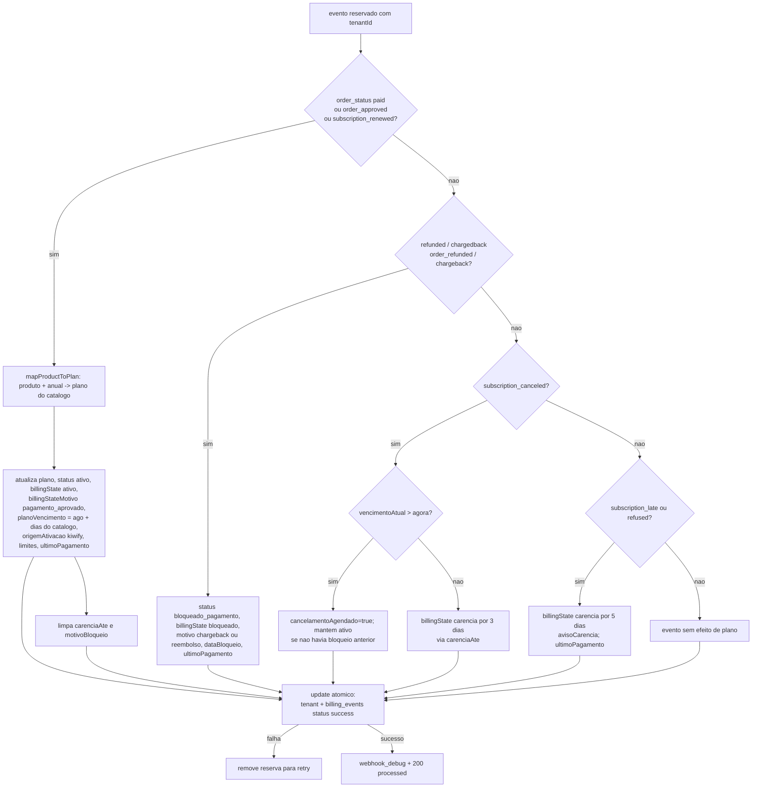
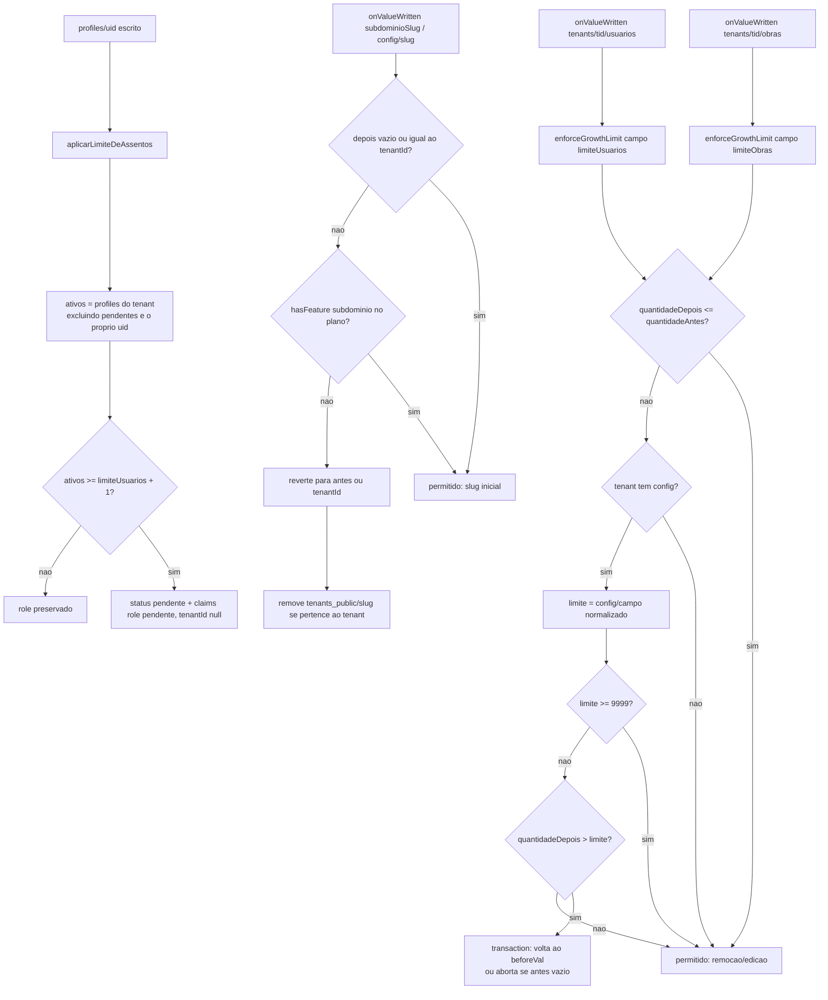
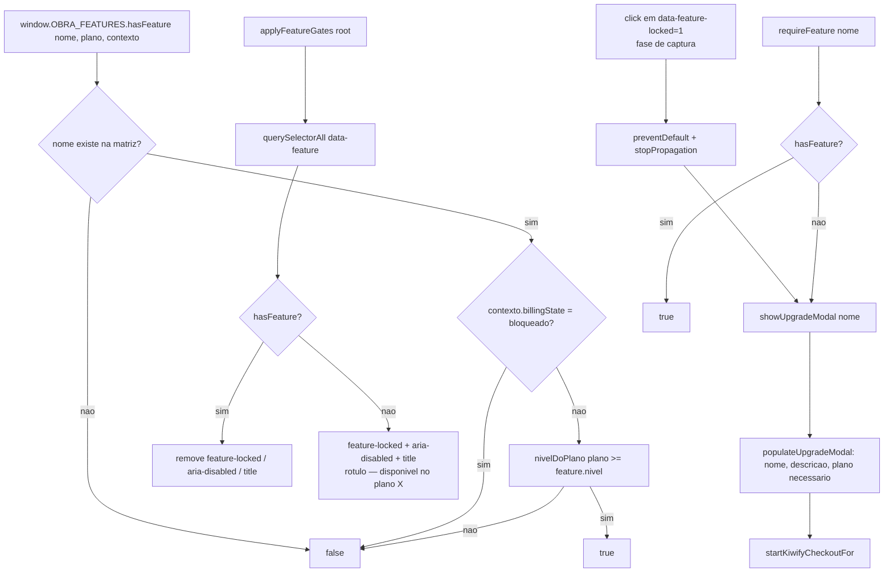
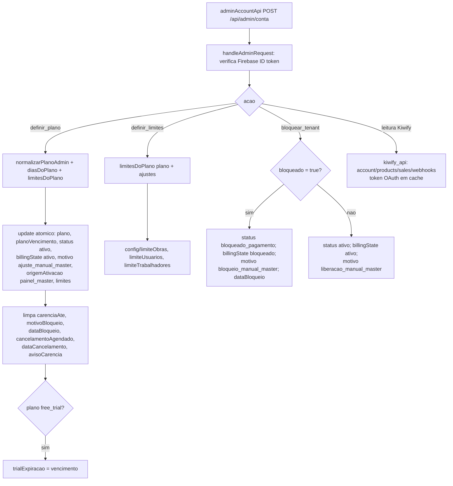
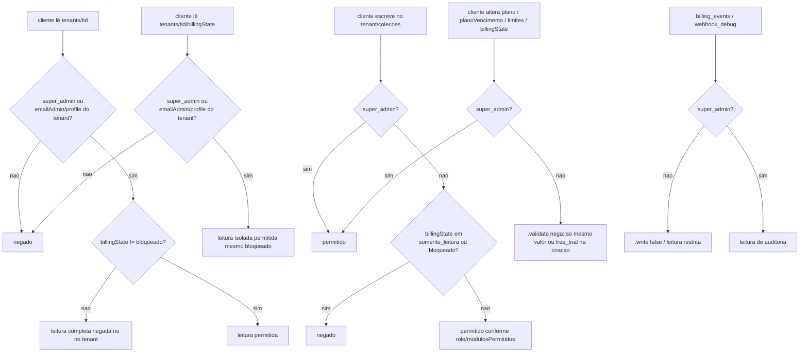
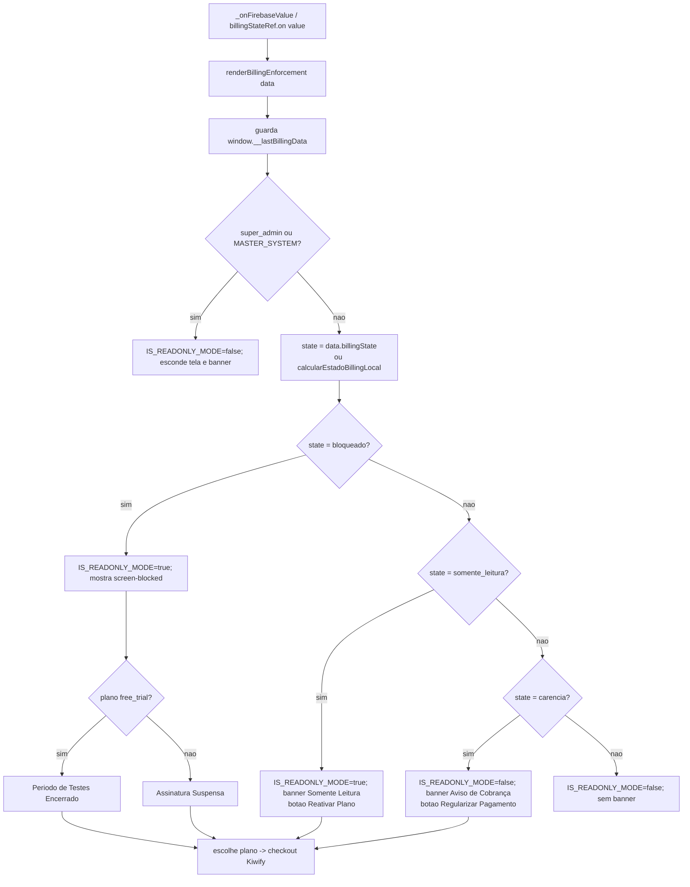

# Fluxograma — Módulo `billing-e-planos`

> 🟢 CONFIRMADO — `functions/billing.js` (`calcularBillingState` 39–137; `atualizarBillingStatesJob` 145–175), `functions/kiwify.js` (`validateKiwifySignature` 11–29; `identifyTenant` 40–105; `mapProductToPlan` 112–140; `reservarEvento` 181–213; `handleKiwifyWebhook` 227–493), `functions/plan_catalog.js:30-161`, `functions/plan_features.js:16-136`, `functions/super_admin.js:248-337`, `functions/kiwify_api.js:1-279`, `functions/index.js:541-685,819-859,920-929`, `public/js/data_core.js:100-268,376-455,645-659`, `public/js/plan_features.js`, `public/js/plans.js:13-115`, `public/js/app_core.js:290-346,4436-4543,4603-4729,5365-5474`, `database.rules.json:30-77,211-233`, `tests/security/billing.test.js`, `tests/plan-features.test.js`, `tests/kiwify.test.js`, `tests/kiwify-idempotency.test.js`, `tests/super-admin.test.js`.

## 1. Visão geral



🟢 Existem **três autoridades** distintas e complementares: o webhook da Kiwify (eventos de pagamento), o painel master (ajustes manuais) e o job diário (recalculo de estado). 🟢 A interface apenas reflete o estado — `renderBillingEnforcement` e `applyFeatureGates` são experiência de uso; as rules do RTDB são quem bloqueia escrita/leitura (`data_core.js:136-137`, `tests/security/billing.test.js:1-3`). 🟢 O checkout reenvia o `tenantId` como `external_reference` para fechar o ciclo (`plans.js:88-109`).

## 2. `calcularBillingState` — máquina de estados



🟢 Precedência documentada em `billing.js:26-32`: MASTER_SYSTEM → bloqueio forçado → trial → plano pago. 🟢 `carenciaAte` tem precedência sobre os 5 dias genéricos porque o webhook grava 3 dias em cancelamento (`billing.js:88-91`; `tests/security/billing.test.js:112-121`). 🟢 Um `carenciaAte` obsoleto após renovação **não** bloqueia (`billing.js:133-139`). 🟢 Sem vencimento confiável o sistema fail-open para `ativo` (`billing.js:101-105`) — decisão de segurança para não trancar contas legadas. 🟢 Constantes: `TRIAL_READONLY_DAYS=7`, `PAID_GRACE_DAYS=5`, `PAID_READONLY_DAYS=7`, `MS_DIA=86400000` (`billing.js:17-20`). 🟡 O estado `carencia` não é recalculado para `ativo` se o pagamento chegar sem webhook até o job diário (janelas de até 24h).

## 3. Job diário de recálculo

```mermaid
flowchart TD
    A[dailyBillingStateJob: every day 04:00<br/>America/Sao_Paulo] --> B[atualizarBillingStatesJob getDatabase]
    B --> C[db.ref tenants.once value]
    C --> D[para cada tid/tData]
    D --> E[tData nao e objeto?] -- sim --> D
    E -- nao --> F[calcularBillingState tData, agora, tid]
    F --> G[estadoAtual = tData.billingState || ativo]
    G --> H{estadoAtual != calculo.billingState?}
    H -- nao --> D
    H -- sim --> I[updates tenants/tid/billingState<br/>+ Motivo + AtualizadoEm]
    I --> J[log transicao estadoAtual -> novo]
    D --> K[existem updates?]
    K -- sim --> L[db.ref().update multi-path unico]
    K -- nao --> M[log Concluido 0/N]
    L --> M
```

🟢 O job grava **apenas transições**, preservando `motivo` e timestamp de quando mudou (`billing.js:159-166`). 🟢 `tenantId` da chave do RTDB é a fonte confiável para isentar `MASTER_SYSTEM` (`billing.js:155-156`). 🟡 O job não importa `diasRestantes` para o nó do tenant — ele existe só no retorno da função pura, usado em testes/UI client-side.

## 4. Webhook da Kiwify — autenticação e idempotência



🟢 Assinatura é validada sobre **rawBody íntegro** e aceita query ou header (`kiwify.js:245-269`); `crypto.timingSafeEqual` evita comparação temporal (`kiwify.js:11-25`). 🟢 Rejeições gravam em `webhook_debug` com `incluirPayload: false`, sem PII arbitrária (`kiwify.js:151-168`). 🟢 A chave de idempotência é `orderId + eventType`; `order_status` é volátil entre entregas e por isso removido do hash (`kiwify.js:288-301`). 🟢 `pending_tenant` e `failed` são **não terminais**: podem ser retomados quando o comprador cria a conta (`kiwify.js:196-198`, `kiwify.js:337-355`). 🟢 Lease `processing` expira em 2 minutos e pode ser retomado (`kiwify.js:199-200`). 🟡 A busca por e-mail percorre todos os tenants e profiles — custo O(n) por evento sem `tenantId` (`kiwify.js:76-102`).

## 5. Webhook — efeitos por evento



🟢 Produto e frequência (`anual` no nome, `frequency=yearly`) mapeiam para o catálogo canônico; vencimento usa o carimbo `agora` persistido na reserva, então retries não presentam dias extras (`kiwify.js:357-393`). 🟢 Um cancelamento agendado **não desbloqueia** chargeback/reembolso anterior (evento fora de ordem) (`kiwify.js:418-422`). 🟢 Efeitos no tenant e marca final `success` acontecem na mesma escrita multi-path: se falha, nada é aplicado e a reserva é liberada (`kiwify.js:448-477`). 🟡 Eventos desconhecidos são marcados `success` sem alterar o tenant — não há fila de "não reconhecido" para revisão. 🟡 `chargeAmount` usa `Commissions.charge_amount / 100` com fallback `order_value` (`kiwify.js:360`).

## 6. Enforcement de quantidade e subdomínio (server-side)



🟢 O enforcement roda no Admin SDK, então vale também para escritas diretas via SDK/DevTools que ignoram as rules (`index.js:541-545`). 🟢 Ausência de metadado cai em `LIMITE_FALLBACK=1`, nunca 0 nem ilimitado (`index.js:548-554`). 🟢 Reversão preserva registros legados: desfaz só a escrita que estourou a cota e aborta se não há estado anterior seguro (`index.js:568-578`). 🟢 Assentos contam o dono separadamente (`limiteUsuarios + 1`) e perfis pendentes não recebem claims (`index.js:603-640`). 🟢 Slug inicial igual ao `tenantId` é permitido a todos; troca posterior exige feature `subdominio` (nível 2) (`index.js:652-678`). 🟡 `enforceGrowthLimit` cobre `obras` e `usuarios`, mas não `trabalhadores`/`medicao` — o limite de trabalhadores do catálogo não é aplicado por trigger equivalente.

## 7. Matriz de features e gates no cliente



🟢 A matriz autoritativa está em `functions/plan_features.js`; o espelho browser em `public/js/plan_features.js` é validado por `tests/plan-features.test.js`. 🟢 Níveis: 0 = sem acesso, 1 = Start, 2 = Pro/`free_trial` (prévia), 3 = Ilimitado (`plan_features.js:8-12`). 🟢 Features: `empreiteiro.subetapa` e `perfis.usuario` nível 1; `relatorio.marca`, `exportacao`, `relatorio.whatsapp.diario`, `subdominio` nível 2; `pix.folha` nível 3 (`plan_features.js:37-73`). 🟢 `billingState === 'bloqueado'` revoga todas as features mesmo com plano alto (`plan_features.js:104-109`). 🟢 O clique é interceptado em **fase de captura** para impedir `onclick` legado (`app_core.js:319-326`). 🟡 `hasFeature` no cliente usa `currentPlan()` vindo de `DB.plano`; se o tenant estiver bloqueado mas o `billingState` isolado ainda não tiver chegado, a checagem depende do fallback local.

## 8. Painel master — plano, limites e bloqueio manual



🟢 `acaoDefinirPlano` é a única via manual que redefine vencimento **e** limites juntos, limpando todo resíduo de carência/bloqueio (`super_admin.js:267-308`). 🟢 `acaoDefinirLimites` mescla ajustes com os limites do plano e nunca aceita 0/negativo/NaN (`plan_catalog.js:116-137`). 🟢 `acaoStatusTenant` aplica bloqueio imediato, sem depender do job (`super_admin.js:310-328`). 🟢 O cliente não grava campos protegidos: `PROTECTED_TENANT_FIELDS` e `PROTECTED_CONFIG_FIELDS` os removem do update (`data_core.js:645-659`). 🟡 A edição manual de limites pode ultrapassar o catálogo até 9999; isso é intencional (ajuste comercial), mas não gera trilha de approval além do log da ação.

## 9. Regras do RTDB — autoridade de acesso



🟢 `billingState` tem `.read` próprio e isolado justamente para a tela de bloqueio funcionar (`database.rules.json:50-52`). 🟢 `.validate` congela `plano`, `planoVencimento`, `trialExpiracao`, `status`, `billingState` e limites para o cliente; somente super_admin (via Admin SDK/painel) altera (`database.rules.json:38-72`). 🟢 Quase todas as coleções filhas repetem a guarda `billingState !== 'somente_leitura' && !== 'bloqueado'` — a trava é transversal (`database.rules.json:79-130`). 🟢 `webhook_debug` e `billing_events` são somente leitura para super_admin (`.write: false`) — o webhook escreve com Admin SDK (`database.rules.json:211-233`). 🟡 O e-mail `tonycampelo@gmail.com` está codificado como super_admin em várias rules; é um mecanismo de escape legado fora do fluxo de claims.

## 10. Experiência do usuário — banners e tela de bloqueio



🟢 O cliente calcula um fallback com as mesmas janelas (30+7 / 5+7) para resposta imediata enquanto o job não roda (`data_core.js:100-129`). 🟢 A tela de bloqueio preserva os dados e oferece reativação, sem logout intrusivo (`data_core.js:131-137`). 🟢 `tenants/<tid>/billingState` é assinado separadamente (`billingStateRef`) porque a leitura completa do tenant falha quando bloqueado (`data_core.js:380-404`). 🟢 Troca de página reaplica o estado via `window.__lastBillingData` (`data_core.js:142-143`). 🟡 O fallback client-side difere do servidor em caso sem `trialExpiracao`: retorna `ativo` no cliente, enquanto o servidor usa `webhookCriacao + 30 dias` (`data_core.js:105-107`; `billing.js:60-62`).
