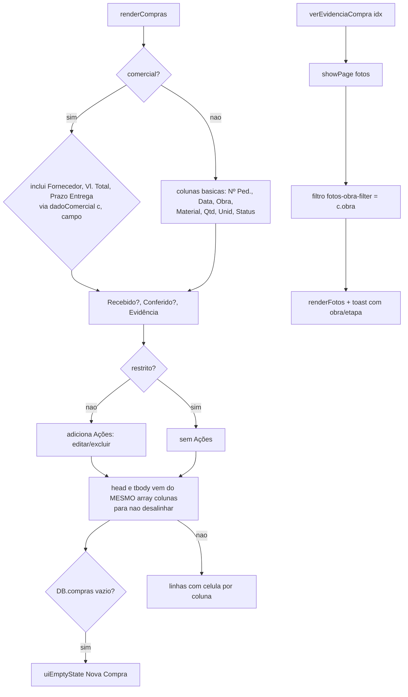
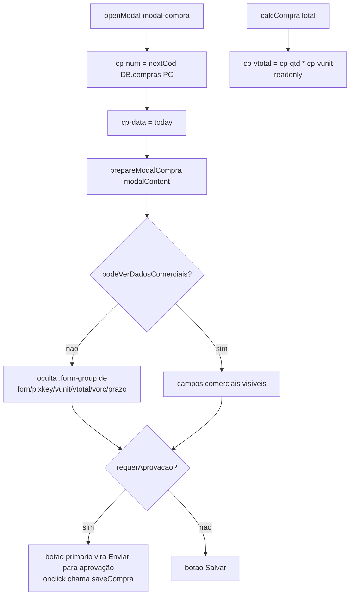
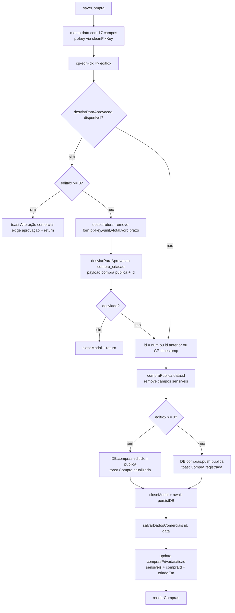
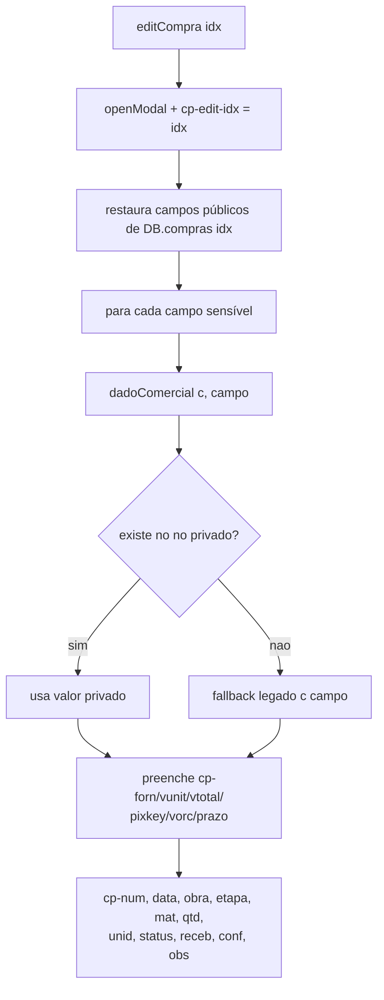
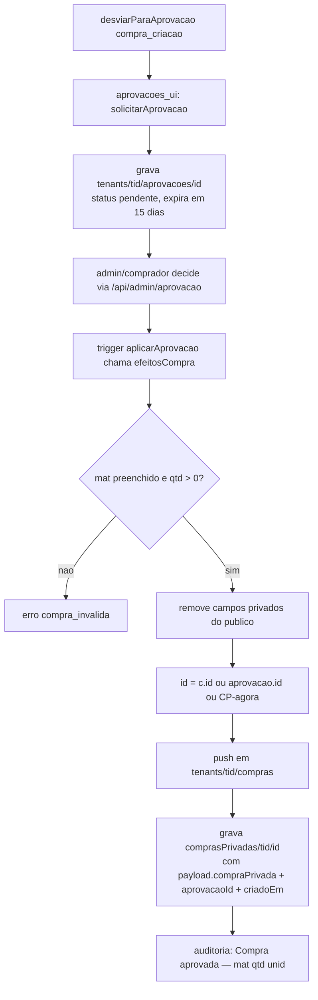
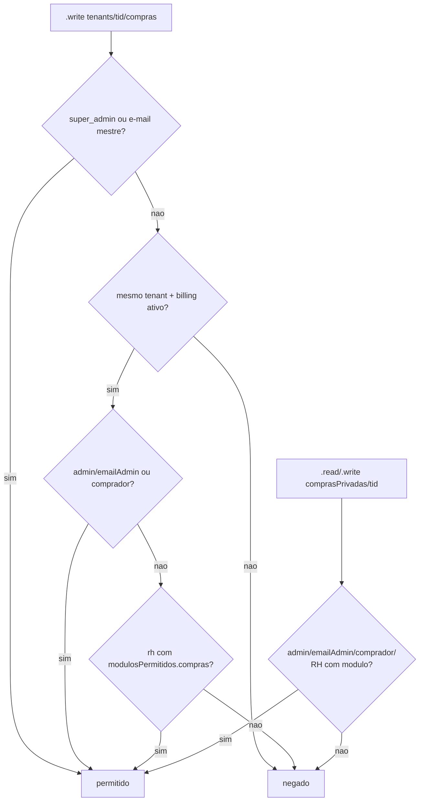

# Fluxograma — Módulo `compras`

> 🟢 CONFIRMADO — `public/pages/compras.html`, `public/modals/modal-compra.html`, `public/js/compras_ui.js`, `public/js/app_core.js` (render 2362–2422; modal 5899–5902; cálculo 6715–6719; save/edit 7216–7298), `public/js/data_core.js` (716–747, 449, 790), `public/js/aprovacoes_ui.js`, `functions/aprovacoes.js:339-364`, `database.rules.json:126-127,172-175`, `tests/compras-segregacao.test.js`, `tests/aprovacoes-ui.test.js`, `tests/rh-customizavel.test.js`, `tests/security/rules.test.js`.

## 1. Modelo de dois nós (segregação comercial)

```mermaid
flowchart TD
    A[campos sensíveis: forn, pixkey, vunit, vtotal, vorc, prazo] --> B[publico: tenants/tid/compras[]<br/>sem campos sensíveis]
    A --> C[privado: comprasPrivadas/tid/id<br/>so com esses campos + compraId + criadoEm]
    B --> D[engenheiro/encarregado podem ler<br/>o tenant inteiro]
    C --> E[rules proprias: so admin/super/<br/>comprador/RH com modulo compras]
    D --> F[sanitizeComprasForRole remove<br/>sensitive do DB e do cache local]
    F --> G[renderCompras so mostra colunas<br/>comerciais para quem pode ver]
```

Origem: `compras_ui.js:1-8`, `data_core.js:716-747`, `tests/compras-segregacao.test.js`.

## 2. Inicialização e escopo de acesso

```mermaid
flowchart TD
    A[DOMContentLoaded ou firebaseSync] --> B[iniciarCompras]
    A2[renderPage compras] --> B
    B --> C[tenantId: superAdminActiveTenant.id<br/>ou sessao.tenantId ou OBRA_CHECKOUT_TENANT_ID]
    C --> D{tid e firebase.database?} -- nao --> E[aborta]
    D -- sim --> F{podeVerDadosComerciais?}
    F -- nao --> G[ref.off; privadas = {};<br/>window.COMPRAS_PRIVADAS = {}; return]
    F -- sim --> H{tenantAtual === tid e ref existe?} -- sim --> I[reusa listener]
    H -- nao --> J[ref.off + ref = comprasPrivadas/tid]
    J --> K[ref.on value]
    K --> L[privadas = snap.val ou {}]
    L --> M[window.COMPRAS_PRIVADAS = privadas]
    M --> N[renderCompras]
    K --> O{erro?} -- sim --> P[console.warn code]
    Q[papel: normalizeRole do claim/perfil] --> R{admin/super/comprador?} -- sim --> S[true]
    R -- nao --> T{rh com modulosPermitidos.compras?} -- sim --> S
    T -- nao --> U[false — engenheiro, encarregado, mestre, RH sem modulo]
```

`podeVerDadosComerciais()` controla quem lê/grava os dados sensíveis; `requerAprovacao()` (`aprovacoes_ui.js:141-144`) vale para `encarregado`, `engenheiro` e `rh`.

## 3. Tabela dinâmica e evidência



🔴 Fato: `renderCompras` não filtra por escopo de obra, ao contrário de almocos/presença/trabalhadores. 🟢 Decisão P16: aplicar `acessoObras`/filtro de obra.

## 4. Modal e preparação por papel



## 5. Salvamento



🔴 Com desvio ativo (encarregado/engenheiro/RH), **edição é bloqueada**; a criação via aprovação envia `compra_criacao` sem `compraPrivada`, e o trigger grava só metadados no nó privado.

## 6. Hidratação da edição



`dadoComercial(c, campo)` (`compras_ui.js:66-73`) só consulta `privadas[compra.id || compra.num]` para os seis campos sensíveis; qualquer outro campo é lido diretamente do registro público.

## 7. Aprovação no servidor



🟢 `tests/aprovacoes-ui.test.js` garante que o payload exibido a papéis restritos remove `compra`, `compraPrivada`, `lancamento` e `movimentacao` dos campos sensíveis. 🟢 `tests/rh-customizavel.test.js` garante que RH só decide `compra_criacao` com `modulosPermitidos.compras === true`.

## 8. Autorização nas rules



🟢 Engenheiro, encarregado e mestre **não** aparecem em nenhuma das duas regras (`tests/compras-segregacao.test.js:191-201`). 🟢 `buildCloudUpdate` e `persistDB` removem `compras` do update quando o papel não pode escrever (`_nodeBloqueadoParaRole`), e o cache local é sanitizado antes de gravar (`data_core.js:790`).
