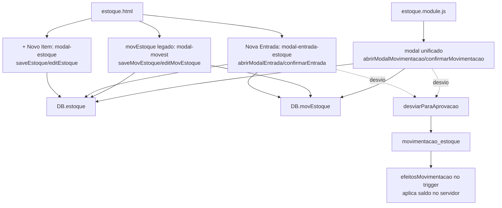
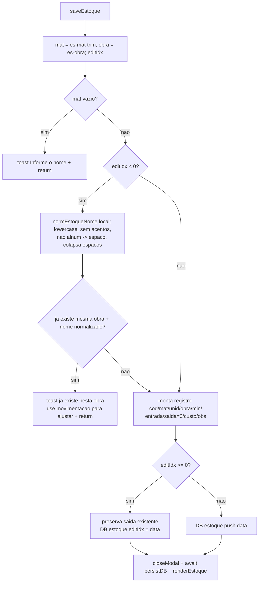
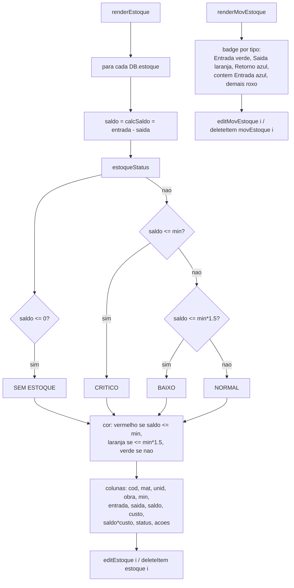
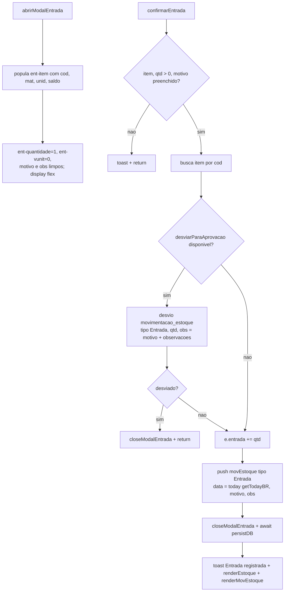
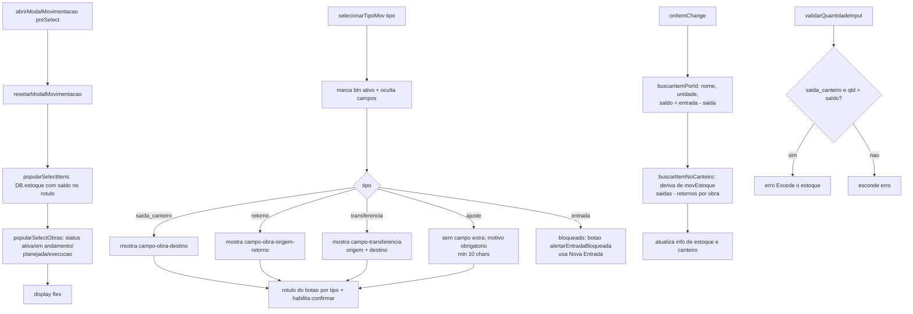
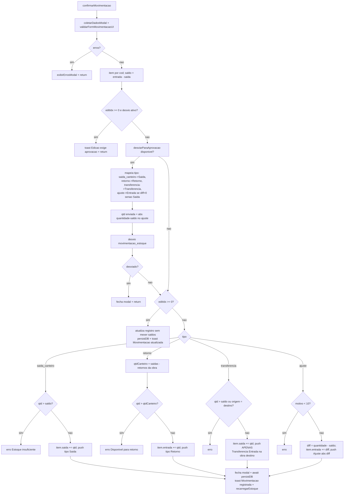
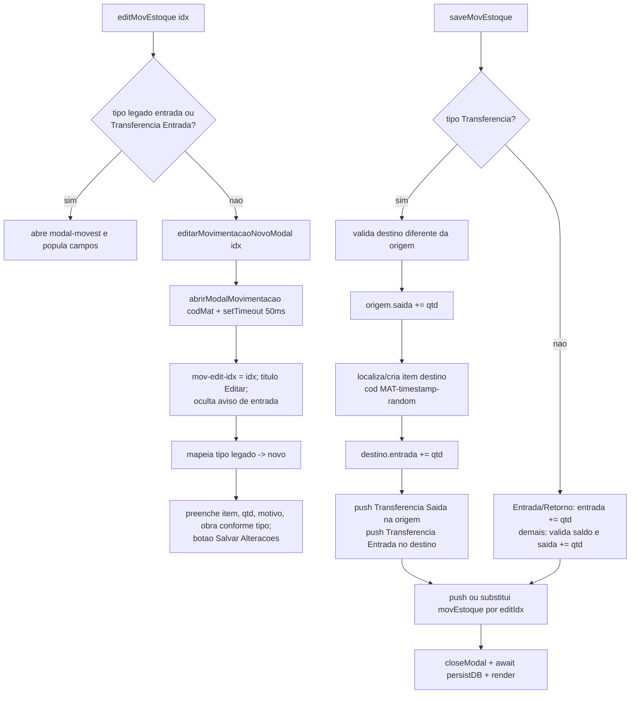
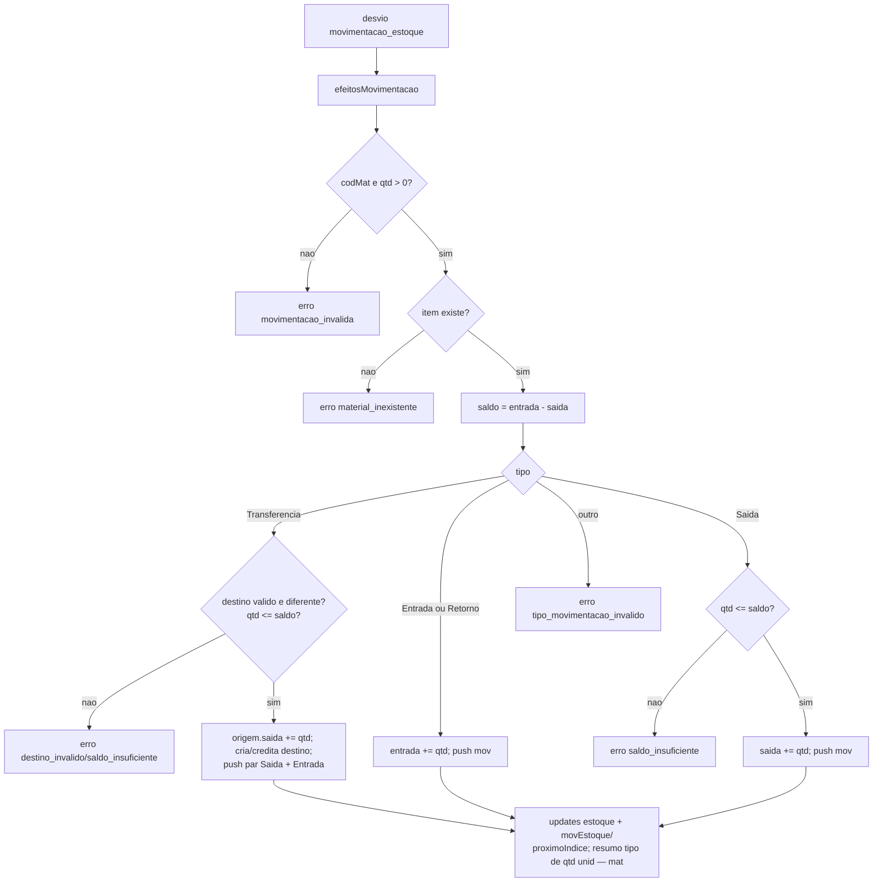
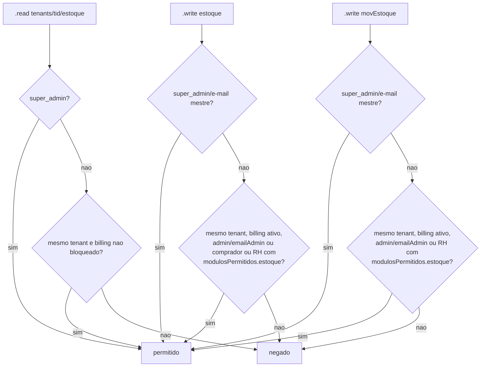

# Fluxograma — Módulo `estoque`

> 🟢 CONFIRMADO — `public/pages/estoque.html`, `public/modals/modal-estoque.html`, `public/modals/modal-movimentacao-estoque.html`, `public/modals/modal-entrada-estoque.html`, `public/js/estoque.module.js` (498 linhas), `public/js/app_core.js` (entrada 2267–2320; render 2323–2359; item 7017–7073; legado 7075–7214), `public/js/utils.module.js:1475-1489`, `functions/aprovacoes.js:167-248`, `database.rules.json:101-113`, `tests/estoqueajuste/estoque.test.js`, `tests/security/rules.test.js`.

## 1. Visão geral — três caminhos de escrita

🟢 O estado canônico é `DB.estoque` + `DB.movEstoque`, persistido por `persistDB()`. 🟡 `+ Novo Item` e `Nova Entrada` são fluxos distintos: o primeiro cadastra o material, o segundo repõe saldo.

## 2. Cadastro de item (`saveEstoque`)

🔴 Fato: `saveEstoque` usa uma **cópia local** `normEstoqueNome` em vez de `window.normalizarNome` (testado em `estoque.test.js`). 🟢 Decisão P17: `normEstoqueNome` é canônica.

## 3. Renderização e status

## 4. Nova Entrada (`confirmarEntrada`)

🟡 O payload de aprovação usa `new Date().toISOString().slice(0,10)` (UTC), enquanto o registro direto usa `today` (`America/Sao_Paulo`).

## 5. Modal unificado de movimentação

`buscarItemNoCanteiro` (`estoque.module.js:72-101`) considera movimentos com `tipo` contendo `saída`/`saida` como acréscimo e `retorno` exato como decréscimo, por obra, ignorando saldos `<= 0`.

## 6. Confirmação da movimentação

🔴 Fato: transferência no modal unificado **não credita o item de destino** — grava só `Transferência (Entrada)` na obra destino e debita a origem. O modal legado e o trigger gravam o par Saída/Entrada. 🟢 Decisão P11: corrigir transferência e edição.

🔴 Fato: no modo edição do modal unificado, os saldos não são ajustados. 🟢 Decisão P11: corrigir o ajuste de saldos antes da reimplementação.

## 7. Edição e legado

## 8. Aprovação (`movimentacao_estoque`)

🟢 Engenheiro pode **decidir** apenas `movimentacao_estoque` e é obrigado a notificar o admin (`aprovacoes_ui.js:133`, `tests/aprovacoes.test.js:33`). 🟢 `encarregado`, `mestre` e `engenheiro` não escrevem diretamente em `estoque`/`movEstoque` (`tests/security/rules.test.js:313-338`).

## 9. Autorização nas rules

🟢 `estoque` aceita **comprador** na escrita; `movEstoque` **não** aceita comprador (apenas admin, mestre e-mail e RH com módulo) — `database.rules.json:101-113`. 🟡 Leitura exige apenas mesmo tenant com billing ≠ `bloqueado`, enquanto a escrita também bloqueia `somente_leitura`.
