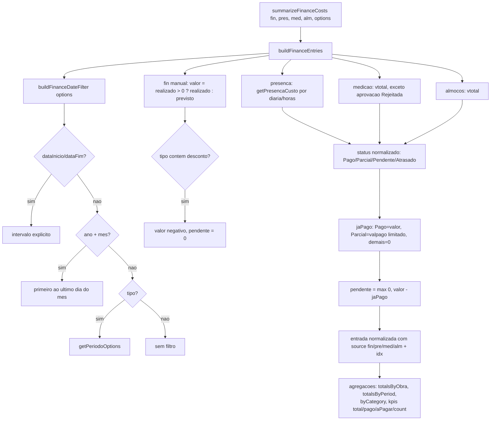
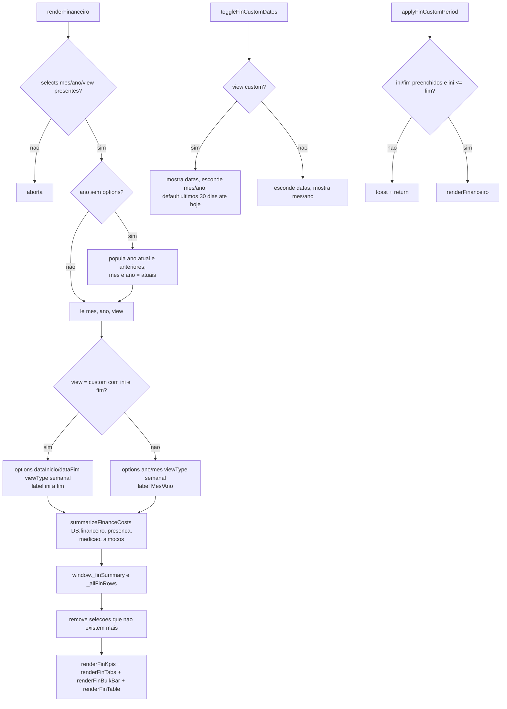
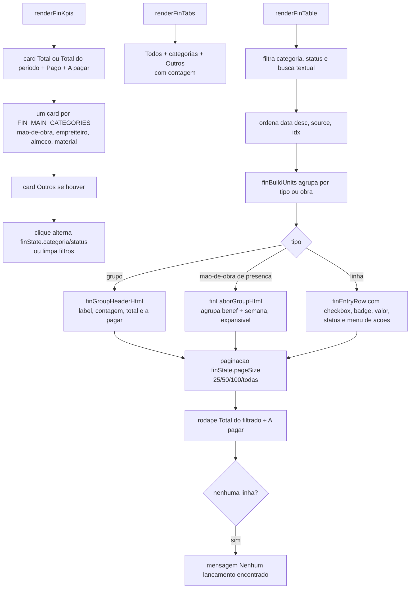
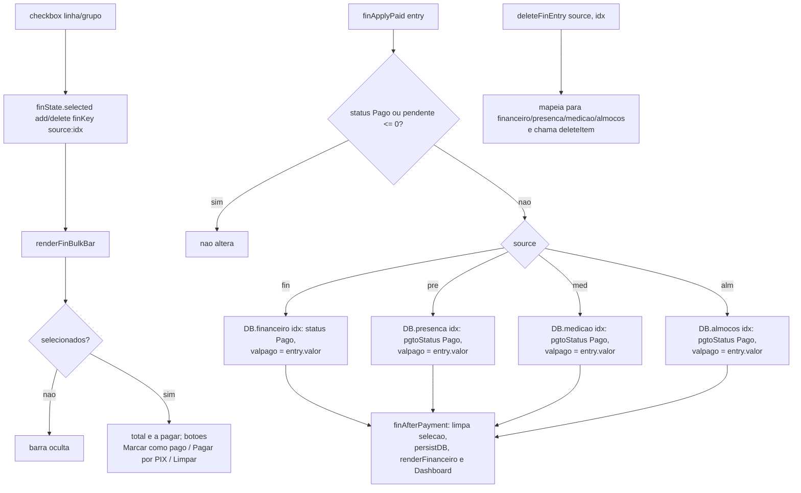
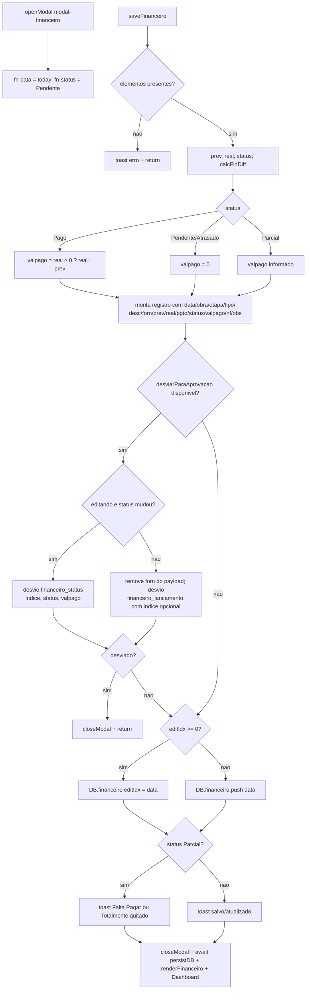
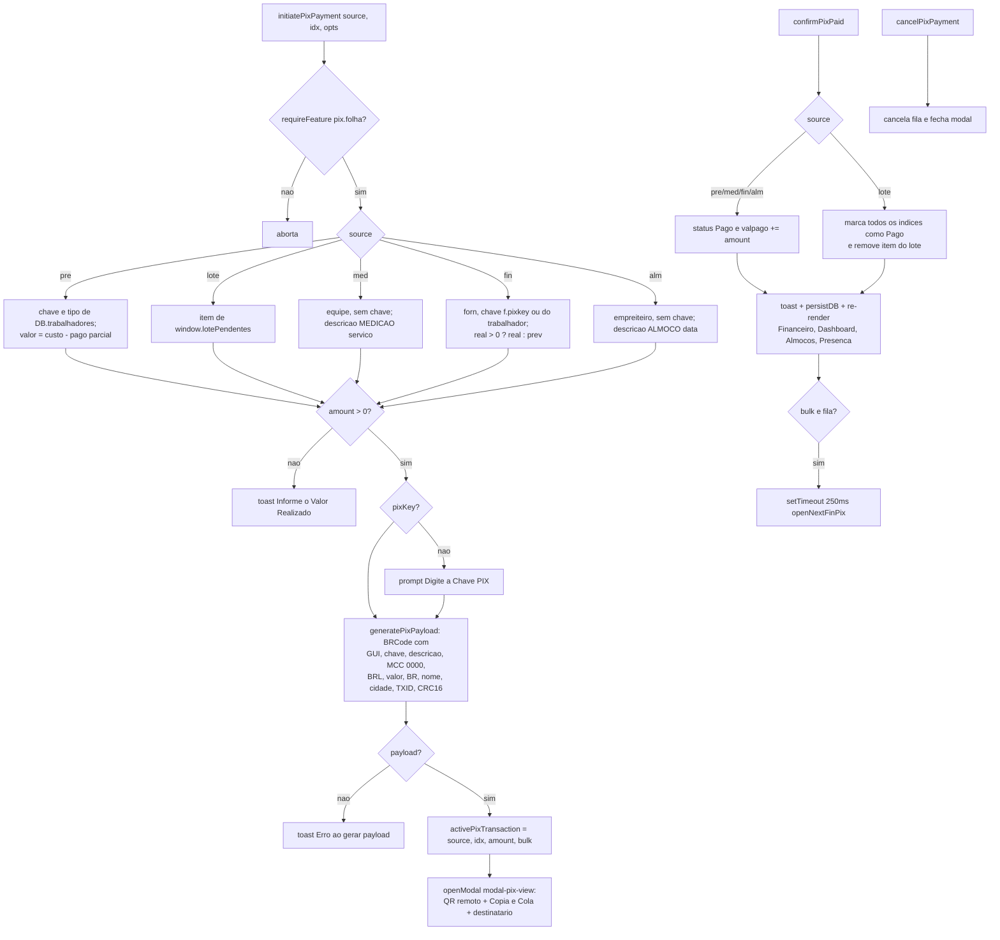
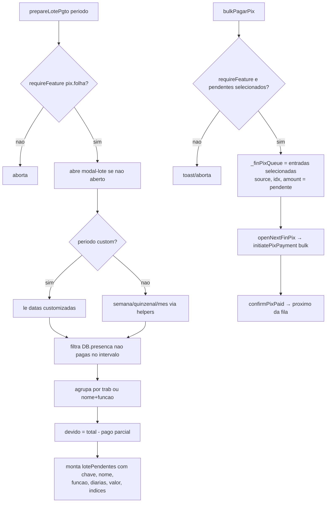
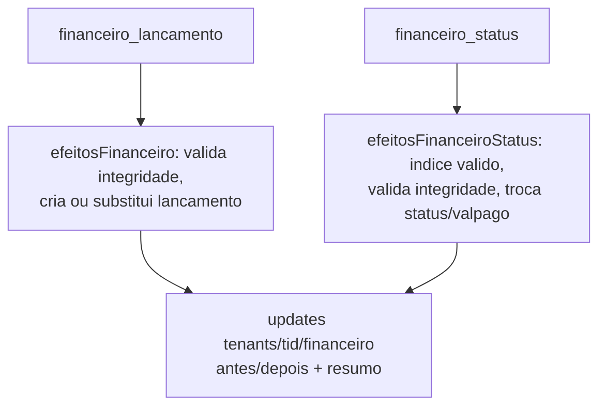
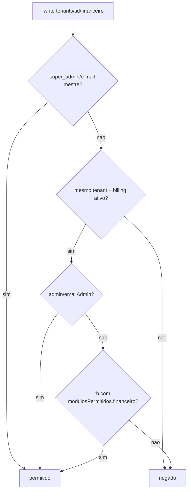

# Fluxograma — Módulo `financeiro-e-pix`

> 🟢 CONFIRMADO — `public/pages/financeiro.html`, `public/modals/modal-financeiro.html`, `public/modals/modal-pix-view.html`, `public/js/app_core.js` (2426–2484, 2485–3184, 6766–6835, 7300–7406), `public/js/utils.module.js` (116–131, 454–667), `public/js/pix_logic.js`, `public/js/pix_ui.js`, `functions/aprovacoes.js` (efeitos financeiros), `database.rules.json:120-121`, `tests/pix.test.js`, `tests/aprovacoes.test.js`, `tests/plan-features.test.js`.

## 1. Fonte única de lançamentos

🔴 Descontos são negativados no valor, mas `pendente` é forçado a `0` (`utils.module.js:509`). 🟢 Medição rejeitada não entra como custo.

## 2. Período e renderização

🟡 `toggleFinCustomDates` e os defaults de data usam `new Date()`/ISO (UTC), não `getTodayBR()`.

## 3. KPIs, abas e tabela

`finStatusMatches`: `pago` → `status === 'Pago'`; `a-pagar` → não pago e `pendente > 0`; `parcial`/`atrasado` → status igual. `finBuscaMatches` varre data formatada/crua, obra (código e nome), tipo, descrição, beneficiário, etapa, NF, pagamento e observações.

## 4. Seleção e baixas

🔴 Fato: `finApplyPaid` grava `valpago = entry.valor` (valor total), ignorando parciais prévios. 🟢 Decisão P12: somar ao `valpago` existente, como `confirmPixPaid`.

## 5. Lançamento manual e desvio

🟢 `forn` (beneficiário) é removido do payload de aprovação — dado comercial não vai para a solicitação. 🟢 Engenheiro/RH/encarregado enviam para decisão; admin/comprador gravam direto.

## 6. PIX

🟢 `cleanPixKey` detecta CPF/CNPJ/telefone/e-mail/aleatória e normaliza (`+55` para telefone, minúsculas para e-mail). 🟢 `crc16` usa polinômio CCITT 0x1021; `tests/pix.test.js` cobre limpeza e estrutura do BRCode. 🟡 QR Code é gerado por serviço externo (`api.qrserver.com`), com fallback textual se falhar.

## 7. Fila de PIX em lote (Fechar Folha)

🟢 Feature gate `pix.folha` protege `prepareLotePgto`, `bulkPagarPix` e `initiatePixPayment` (`tests/plan-features.test.js:84`). 🟡 Fechar Folha cobre apenas `presenca`, enquanto o PIX individual também trata medição, almoço e lançamentos manuais.

## 8. Aprovação no servidor

🟢 `tests/aprovacoes.test.js:190-217`: lançamento solicitado nasce `Pendente` com `valpago = 0`; mudança de status passa por `financeiro_status` e o trigger grava `Pago` com `valpago = 500`.

## 9. Autorização nas rules

🟢 Não há `.read` explícito em `financeiro`: herda a leitura do nó do tenant. 🟡 `comprador` não consta na regra de escrita financeira, embora possa escrever `estoque`.
