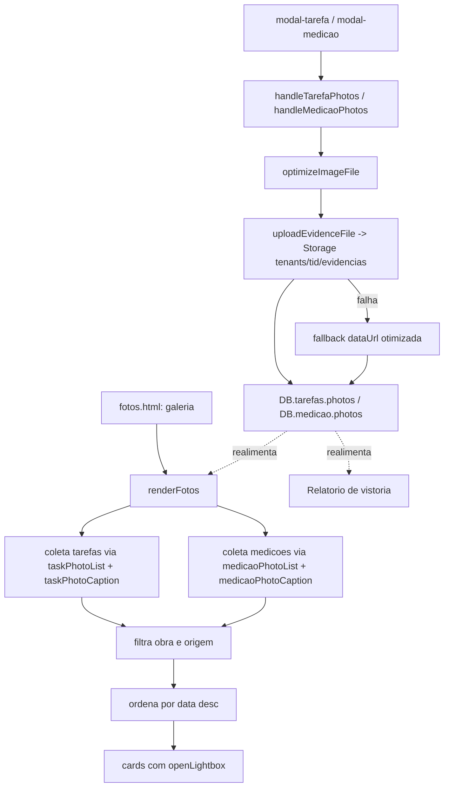
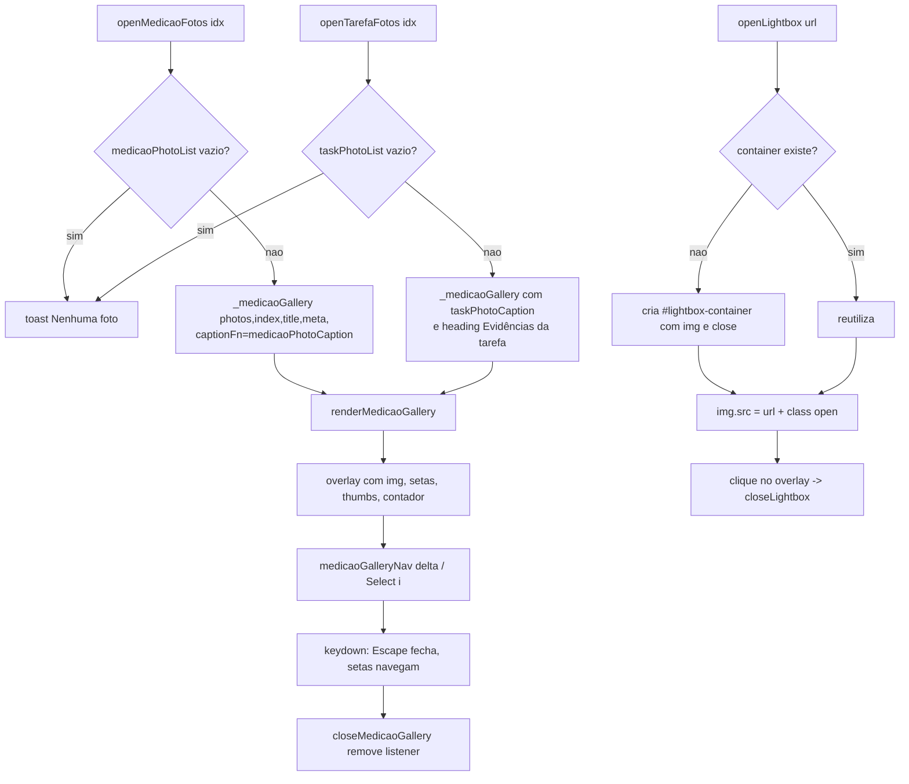
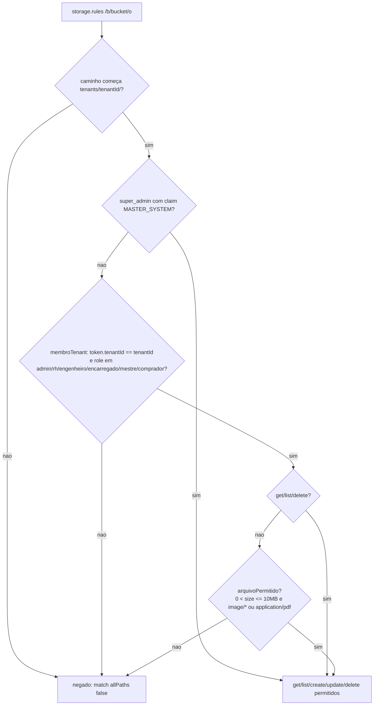

# Fluxograma — Módulo `fotos`

> 🟢 CONFIRMADO — `public/pages/fotos.html`, `public/js/app_core.js` (`renderFotos` 4471–4559; `uploadErrorMessage` 8054–8067; `uploadEvidenceFile` 8069–8094; helpers de medição 3857–4433; helpers de tarefa 8145–8248; `openLightbox`/`closeLightbox` 8252–8268), `public/js/utils.module.js` (`optimizeImageFile` 1341–1406; `auditSafeImage` 1330–1334), `public/js/data_core.js:458-484,790-850,888-930`, `storage.rules:1-47`, `tests/tarefas-fotos.test.js`, `tests/security/tenant-isolation.test.js:391-417`, `tests/rh-customizavel.test.js:89-122`.

## 1. Visão geral



🟢 A página de fotos é **agregadora e somente leitura**: não anexa fotos, apenas reúne as evidências já gravadas em tarefas e medições. 🟢 O upload acontece nos modais de origem; ambas as rotas compartilham `uploadEvidenceFile` e `optimizeImageFile`.

## 2. `renderFotos` — agregação e filtros

```mermaid
flowchart TD
    A[renderFotos] --> B[le fotos-obra-filter e fotos-origem-filter]
    B --> C{select de obras tem só 1 option?}
    C -- sim --> D[append de DB.obras: value=cod, label=cod - nome]
    C -- nao --> E[preserva seleção]
    D & E --> F[para cada tarefa: taskPhotoList t]
    F --> G[push url, legenda=taskPhotoCaption,<br/>obra, origem Tarefa, cod, desc, etapa,<br/>frente, status, data=conclusao|prazo|criacao]
    H[para cada medição: medicaoPhotoList m] --> I[push url, legenda=medicaoPhotoCaption,<br/>obra, origem Medição, cod, desc=servico|etapa,<br/>etapa, frente, status=aprovacao, data=semana|data]
    G & I --> J{obra selecionada?} -- sim --> K[filter por obra]
    J -- nao --> L[filter por origem se preenchido]
    K --> L
    L --> M[sort por data desc via localeCompare]
    M --> N{fotos-grid existe?} -- nao --> O[return]
    N -- sim --> P{allPhotos vazio?}
    P -- sim --> Q[empty state Nenhuma foto]
    P -- nao --> R[para cada foto: card]
    R --> S[data-photo=auditEsc url<br/>onclick=openLightbox]
    S --> T[img src=url, onerror opacidade 0.5, loading lazy]
    T --> U[legenda e metadados escapados<br/>obName, origem, fmtDate, etapa/frente/status]
```

🟢 O filtro de obras é preenchido apenas uma vez (`options.length === 1`), preservando a seleção em re-renders (`app_core.js:4476-4484`). 🟢 Origens disponíveis: `Tarefa` e `Medição` (`fotos.html:12-16`). 🟢 Texto vem de `auditEsc`; `src` usa a URL bruta retornada pelas rotas de upload/normalização. 🟡 Cards com URL quebrada ficam com opacidade 0.5, mas permanecem clicáveis.

## 3. Upload, otimização e Storage

```mermaid
flowchart TD
    A[input múltiplo tf-file / md-photos-input] --> B[handleTarefaPhotos / handleMedicaoPhotos]
    B --> C[files.slice 0, room = 6 - fotos atuais]
    C --> D{excedeu?} -- sim --> E[toast limite e descarta excedente]
    C --> F[para cada arquivo]
    F --> G[optimizeImageFile maxDim 1280 quality 0.75]
    G --> H[uploadEvidenceFile optimizedFile]
    H --> I{firebase.storage / bucket disponíveis?} -- nao --> J[throw SDK/Bucket não configurado]
    H --> K[user = gestaoUser do sessionStorage]
    K --> L[tid = user.tenantId || global]
    L --> M[fileName = Date.now + nome sanitizado]
    M --> N[path tenants/tid/evidencias/fileName]
    N --> O[fileRef.put com contentType]
    O --> P[state_changed -> log progresso]
    P --> Q[await uploadTask]
    Q --> R[fileRef.getDownloadURL]
    H -- erro --> S{dataUrl otimizada existe?}
    S -- sim --> T[usa dataUrl como fallback]
    S -- nao --> U[throw storageErr]
    R & T --> V[push URL em _tarefaPhotos / _medicaoPhotos]
    V --> W[renderPhotoPreview + toast final]
    U --> X[console.error + uploadErrorMessage + break]
```

🟢 `uploadEvidenceFile` exige SDK de Storage e `storageBucket` configurados; usa `tenantId` da sessão com fallback `global` (`app_core.js:8069-8080`). 🟢 Nome de arquivo é sanitizado com regex `[^a-zA-Z0-9.]` e prefixado por `Date.now()` (`app_core.js:8078`). 🟢 Limite de 6 fotos por tarefa (`MAX_TAREFA_FOTOS`) e por medição (`app_core.js:8146,4398`). 🟢 A otimização reduz as dimensões a 1280 px e comprime em JPEG 75% (`utils.module.js:1341-1406`). 🟡 O caminho `tenants/global/evidencias/...` não satisfaz `membroTenant` nem `superAdmin` — sessões sem `tenantId` falham no upload. 🟡 O progresso do upload é só logado no console, não exibido na UI.

## 4. Normalização e legendas

```mermaid
flowchart TD
    A[taskPhotoList t] --> B{Array photos não vazio?}
    B -- sim --> C[photos]
    B -- nao --> D[[photoUrl, foto]]
    C & D --> E[filter Boolean]
    E --> F[filter regex http(s) ou data:image]
    G[taskPhotoCaption t, i, total] --> H[desc = t.desc || Tarefa]
    H --> I{total > 1?} -- sim --> J[desc + ' · Foto i+1/total']
    I -- nao --> K[desc]
    L[medicaoPhotoList m] --> M{Array photos não vazio?}
    M -- sim --> N[photos filter Boolean]
    M -- nao --> O[photoUrl em array]
    P[medicaoPhotoCaption m, i, total] --> Q[desc = servico || etapa || Medição]
    Q --> R{total > 1?} -- sim --> S[desc + ' · Foto i+1/total']
    R -- nao --> T[desc]
    J & K & S & T --> U[legenda usada em galeria, preview,<br/>relatório e página de fotos]
```

🟢 `taskPhotoList` aceita os três formatos históricos (`photos`, `photoUrl`, `foto`) e filtra esquemas perigosos (`app_core.js:8149-8153`). 🟢 `medicaoPhotoList` aceita `photos` e o legado `photoUrl` (`app_core.js:4072-4075`). 🟢 Legenda é sempre derivada da descrição da tarefa ou do serviço medido — não é campo gravado (`tests/tarefas-fotos.test.js:43-48,59-75`). 🟡 Renomear a descrição altera a legenda de fotos antigas.

## 5. Persistência (nuvem e fallback local)

```mermaid
flowchart TD
    A[persistDB / backup local] --> B[sanitizeComprasForRole]
    B --> C[trabalhadores: foto data: -> fotosMap[cod]]
    C --> D[medicao: remove photoUrl data: e photos data:]
    D --> E[tarefas: b64 de photoUrl+photos -> fotosMap['tf_'+cod].slice 0,6]
    E --> F[localStorage gestaoObraDB sem base64]
    F --> G[localStorage gestaoObraFotos com base64 separado]
    G -- sem espaço --> H[console.warn e segue]
    I[persist nuvem] --> J[dbForCloud = deep clone DB]
    J --> K[remove foto data: de trabalhadores, medicao e tarefas]
    K --> L[firebase.database().goOnline + persist]
    M[carregamento do tenant] --> N[localStorage gestaoObraFotos]
    N --> O[trabalhadores: restaura foto se vazia]
    O --> P[tarefas: mescla unica atuais + photoUrl + restauradas]
    P --> Q[photoUrl = primeira; photos = lista]
    Q --> R[processCloudUpdate]
```

🟢 Base64 nunca vai ao RTDB: limite de 10 MB por escrita (`data_core.js:892-894,905-930`). 🟢 Fotos locais são guardadas em `gestaoObraFotos`, separadas de `gestaoObraDB` (`data_core.js:793-850`). 🟢 Restauração usa `Set` para deduplicar e preserva URLs já presentes (`data_core.js:471-481`). 🟡 Base64 não é restaurado para medições — apenas trabalhadores e tarefas (`data_core.js:463-482`); medição com fallback local perde a foto após recarregar se não houver URL remota. 🟡 `fotosMap['tf_' + cod]` depende de `t.cod`; tarefas sem código podem colidir.

## 6. Galeria navegável e lightbox



🟢 Tarefas reaproveitam o mesmo player das medições (`window._medicaoGallery` e `renderMedicaoGallery`) — `app_core.js:8231-8247`. 🟢 `openLightbox` cria o container sob demanda e o fecha por clique no overlay (`app_core.js:8252-8268`). 🟡 `closeLightbox` presume que `#lightbox-container` existe; chamar sem abrir antes gera erro. 🟡 O lightbox não sanitiza a URL recebida — a sanitização depende de quem monta o `data-photo`.

## 7. Autorização no Storage



🟢 Autoridade no Storage são as **Custom Claims** (`role` + `tenantId`) emitidas por `syncCustomClaims`, pois as rules não leem o RTDB (`storage.rules:4-7`). 🟢 `comprador` tem acesso ao Storage embora não escreva `medicao` no RTDB — escopo maior do que o de dados (`storage.rules:10-15`). 🟢 Caminhos fora de `tenants/<tenantId>/` são negados por fallback (`storage.rules:42-45`, `tests/security/tenant-isolation.test.js:391-417`). 🟡 `request.auth.token.tenantId == 'global'` não é aceito: uploads sem tenant falham. 🟡 Não há validação de extensão ou conteúdo real da imagem, apenas `contentType` declarado pelo cliente.
