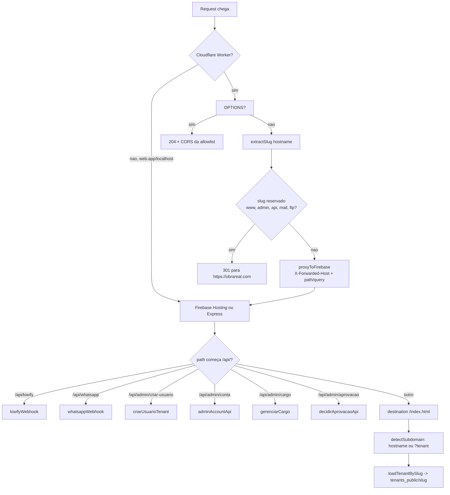
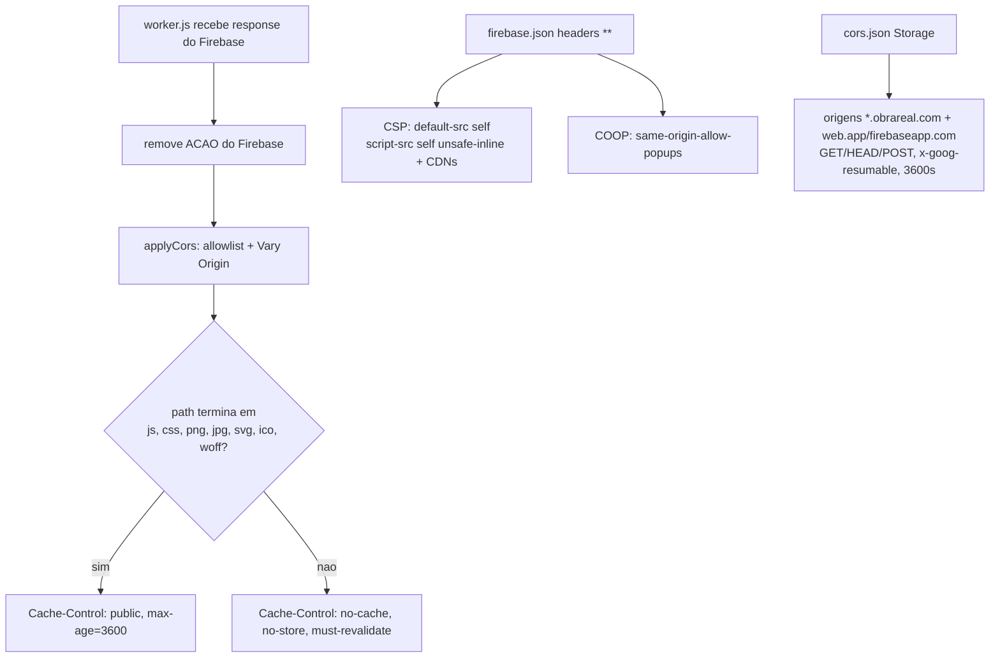
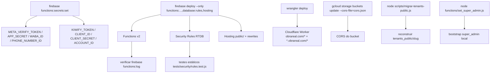
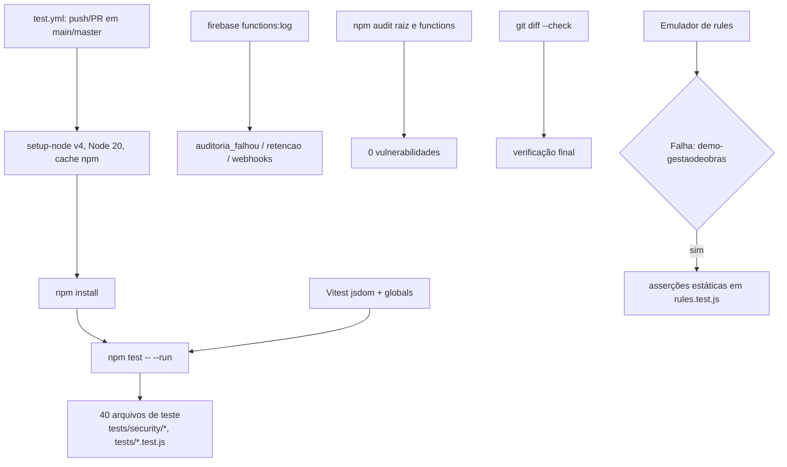

# Fluxograma — Módulo `infra-e-deploy`

> 🟢 CONFIRMADO — `firebase.json:1-66`, `.firebaserc:1-5`, `functions/index.js` (exports `onRequest`/`onSchedule`/`onValueWritten`), `server.js:1-17`, `package.json:1-22`, `functions/package.json:1-22`, `vitest.config.mjs:1-8`, `apphosting.yaml:1-5`, `wrangler.jsonc:1-9`, `cloudflare-worker/wrangler.toml:1-8`, `cloudflare-worker/worker.js:1-143`, `cors.json:1-14`, `.github/workflows/deploy.yml:1-18`, `.github/workflows/test.yml:1-22`, `.gitignore:1-75`, `docs/security/hardening.md:141-179`, `docs/security/cors.md`, `docs/security/super-admin.md:100-108`, `docs/security/tenants-public.md:39-58`, `public/js/data_core.js:269-294`, `public/js/slug.js:14-99`.

## 1. Visão geral — três superfícies de entrega

```mermaid
flowchart TD
    A[Push em main] --> B[GitHub Actions: test.yml]
    A --> C[GitHub Actions: deploy.yml]
    B --> D[npm install + npm test -- --run]
    C --> E[FirebaseExtended/action-hosting-deploy@v0<br/>channel live]
    F[Dev local: npm start] --> G[server.js Express<br/>public/ + fallback index.html]
    H[Navegador: obrareal.com<br/>ou slug.obrareal.com] --> I[Cloudflare Worker]
    I --> J[proxy transparente para<br/>controle-obras-c889d.web.app]
    J --> K[Firebase Hosting]
    K --> L[rewrites /api/* -> Cloud Functions]
    K --> M[SPA: /** -> /index.html]
    L --> N[RTDB + Storage<br/>rules + dados]
    L --> O[Secret Manager]
    E --> K
    G --> M
```

🟢 O repositório entrega três superfícies: **Hosting + Functions** (produção), **Cloudflare Worker** (subdomínios wildcard) e **Express local** (`npm start`). 🟢 O GitHub Actions de deploy publica **somente Hosting**; functions, rules e secrets são publicados manualmente pela CLI conforme `docs/security/hardening.md:141-156`. 🟢 O projeto Firebase é fixo em `.firebaserc`: `controle-obras-c889d`. 🟡 `apphosting.yaml` (1 CPU / 512 MiB) existe, mas o fluxo ativo usa Firebase Hosting, não App Hosting.

## 2. Roteamento — rewrites e subdomínios



🟢 `firebase.json:11-40` define 6 rewrites de API + fallback SPA; o `server.js:8-13` replica o fallback local com `express.static('public')`. 🟢 Em produção o hostname é autoridade (`detectSubdomain` ignora `?tenant=` quando `obrareal.com`/`*.obrareal.com`); em dev/staging o parâmetro `?tenant=` funciona (`data_core.js:270-289`). 🟢 Subdomínios reservados no worker: `www`, `admin`, `api`, `mail`, `ftp` (`worker.js:16`); a lista reservada do app é maior e inclui `app`, `login`, `master`, `webhook`, `pix`, etc. (`slug.js:21-29`). 🟢 O worker repassa `X-Forwarded-Host` e remove `host`, preservando o hostname original no navegador (`worker.js:109-119`). 🟢 `tenants_public/<slug>` é lido diretamente por chave — nunca com `orderByChild` — para não enumerar clientes (`tenants-public.md:24-37`). 🟡 Domínio raiz/www e `web.app`/`firebaseapp.com` não carregam tenant por subdomínio; dependem de `?tenant=` fora de produção.

## 3. Cache, CORS e cabeçalhos



🟢 O worker define `Access-Control-Allow-Origin` apenas para origens casadas com `*.obrareal.com`, `controle-obras-c889d.web.app` ou `.firebaseapp.com`; usa `Vary: Origin`, `Allow-Credentials:true` e `Max-Age:3600` (`worker.js:23-50`). 🟢 Preflight `OPTIONS` é respondido localmente com `204`, sem proxy (`worker.js:57-61`). 🟢 Assets estáticos são cacheados por 1 h; HTML nunca é cacheado (`worker.js:131-136`). 🟢 CSP em `firebase.json:46-47` permite CDNs de Analytics/Cloudflare/Google, Firebase/Graph/QR Server; `object-src 'none'`, `base-uri 'self'`, `frame-ancestors 'none'`. 🟢 COOP `same-origin-allow-popups` é necessário para `signInWithPopup` (`cors.md:47-49`). 🟡 `cors.json` e `ALLOWED_ORIGINS` do worker precisam ser alterados juntos; `gcloud storage buckets update --cors-file=cors.json` é manual (`cors.md:19-30`).

## 4. Deploy e segredos



🟢 Comando canônico de deploy em `hardening.md:143-156`: 8 segredos + `firebase deploy --only functions:whatsappWebhook,functions:kiwifyWebhook,functions:adminAccountApi,functions:gerenciarCargo,functions:criarUsuarioTenant,functions:retencaoSegurancaJob,database:rules,hosting`. 🟢 Outros fluxos exigem deploy específico: `functions:gerenciarCargo,functions:syncCustomClaims` (`tenant-isolation.md:50-55`), `functions:adminAccountApi,database:rules,hosting` (`super-admin.md:104-106`). 🟢 `wrangler.jsonc` e `cloudflare-worker/wrangler.toml` descrevem o mesmo worker (`name`, `main`, `compatibility_date:2024-01-01`, rotas `obrareal.com/*` e `*.obrareal.com/*`). 🟢 A migração de `tenants_public` deve rodar **após** as rules e **antes** de divulgar subdomínios (`tenants-public.md:56`). 🟡 Duas configurações do Wrangler (JSONC na raiz e TOML na pasta) podem divergir; não há fonte única declarada. 🟡 `.firebaserc` está listado em `.gitignore:11`, embora o arquivo exista no repositório — conferir se está versionado antes de alterar. 🟡 `FIREBASE_URL` do worker é fixo (`worker.js:13`); trocar de projeto exige editar código + ambos os configs.

## 5. Qualidade e observabilidade



🟢 `test.yml` roda em push e PR nas branches `main`/`master`, com Node 20 e `npm test -- --run` (`test.yml:1-22`). 🟢 `vitest.config.mjs` usa `environment:'jsdom'` e `globals:true`. 🟢 `deploy.yml` dispara somente em `push` em `main`, usando service account via secret `FIREBASE_SERVICE_ACCOUNT_CONTROLE_OBRAS_C889D` e `channelId: live` (`deploy.yml:1-18`). 🟢 Verificação pós-deploy: confirmar token da Meta no Secret Manager, checar logs do job de retenção e `auditoria_falhou`, aplicar CORS e publicar o worker (`hardening.md:158-164`). 🟡 O emulador de rules falha por configuração de projeto; substituto são as asserções estáticas (`hardening.md:176-179`). 🟡 `deploy.yml` não roda testes antes de publicar — a garantia depende do fluxo de PR.

## 6. Lacunas / pontos de atenção 🔴

- 🔴 `deploy.yml` publica somente Hosting: uma mudança em functions/rules exige deploy manual, e um merge pode deixar front novo com back antigo.
- 🟡 `package.json` (raiz) declara Node 20 e `functions/package.json` declara Node 24 — ambientes distintos, intencionais ou não.
- 🟡 Duas configurações do Wrangler (`wrangler.jsonc`, `cloudflare-worker/wrangler.toml`) duplicam nome/main/rotas.
- 🟡 `FIREBASE_URL` fixo no worker e `projectId` fixo no workflow impedem promover facilmente para outro projeto.
- 🟡 `apphosting.yaml` presente sem uso confirmado no pipeline.
- 🟡 Lista de subdomínios reservados diverge entre worker (5) e `slug.js` (~35) (`worker.js:16`, `slug.js:21-29`).
- 🟡 `.firebaserc` aparece no `.gitignore`, mas é necessário para CLI local — conferir rastreamento no Git.
- 🟡 Falha de auditoria/rules depende de logs manuais; não há alerta automatizado no CI.

**Próximo módulo:** encerramento da Fase 2 — 21/21.
