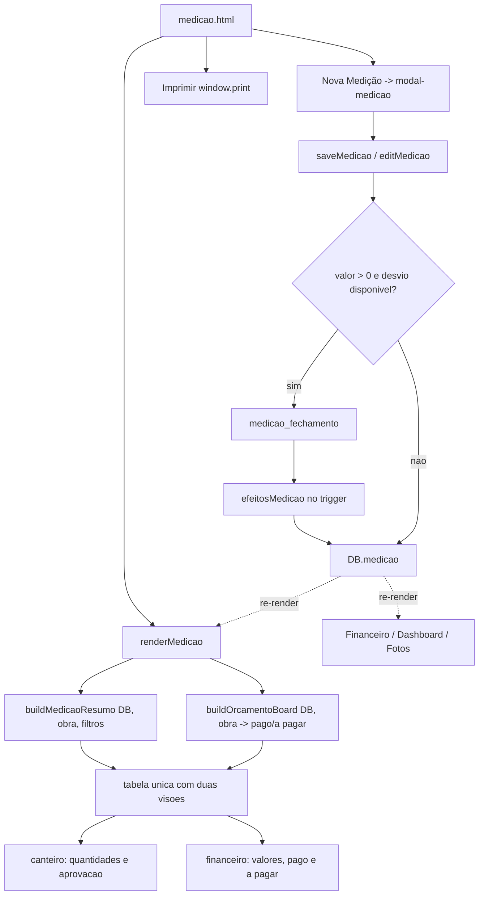
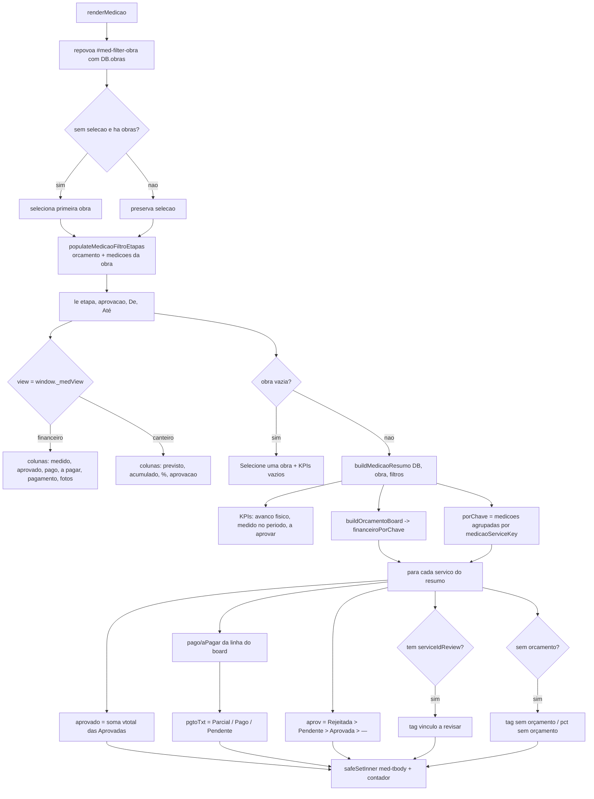
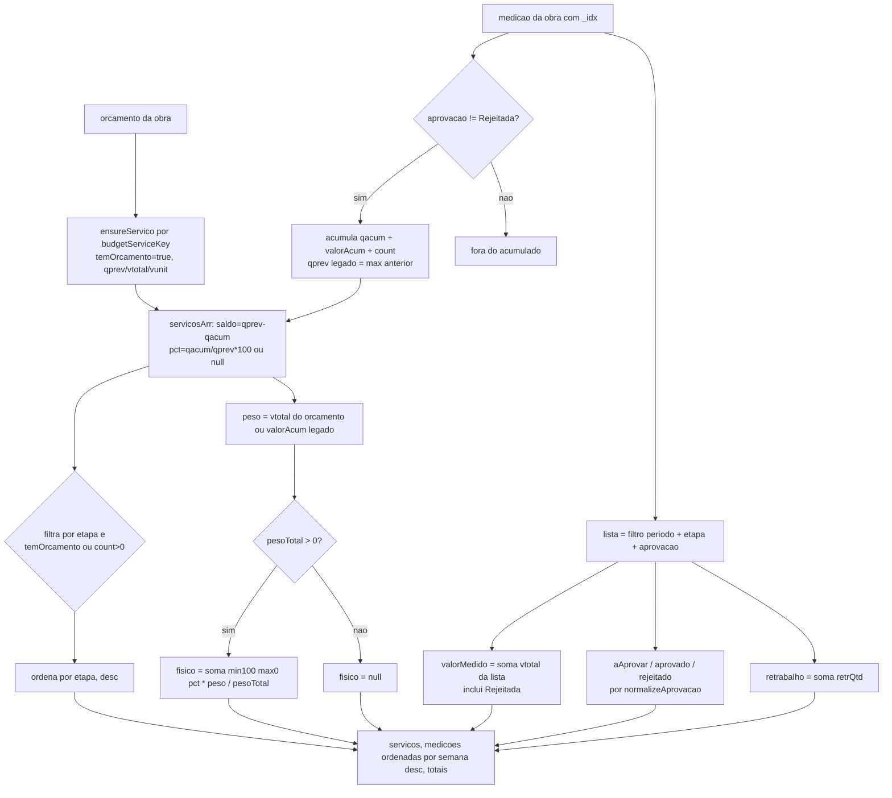
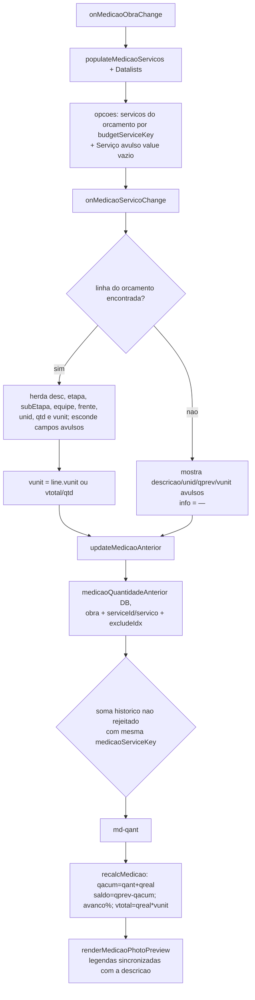
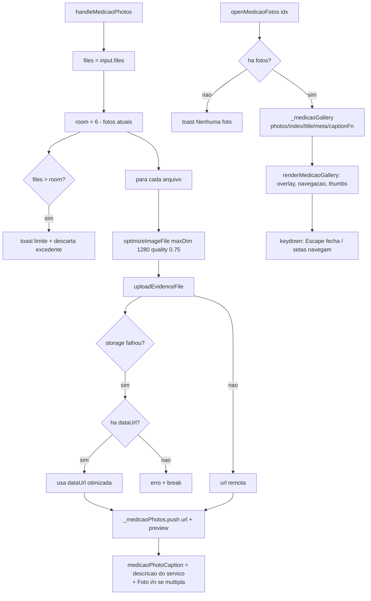
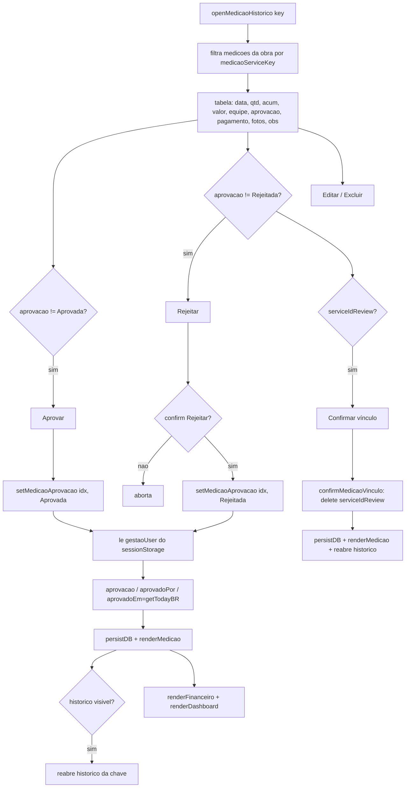
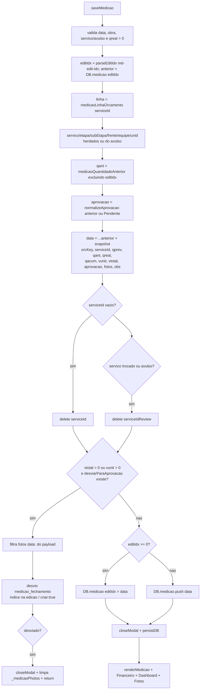
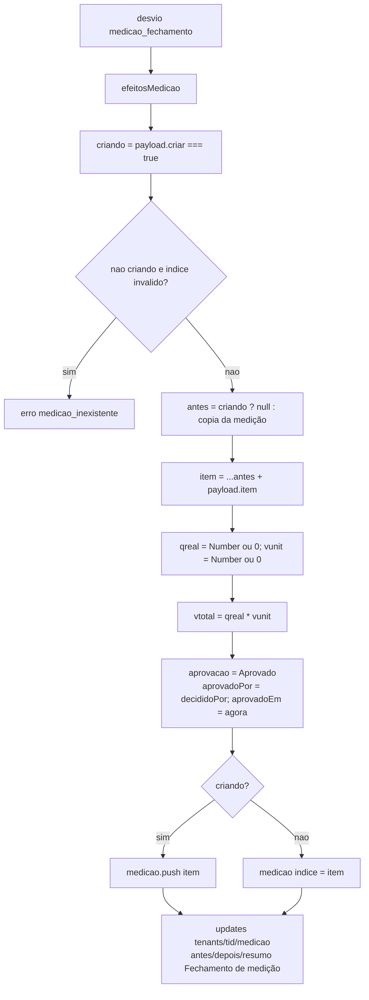
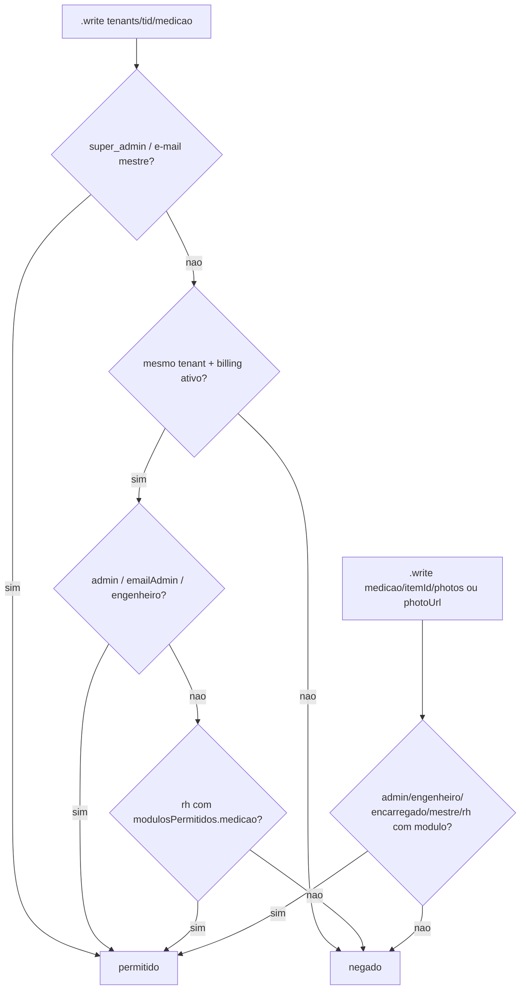

# Fluxograma — Módulo `medicao`

> 🟢 CONFIRMADO — `public/pages/medicao.html`, `public/modals/modal-medicao.html`, `public/js/app_core.js` (helpers/render 3814–3985; histórico/galeria/aprovação 3986–4211; formulário 4214–4433; save/edit 7491–7616), `public/js/utils.module.js` (aprovação 180–190; chaves 192–296; `buildMedicaoResumo` 298–411; `medicaoQuantidadeAnterior` 413–423), `functions/aprovacoes.js:36,49,367-386,403`, `functions/aprovacoes-api.js:16,29`, `database.rules.json:90-99,139-145`, `tests/medicao.test.js`, `tests/aprovacoes.test.js:244-291`, `tests/aprovacoes-ui.test.js:131,163`, `tests/rh-customizavel.test.js:75`.

## 1. Visão geral

🟢 Aprovação é **física**; pagamento é **financeiro** e aparece somente em leitura nesta página (`medicao.html:45`, `app_core.js:3899`). 🟢 Medições rejeitadas deixam de contar como custo (`utils.module.js:561`) e como avanço físico (`utils.module.js:352`).

## 2. Renderização e filtros

🟢 `fisico` é `null` quando não há peso válido: a KPI mostra `—` em vez de `0%` (`app_core.js:3924`). 🟢 `pct` é limitado visualmente a 0–100 e ganha classe `is-over` quando ultrapassa 100 (`app_core.js:3948-3949,3973`). 🟡 Filtro de obra defaulta para a primeira obra, como em `orcamento`.

## 3. `buildMedicaoResumo` — consolidação

🟢 `qacum` usa **todo o histórico**, mesmo quando o período filtra a lista exibida — coberto por `tests/medicao.test.js:81-90`. 🟢 Registros antigos sem `aprovacao`/`aprovado` são considerados `Aprovada` (`utils.module.js:188-190`, teste `:139-146`). 🟢 `pagamento` não altera avanço físico (teste `:168-175`).

## 4. Quantidade anterior e formulário

🟢 `medicaoQuantidadeAnterior` ignora a própria medição em edição (`excludeIdx`) e medições rejeitadas (`utils.module.js:414-423`, testes `:115-137`). 🟢 Na edição, `editMedicao` aceita `m.semana || m.data` e `m.serviceId || m.orcKey`, mantendo compatibilidade com registros legados (`app_core.js:7593,7598`).

## 5. Fotos e galeria

🟢 Fotos base64 são removidas do payload de aprovação; apenas URLs enviadas ao Storage seguem no desvio (`app_core.js:7553-7558`). 🟢 `medicaoFotosHtml` deduplica URLs e mostra no máximo 3 miniaturas + contador (`app_core.js:3857-3868`). 🟡 Legenda é derivada de `servico`/`etapa` no momento da exibição: renomear o serviço muda a legenda de fotos antigas.

## 6. Aprovação física e confirmação de vínculo

🟢 Rejeitar exige `confirm` explícito avisando que a medição deixa de contar como custo e avanço (`app_core.js:4183`). 🟢 `getTodayBR()` é usado para `aprovadoEm`, consistente com o fuso `America/Sao_Paulo`. 🟡 `setMedicaoAprovacao` grava direto no RTDB pelo cliente (não passa por aprovação no servidor), então qualquer papel com `.write` em `medicao` pode aprovar/rejeitar a própria medição. 🟡 `confirmMedicaoVinculo` não registra quem confirmou nem quando.

## 7. Salvamento (`saveMedicao`)

🟢 Campos de pagamento não são mais digitados na medição: valores antigos são preservados só para compatibilidade (`app_core.js:7523-7524`). 🟡 Medição com `vunit = 0` e `vtotal = 0` **não desvia** para aprovação e é gravada diretamente por qualquer papel com permissão de escrita — possível buraco no fechamento. 🟡 `qant`/`qacum` são snapshots no registro; se uma medição anterior for editada ou excluída, o campo gravado fica desatualizado, mas `buildMedicaoResumo` recalcula o acumulado correto a partir do histórico.

## 8. Aprovação no servidor (`medicao_fechamento`)

🟢 O trigger grava `aprovacao = 'Aprovado'` (masculino), enquanto a UI usa `Aprovada`; `normalizeAprovacao` aceita ambos (`utils.module.js:180-185`), então o comportamento converge — mas o valor bruto persistido difere do esperado pelo filtro textual direto. 🟢 `tests/aprovacoes.test.js:244-291` cobre edição e criação com recálculo de `vtotal` e auditoria do decisor. 🟢 `engenheiro` pode criar `medicao_fechamento`; `encarregado`/`mestre` só podem criar `movimentacao_estoque`, `trabalhador_add` e `trabalhador_remove` (`database.rules.json:139`, `aprovacoes_ui.js:20,31`, `aprovacoes-api.js:16,29`). 🟢 RH com `modulosPermitidos` não decide este tipo (`tests/rh-customizavel.test.js:75`).

## 9. Autorização nas rules

🟢 `encarregado` e `mestre` **não** escrevem a medição em si, mas podem escrever somente `photos`/`photoUrl` de um item existente (`database.rules.json:92-98`). 🟢 Não há `.read` explícito: leitura herdada do nó do tenant. 🟡 Não há validação de `qreal > 0` nem de unicidade de `serviceId` nas rules — integridade depende do cliente e do trigger.
