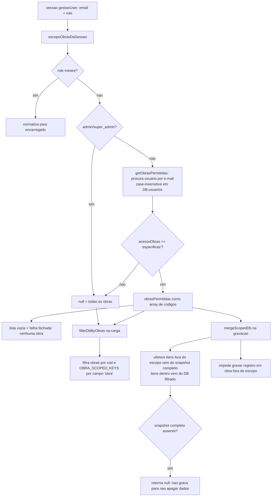
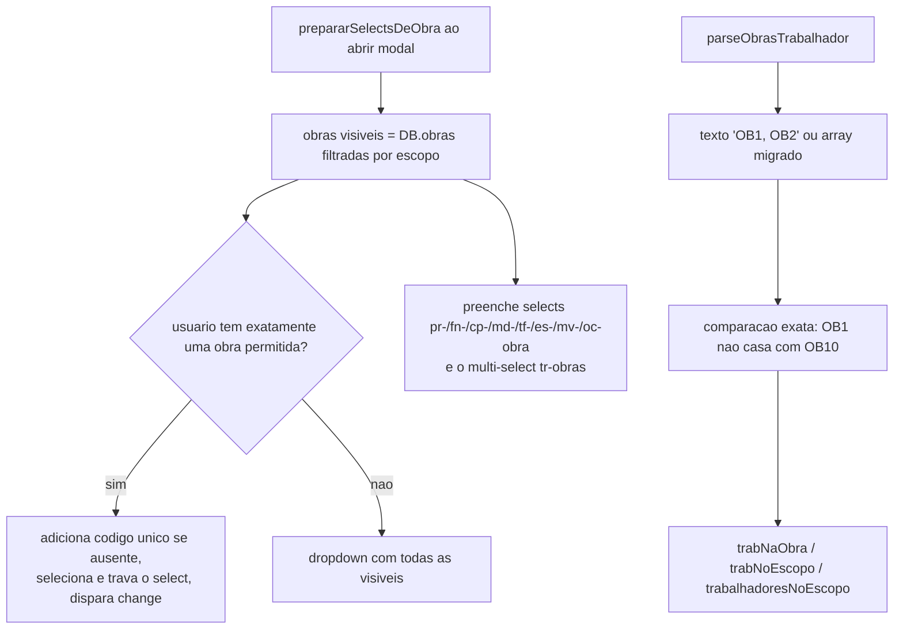
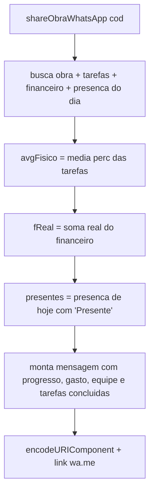
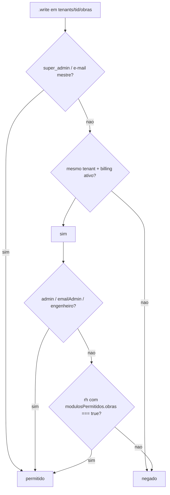

# Fluxograma — Módulo `obras`

> 🟢 CONFIRMADO — `public/pages/obras.html`, `public/modals/modal-obra.html`, `public/js/app_core.js`, `public/js/data_core.js`, `public/js/utils.module.js`, `database.rules.json`, `tests/acesso-por-obra.test.js`, `tests/escopo-obras-paginas.test.js`, `tests/obra-select-modal.test.js`.

## 1. Cadastro e edição

```mermaid
flowchart TD
    A[obras.html: + Nova Obra -> modal-obra] --> B[saveObra]
    B --> C{codigo informado?} -- não --> C1[toast: informe o codigo da obra]
    C --> sim --> D{editando?}
    D -- não --> E{codigo duplicado?} -- sim --> E1[toast: codigo ja existe]
    E -- não --> F{DB.obras.length >= getPlanLimits().obras?}
    F -- sim --> F1[toast: limite do plano; faca upgrade]
    F -- nao --> G[DB.obras.push dados do modal]
    D -- sim --> H[DB.obras[editIdx] = dados]
    G & H --> I[closeModal + persistDB + renderObras + renderDashboard]
    I --> J[persistDB: update multi-path no tenant<br/>com mergeScopedDb se usuario restrito]
```

### Campos do modal

`cod`, `nome`, `end`, `tipo`, `status`, `inicio`, `prazo`, `orc`, `mestre`, `eng`, `cliente`, `cliente_contato`, `contrato_tipo`, `obs`.

`editObra(idx)` copia o registro para o modal e grava o índice em `#ob-edit-idx`; `deleteItem('obras', idx)` remove do array e persiste (validação final nas rules).

## 2. Renderização e indicadores

```mermaid
flowchart TD
    A[renderObras] --> B[para cada obra do DB (ja filtrado por escopo)]
    B --> C[fReal = soma financeiro.real da obra]
    C --> D[pctCusto = fReal / orc * 100]
    B --> E[avgFisico = media tarefas.perc da obra]
    D & E --> F[card: nome, status, endereco,<br/>barra de progresso, orcamento, % custo]
    F --> G[acoes: WhatsApp, Tarefas]
    B --> H[tabela: nome, cod, status, prazo, orcamento, mestre,<br/>Editar/Excluir com indice original]
```

Cor da barra: verde se `>70%`, âmbar se `>30%`, laranja caso contrário. `% custo` fica vermelho quando `fReal > orc`.

## 3. Escopo de obras (filtragem no cliente)



`OBRA_SCOPED_KEYS = [presenca, tarefas, estoque, movEstoque, compras, financeiro, orcamento, medicao, almocos]`.

## 4. Seletores de obra e ficha do trabalhador



## 5. Resumo via WhatsApp



## 6. Autorização nas rules


