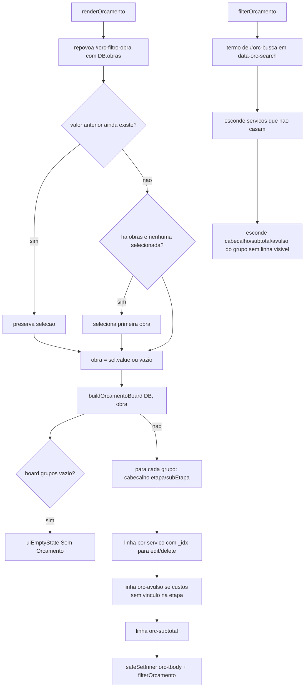
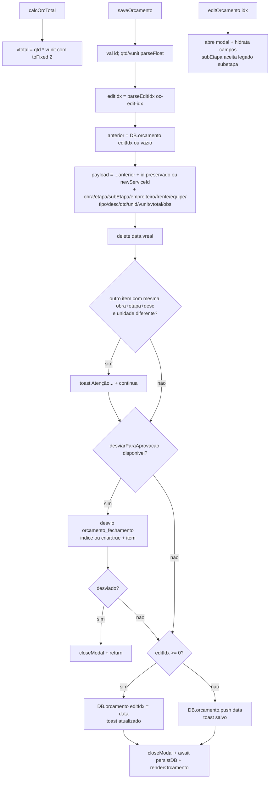
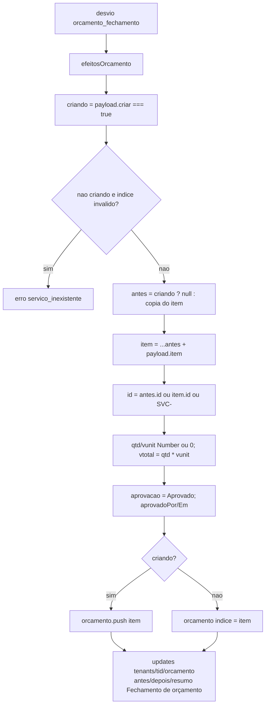
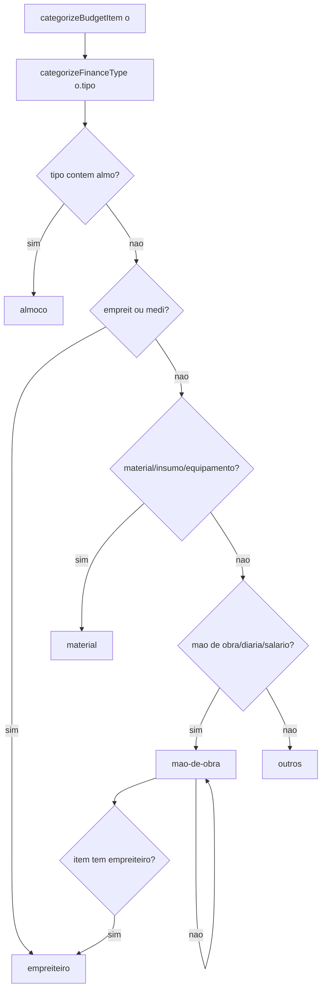
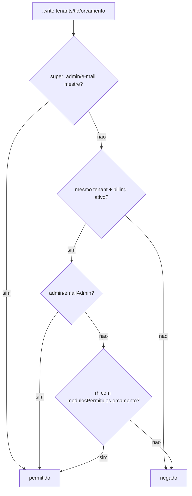

# Fluxograma — Módulo `orcamento`

> 🟢 CONFIRMADO — `public/pages/orcamento.html`, `public/modals/modal-orcamento.html`, `public/js/app_core.js` (render/filtro 3229–3314; medição 3832–3934; save/edit 7408–7489), `public/js/utils.module.js` (categorias 143–163; ID e migração 199–296; board 689–799; compatibilidade 1448–1472), `functions/aprovacoes.js:316-337`, `database.rules.json:123-124`, `tests/budget-fixes.test.js`, `tests/security/rules.test.js`.

## 1. Visão geral — board derivado

```mermaid
flowchart TD
    A[orcamento.html] --> B[+ Novo Serviço -> modal-orcamento]
    A --> C[renderOrcamento / filterOrcamento]
    B --> D[saveOrcamento / editOrcamento]
    D --> E[DB.orcamento via persistDB]
    C --> F[buildOrcamentoBoard DB, obra]
    F --> G[buildMedicaoResumo por obra]
    F --> H[buildFinanceEntries sem filtro]
    G & H --> I[linhas com medido, pago, a pagar, pct]
    I --> J[grupos por etapa|subEtapa + subtotais]
    J --> K[tabela: previsto, medido, pago, a pagar, % exec]
    D -. desvio .-> L[orcamento_fechamento]
    L --> M[efeitosOrcamento no trigger]
    M --> E
```

🟢 Nenhum valor de "medido"/"pago" é gravado no orçamento: tudo é derivado de `DB.medicao`, `DB.financeiro`, `DB.presenca` e `DB.almocos`. 🟢 `vreal` é explicitamente removido no save (`app_core.js:7439`).

## 2. Renderização e filtro



🟡 Filtro de obra default é a **primeira obra**, não "Todas", quando há obras cadastradas. 🟢 Busca cobre etapa, subetapa, descrição, empreiteiro, tipo, unidade e nome da obra (`app_core.js:3258-3260`).

## 3. Cadastro e edição (`saveOrcamento`)



🟢 `parseEditIdx` (`utils.module.js:169-172`) trata `0` como edição — o bug antigo (`parseInt(...) || -1`) duplicava o primeiro item; coberto por `tests/budget-fixes.test.js:160-170,200-206`. 🟢 `id` é preservado na edição para manter medições vinculadas. 🟡 Aviso de unidade divergente usa `escHtml`, mas **não bloqueia** o salvamento (`tests/budget-fixes.test.js:214-237`).

## 4. Aprovação (`orcamento_fechamento`)



🟢 Engenheiro prepara itens novos; o admin aplica somente após decidir (`functions/aprovacoes.js:318`). 🟢 RH/engenheiro/encarregado/mestre não escrevem diretamente em `orcamento` (`tests/security/rules.test.js:315,323`). 🟡 `efeitosOrcamento` **não** recalcula `vreal` nem mexe em medições/pagamentos — apenas substitui o item de orçamento.

## 5. Vínculo serviço ↔ medição

```mermaid
flowchart TD
    A[budgetServiceKey o] --> B{o.id?} -- sim --> C[id como string]
    B -- nao --> D[normalizeServiceKey = obra|etapa|desc sem acentos]
    E[medicaoServiceKey m] --> F{m.serviceId?} -- sim --> G[id]
    F -- nao --> H{m.orcKey?} -- sim --> I[orcKey]
    H -- nao --> J[normalizeServiceKey obra|etapa|servico]
    K[migrateServiceIds db] --> L[garante id unico por linha do orcamento]
    L --> M[indices por chave legada]
    M --> N[medicao com serviceId valido?] -- sim --> O[preserva e migra orcKey]
    N -- nao --> P{candidatos por chave legada}
    P -- 1 --> Q[vincula ao unico]
    P -- varios --> R[score: subEtapa 4, frente 3, equipe/empreiteiro 2]
    R --> S[escolhe maior; marca serviceIdReview se<br/>score 0 ou empate]
    P -- 0 --> T[remove serviceId se invalido; mantem avulso]
    U[confirmMedicaoVinculo] --> V[remove serviceIdReview da escolhida<br/>persistDB + renderMedicao + toast]
```

🟢 `tests/budget-fixes.test.js:139-158`: mesmo serviço em duas casas com empreiteiros distintos é ligado pela equipe, sem revisão; sem equipe, liga ao primeiro e marca `serviceIdReview = true`. 🟢 A chave textual antiga é preservada em `orcKey` para rastreabilidade (`utils.module.js:219`).

## 6. Classificação de categorias



🟢 Serviço "Mão de obra" **com** empreiteiro conta como `empreiteiro` no previsto, alinhando com a medição que gera o realizado — `tests/budget-fixes.test.js:42-62,68-93`. 🟢 Material/equipamento não mudam de categoria.

## 7. Aggregação do board (`buildOrcamentoBoard`)

```mermaid
flowchart TD
    A[budget = orcamento filtrado por obra, com _idx] --> B[obras = unicas ou só a selecionada]
    B --> C[buildMedicaoResumo por obra -> medidoPorChave]
    C --> D[buildFinanceEntries fin/pres/med/alm sem filtro]
    D --> E{cada entrada tem serviceId?}
    E -- sim --> F[pagoPorServico += jaPago; aPagarPorServico += pendente]
    E -- nao --> G{tem etapa?} -- sim --> H[outrosPorEtapa += pago/aPagar]
    F & H --> I[linhas: medidoQtd/Valor, saldo, pct,<br/>pago, aPagar, diferenca, key]
    I --> J[gruposMap por etapa|subEtapa com subtotais]
    J --> K[grupos ordenados por etapa/subEtapa]
    K --> L{custo sem vinculo ja contabilizado<br/>ou grupo filho com raiz?} -- sim --> M[nao repete]
    L -- nao --> N[atribui semVinculo ao grupo raiz<br/>e soma ao subtotal]
    N --> O[totais = soma dos subtotais]
```

🟢 `pct = medidoQtd / qtd * 100` (ou `null` se `qtd <= 0`); `saldo = qtd - medidoQtd`; `diferenca = vtotal - medidoValor`. 🟢 Custos sem serviço vinculado aparecem **uma única vez** na etapa, preferindo o grupo raiz (`utils.module.js:779-791`).

## 8. Autorização nas rules



🟢 `encarregado`, `mestre` e `engenheiro` não escrevem diretamente em `orcamento` — preparam `orcamento_fechamento` (`database.rules.json:139-144`, `aprovacoes_ui.js:18,29`, `aprovacoes-api.js:15,27`, `tests/security/rules.test.js:315,323`).
