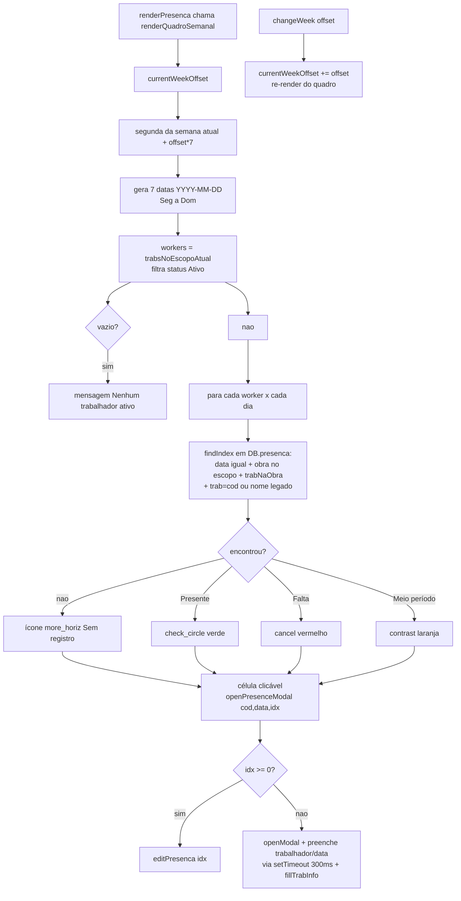
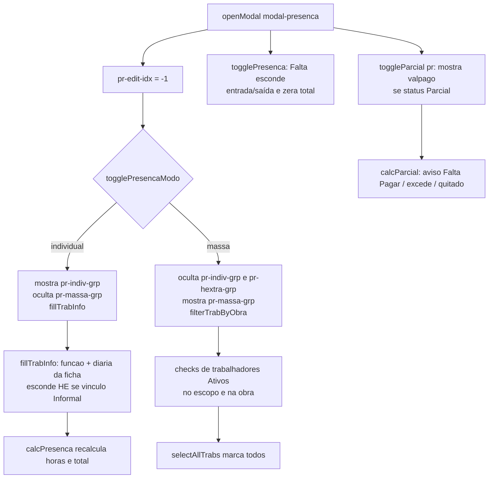
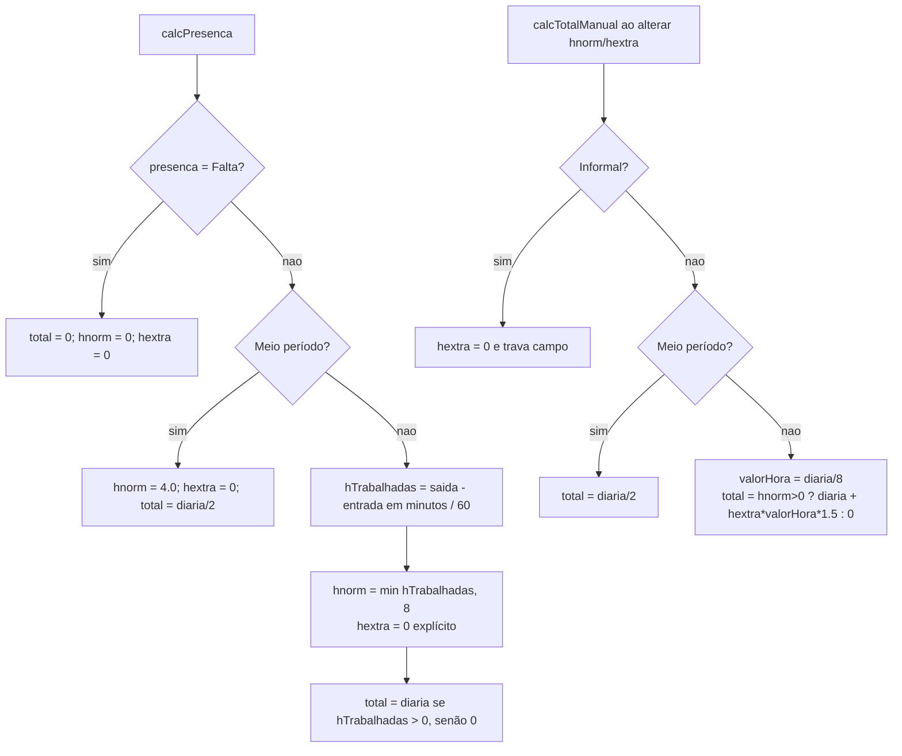
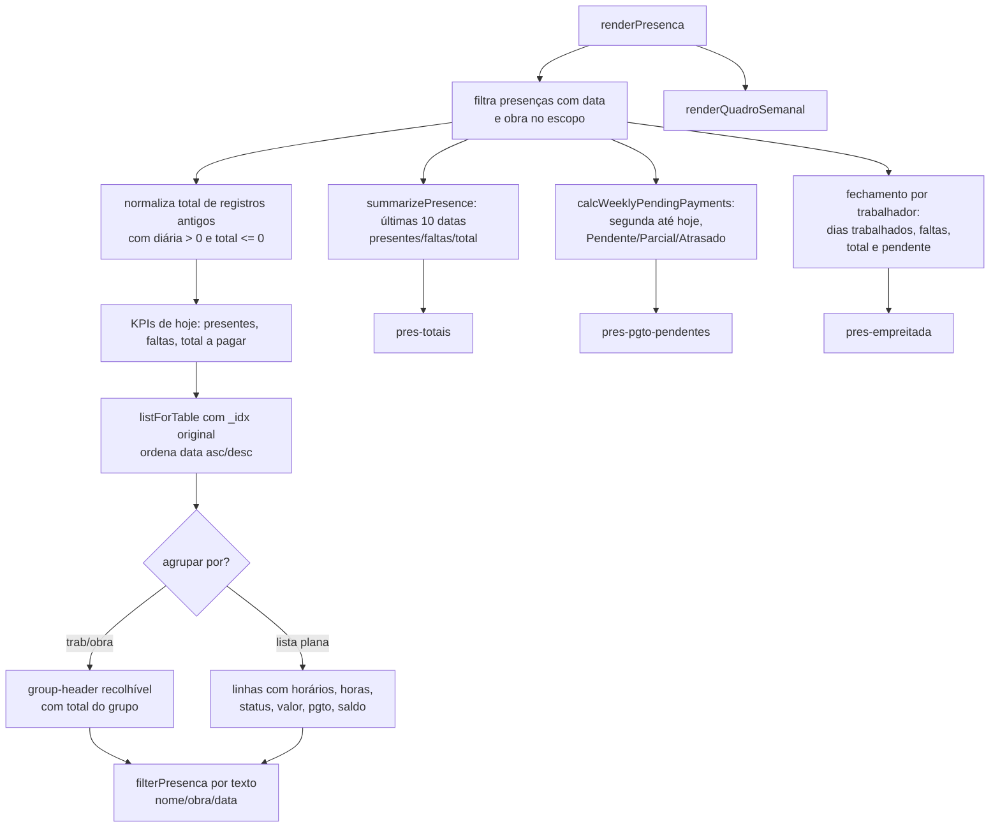
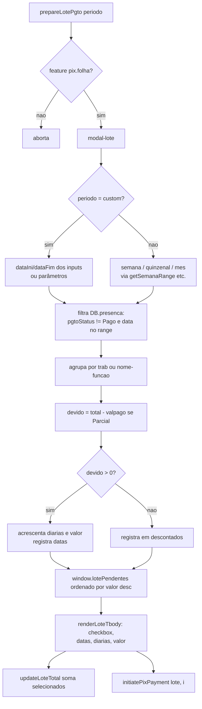
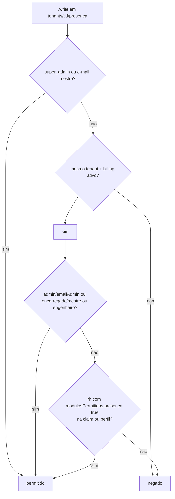

# Fluxograma — Módulo `presenca-e-ponto`

> 🟢 CONFIRMADO — `public/pages/presenca.html`, `public/modals/modal-presenca.html`, `public/js/app_core.js`, `public/js/utils.module.js`, `database.rules.json`, `tests/helpers.test.js`, `tests/dashboard.test.js`, `tests/budget-fixes.test.js`, `tests/report.test.js`, `tests/escopo-obras-paginas.test.js`, `tests/rh-customizavel.test.js`, `tests/security/rules.test.js`.

## 1. Quadro semanal



## 2. Modal: individual × massa



`filterTrabByObra` usa `trabsNoEscopoAtual` + `trabNaObra(t, obraSelecionada)` e limpa `pr-diaria`/`pr-funcao` quando não há trabalhadores na obra.

## 3. Cálculo de horas e valor



🟡 `calcPresenca` ignora a diária proporcional a menos de 8h (usa a diária cheia); `calcTotalManual` usa `diária/8` para hora extra, enquanto `getPresencaCusto` em `utils.module.js` usa `diária/hnorm` — critérios diferentes.

## 4. Salvamento (individual e em massa)

```mermaid
flowchart TD
    A[savePresenca keepOpen] --> B{modo massa?}
    B -- sim --> C[checks .pr-massa-check:checked<br/>exige ao menos 1]
    B -- nao --> D[pr-trab<br/>exige trabalhador]
    C & D --> E{data e obra preenchidas?} -- nao --> F[toast erro]
    E --> G{obra no escopo?} -- nao --> F
    G --> sim --> H[para cada trabalhador]
    H --> I{já existe registro na data?<br/>trab=cod ou nome legado}
    I -- sim --> J[toast Já existe registro<br/>massa: continua; individual: return]
    I -- nao --> K{trabalhador não atua na obra?}
    K -- sim --> L[anexa código ao campo obras<br/>comparação exata]
    K -- nao --> M[monta registro]
    L --> M
    M --> N[valor: Falta=0; Meio=diaria/2;<br/>Informal=diaria; senão pr-total<br/>ou diária do cadastro]
    N --> O{editIdx >= 0 e não massa?} -- sim --> P[DB.presenca[editIdx] = data]
    O -- nao --> Q[DB.presenca.push data]
    P & Q --> R{keepOpen?}
    R -- sim --> S[limpa campos, pr-edit-idx=-1,<br/>togglePresenca mantém modal]
    R -- nao --> T[closeModal]
    S & T --> U[await persistDB]
    U --> V{erro?} -- sim --> W[toast Salvo localmente, falhou na nuvem]
    U -- nao --> X[toast Presença registrada/atualizada<br/>ou Falta Pagar se Parcial]
    W & X --> Y[renderPresenca + renderFinanceiro + renderDashboard]
```

## 5. Listagem, KPIs e fechamentos



`groupMode` vem de `#pres-group-select` (`trab`, `obra` ou vazio); `sortVal` de `#pres-sort-select` (`data_desc`/`data_asc`).

## 6. Fechamento em lote e PIX



## 7. Autorização nas rules



Registro de ponto é escrita direita permitida a admin, encarregado/mestre e engenheiro (`tests/security/rules.test.js`); ao contrário de trabalhadores, **não** passa por aprovação.
