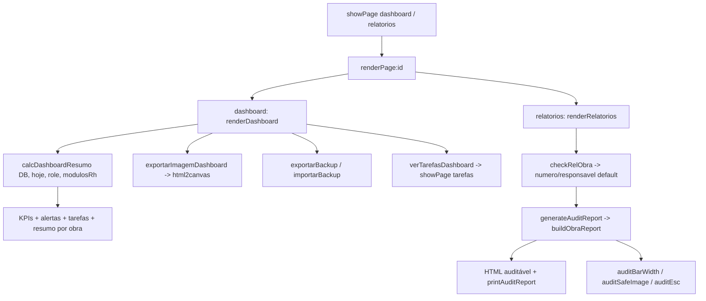
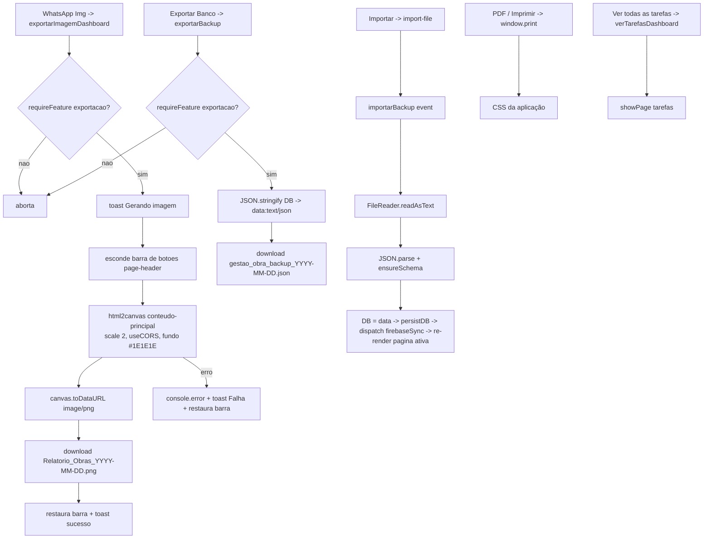
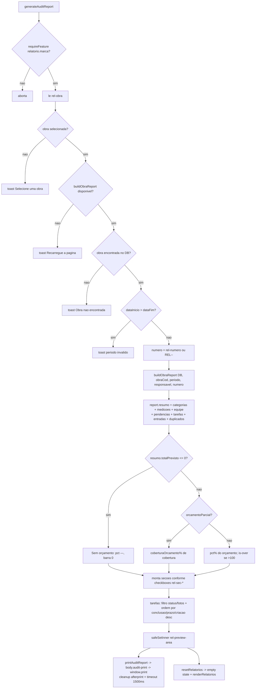
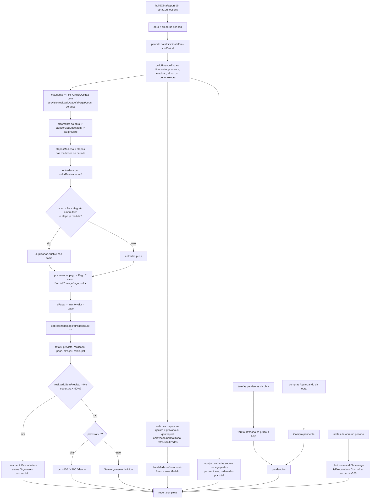
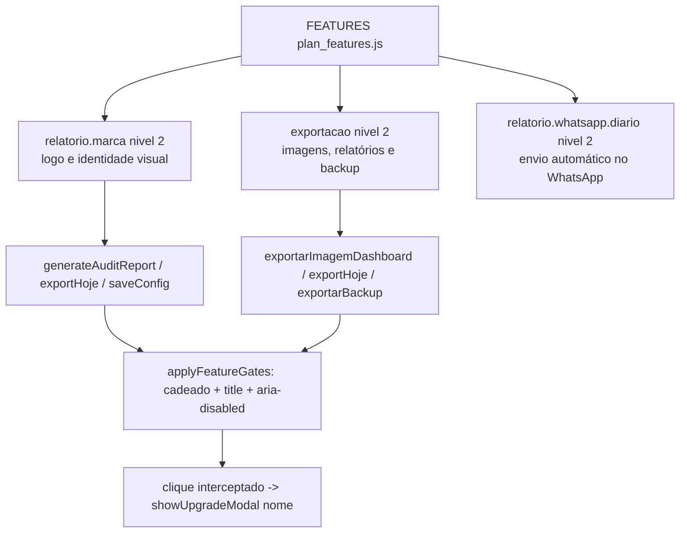

# Fluxograma — Módulo `relatorios-e-dashboard`

> 🟢 CONFIRMADO — `public/pages/dashboard.html`, `public/pages/relatorios.html`, `public/js/app_core.js` (`renderDashboard` 100–218; `applyFeatureGates`/`showUpgradeModal` 294–331; `renderPage` 430–447; `exportHoje` 694–735; `verTarefasDashboard` 2094–2097; `exportarImagemDashboard` 3203–3226; relatórios 3316–3809), `public/js/utils.module.js` (`hojeLocal` 942; `calcCustoObra` 954–980; `calcTarefasResumo` 987–1012; `calcAlertas` 1021–1068; `calcDashboardResumo` 1074–1111; `buildObraReport` 1126–1327; `auditSafeImage` 1330–1334; exports 1412–1416), `public/js/plan_features.js:25-54`, `public/js/data_core.js:1018-1047`, `tests/dashboard.test.js`, `tests/report.test.js`, `tests/tarefas-dashboard.test.js`.

## 1. Visão geral



🟢 Dashboard e Relatórios compartilham a **mesma fonte de custo** (`buildFinanceEntries`) via `calcCustoObra` e `buildObraReport`; apenas a apresentação muda. 🟢 Ambos os módulos são somente leitura: não gravam entidades novas — a única mutação é `DB` substituído por `importarBackup`.

## 2. Renderização do dashboard

```mermaid
flowchart TD
    A[renderDashboard] --> B[le role de gestaoUser no sessionStorage<br/>alias mestre -> encarregado]
    B --> C[le modulosPermitidos do RH]
    C --> D[podeModulo modulo = role != rh || modulos[modulo] === true]
    D --> E[calcDashboardResumo DB, null, role, modulosRh]
    E --> F[kpis, linhas, alertas, tarefas]
    F --> G[dash-actions: Lançar Presença / Nova Tarefa / Nova Compra<br/>filtradas por papel e modulo]
    G --> H[KPIs: Presentes, Faltas, Obras Ativas,<br/>Diárias Hoje, Tarefas Abertas, Tarefas Atrasadas]
    F --> I[alertas: TAREFA* primeiro, demais depois<br/>.slice 0,8 + '+ N alertas']
    F --> J[painel dash-tarefas-grid: primeiras 5<br/>com concluirTarefaRapida idx]
    F --> K[resumo por obra]
    K --> L{dash-show-done marcado?}
    L -- nao --> M[filtra status !== Concluída]
    L -- sim --> N[mostra todas]
    M & N --> O[por linha: pctCusto null -> —<br/>verde <80, laranja 80-100, vermelho >100]
    O --> P{mestre vazio e papel permite obras?} -- sim --> Q[botão Atribuir -> editObra idx]
    O --> R{tarefasTotal > 0?} -- sim --> S[link verTarefasDaObra cod + barra de progresso]
    Q & S --> T[dash-obras-tbody + dash-updated timestamp]
```

🟢 Alertas de tarefa têm slots reservados: custo/compra não empurram tarefas para fora do topo (`app_core.js:143-152`). 🟢 `pctCusto === null` (sem orçamento) exibe `—` com tooltip, não `0%`. 🟢 `Diárias Hoje` vem de `calcCustosDiarias` no fuso local, não de `new Date().toISOString()`. 🟡 `renderDashboard` é declarado com `window.renderDashboard = window.renderDashboard || function () { }` para permitir injeção/override em testes — o corpo real é atribuído nesse mesmo ponto (`app_core.js:100`).

## 3. `calcDashboardResumo` e dependentes

```mermaid
flowchart TD
    A[calcDashboardResumo db, hoje, role, modulos] --> B[hoje = hojeLocal se vazio]
    B --> C[presença de hoje -> presentes/faltas]
    C --> D[obras status Em andamento -> obrasAtivas]
    D --> E[calcCustosDiarias hoje -> diariasHoje]
    E --> F[para cada obra]
    F --> G[calcCustoObra semana / mes / total]
    G --> H[buildFinanceEntries financeiro, presenca,<br/>medicao, almocos + periodo + obra]
    H --> I[soma valorRealizado por source:<br/>pre=maoDeObra, med, fin, alm]
    I --> J[diarias = entradas pre com valor > 0]
    J --> K[pctCusto = total/orc*100 ou null]
    K --> L[tarefasFeitas / tarefasTotal da obra]
    L --> M[calcTarefasResumo db, hoje]
    M --> N[abertas = status != Concluída]
    N --> O[itens: prazo < hoje = atrasada;<br/>prazo = hoje = venceHoje;<br/>ordena por prazo e atrasada]
    O --> P[calcAlertas db, hoje, linhas, role, modulos]
    P --> Q[TAREFA ATRASADA agrupada: alto]
    Q --> R[TAREFA HOJE por tarefa: medio]
    R --> S{role permite custos?<br/>nao encarregado/mestre; RH com financeiro ou orcamento}
    S -- sim --> T[pctCusto >100 alto / >=80 medio]
    T --> U{RH com compras?}
    U -- sim --> V[compras Aguardando -> medio]
    S -- nao --> W[SEM PRESENÇA HOJE para obras ativas<br/>exceto domingo]
    V --> W
    W --> X[OBRA SEM MESTRE: baixo]
    X --> Y[ordena por prioridade alto>medio>baixo]
    Y --> Z[{kpis, linhas, tarefas, alertas, hoje}]
```

🟢 `atrasada` é calculada em leitura: não depende de status gravado manualmente (`utils.module.js:982-1002`, `tests/tarefas-dashboard.test.js:41-67`). 🟢 Tarefas sem prazo contam como abertas, mas não entram em alertas (`utils.module.js:994-1001`). 🟢 Domingo não gera alerta `SEM PRESENÇA HOJE` (`utils.module.js:1057-1063`). 🟡 `calcCustoObra` sem período soma também lançamentos sem data, enquanto com período os ignora (`utils.module.js:947-952`).

## 4. Exportações do dashboard



🟢 `exportarImagemDashboard`, `exportHoje` e `exportarBackup` checam `requireFeature('exportacao')`; `saveConfig` checa `relatorio.marca` (`app_core.js:3204,695,5655`; `data_core.js:1026`). 🟢 `applyFeatureGates` adiciona cadeado a qualquer `[data-feature]` e intercepta clique em fase de captura, abrindo `modal-upgrade` (`app_core.js:294-331`). 🟡 `importarBackup` não checa feature gate nem valida integridade referencial dos dados importados além de `ensureSchema` — pode substituir todo o `DB` do tenant. 🟡 `exportarImagemDashboard` usa `new Date().toISOString().split('T')[0]` para o nome do arquivo (UTC), diferente de `hojeLocal()`.

## 5. Geração do relatório de vistoria



🟢 O filtro de tarefas aceita `concluidas` (padrão) ou `todas`, e opcionalmente só com fotos (`relatorios.html:68-77`, `app_core.js:3511-3517`). 🟢 `rel-numero` é gerado automaticamente por `checkRelObra` e pode ser sobrescrito pelo usuário. 🟢 `generateAuditReport` valida obra, disponibilidade da função e ordem das datas antes de calcular. 🟡 `printAuditReport` usa `setTimeout(cleanup, 1500)` como fallback: impressões mais lentas podem perder a classe `audit-print`.

## 6. `buildObraReport` — consolidação



🟢 Compras **não** entram no custo realizado (evita duplicar com Material) — aparecem só em pendências (`utils.module.js:1124,1270-1277`, `tests/report.test.js`). 🟢 Lançamento manual `Empreiteiro` para etapa já medida é listado em `duplicados` e excluído do total (`utils.module.js:1157-1176`). 🟢 `orcamentoParcial` só é ativado quando a cobertura (`previsto/realizado`) é menor que 50% e existe gasto sem previsão (`utils.module.js:1203-1207`) — evita rotular estouro real como orçamento incompleto. 🟢 `fisico` e `valorMedido` vêm de `buildMedicaoResumo`, reaproveitando a regra do módulo `medicao`. 🟡 `buildObraReport` não aplica filtro de papel: qualquer papel que abra a página vê todos os dados financeiros da obra.

## 7. Segurança de renderização

```mermaid
flowchart TD
    A[auditEsc / escHtml] --> B[& -> &amp;]
    B --> C[< -> &lt; e > -> &gt;]
    C --> D[" -> &quot; e ' -> &#39;]
    E[auditSafeImage / window.auditSafeImage] --> F{/^(https?:\\/\\/|data:image\\/)/i}
    F -- sim --> G[mantém URL]
    F -- nao --> H[retorna string vazia]
    I[auditBarWidth valor, previsto] --> J{previsto > 0?}
    J -- nao --> K[0]
    J -- sim --> L[clamp 0-100 de valor/previsto*100]
    M[safeSetInner rel-preview-area] --> N[HTML higienizado no container]
    O[openLightbox data-photo] --> P[amplia foto aprovada por auditSafeImage]
```

🟢 URLs de imagem só passam quando começam com `http://`, `https://` ou `data:image/` — bloqueia `javascript:` (`app_core.js:3377-3380`, `utils.module.js:1330-1333`). 🟢 Texto de obra, tarefa, equipe e empresa passa por escape antes de `innerHTML`. 🟡 Há duas implementações de `auditSafeImage` (app_core e utils.module) com a mesma regex; divergências futuras podem passar despercebidas.

## 8. Feature gates e planos



🟢 `data-feature="exportacao"` aparece nos botões `WhatsApp (Img)` e `Exportar Banco` do dashboard (`dashboard.html:6,12`). 🟢 `relatorio.marca` controla logo/marca d'água e a própria geração do relatório (`app_core.js:3388`, `:5655`, `:704-706`). 🟡 `relatorio.whatsapp.diario` está cadastrado no plano, mas o gatilho automático pertence ao módulo `whatsapp-bot`.
