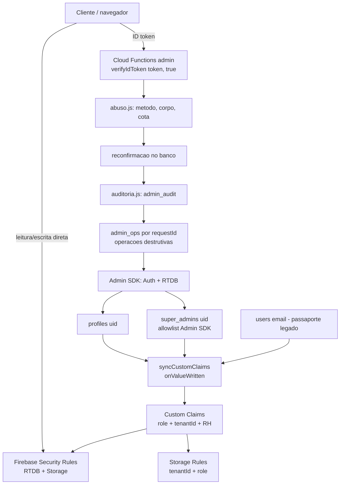
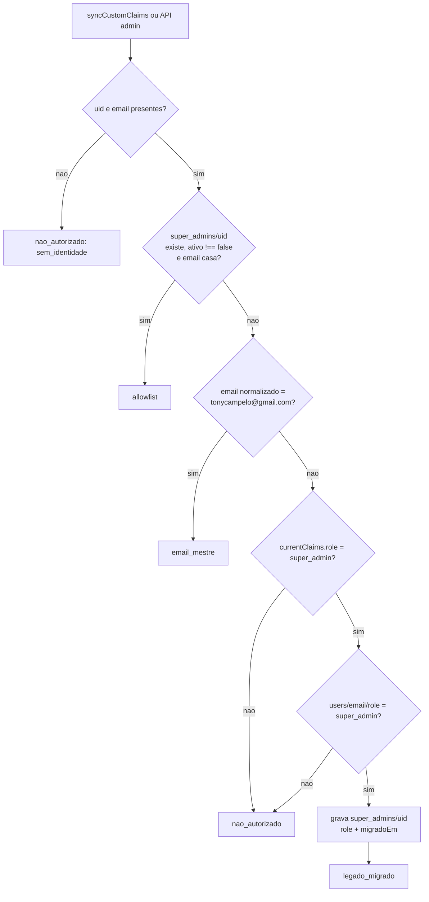
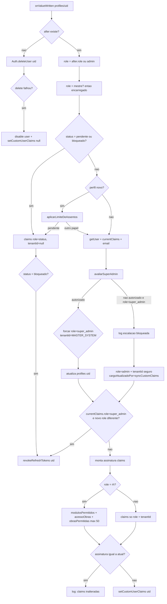
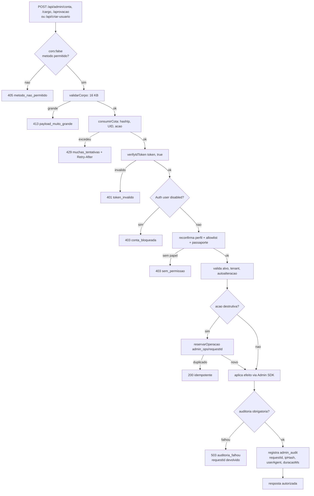
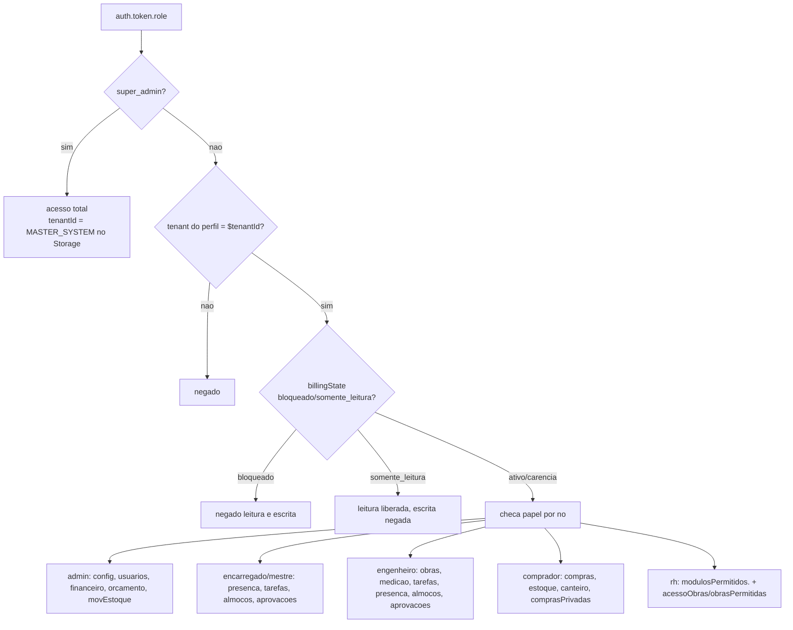
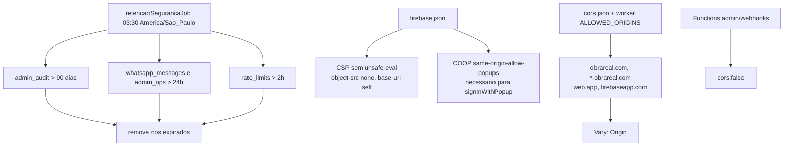

# Fluxograma — Módulo `seguranca-e-rbac`

> 🟢 CONFIRMADO — `functions/claims.js:11-80`, `functions/abuso.js:1-79`, `functions/auditoria.js:1-114`, `functions/super_admin.js:1-...`, `functions/cargos.js:1-411`, `functions/usuarios.js:1-...`, `functions/index.js:680-817,913-...`, `functions/set_super_admin.js:1-56`, `database.rules.json:1-292`, `storage.rules:1-47`, `docs/security/hardening.md`, `docs/security/super-admin.md`, `docs/security/tenant-isolation.md`, `docs/security/cors.md`, `tests/security/*.test.js`, `tests/abuso.test.js`, `tests/auditoria.test.js`.

## 1. Visão geral — quatro camadas de autoridade

🟢 O cliente **nunca** recebe papel por parâmetro: toda autoridade vem de `verifyIdToken(token, true)` + consulta ao perfil/allowlist no servidor (`super_admin.js:46-91`, `cargos.js:50-97`, `usuarios.js:44-61`). 🟢 As rules do RTDB repetem a checagem usando `auth.token` e `root.child('profiles/...')`; as do Storage só podem usar claims (`storage.rules:4-6`). 🟢 Revogação de token é obrigatória porque as Storage Rules não consultam o RTDB (`tenant-isolation.md:39-41`).

## 2. `avaliarSuperAdmin` — fonte canônica e migração segura

🟢 A ordem de confiança é allowlist → e-mail mestre → migração legada (`claims.js:26-72`). 🟢 `users/<email>/role` **nunca promove**: só preserva uma conta que já tinha a claim `super_admin` (`claims.js:7-9,52-68`). 🟢 `chaveEmail` transforma `.` em `,` para casar com as chaves do RTDB (`claims.js:17-19`). 🟢 `normalizarRole` converte o alias legado `mestre` em `encarregado` (`claims.js:21-24`). 🟡 `EMAIL_MESTRA` é exceção histórica espelhada nas rules (`database.rules.json:4-5`).

## 3. `syncCustomClaims` — sincronização e contenção de escalação

🟢 A trava de assentos só vale para perfis **novos**, para não punir usuários legados (`index.js:716-720`). 🟢 Tentativa de escalação via `profiles/<uid>/role='super_admin'` é corrigida no próprio perfil, porque as rules também leem esse nó (`index.js:741-753`). 🟢 `setCustomUserClaims` substitui o objeto inteiro; para não-RH as chaves de módulo/obra não existem e equivalem a `null` nas rules (`index.js:807-809`). 🟢 RH carrega em claims `modulosPermitidos` (apenas `true`), `acessoObras` (`especificas`/`todas`) e até 50 `obrasPermitidas` (`index.js:788-806`). 🟡 Erro no `getUser` é engolido e a trigger retorna `null`, sem retry explícito (`index.js:813-816`).

## 4. APIs administrativas — defesa em profundidade

🟢 Cota e tamanho são checados **antes** de Auth/DB (`hardening.md:55`, `usuarios.js:71-95`). 🟢 `hashIp` usa SHA-256 com salt `obrareal:cargo:` e devolve 32 hex — nenhum IP em claro no RTDB (`abuso.js:32-41`). 🟢 `consumirCota` usa transação em `rate_limits/<chave>/<bucket>/n`, grava `expiraEm` e responde `429 muchas_tentativas` com `retryAfter` (`abuso.js:43-77`). 🟢 Ações destrutivas: `excluir_usuario`, `bloquear_tenant`, `bloquear_usuario`, `remover_usuario`, `definir_plano`, `definir_cargo` (`auditoria.js:15-18`). 🟢 Fail-closed: falha de auditoria obrigatória aborta com `503 auditoria_falhou`; se o efeito foi aplicado e a auditoria falhou, reentrega com mesmo `requestId` retorna `200 {idempotente:true}` (`hardening.md:89-92`). 🟢 Links de reset de senha não entram em `admin_audit` (`super_admin.js:153`).

## 5. Matriz de acesso efetiva (RTDB + Storage)

🟢 `profiles`, `users`, `invites` e `super_admins` usam autoridade mista: claim/perfil/allowlist/e-mail mestre; `role`, `tenantId`, `status` são imutáveis para o cliente depois da criação (`database.rules.json:3-28,241-284`). 🟢 `profiles/$uid` só pode ser criado pelo próprio `auth.uid`, com `email` do token e `status='ativo'` (`database.rules.json:12`). 🟢 `telefone`, `whatsappId` e `config.telefonesPermitidos` exigem super_admin ou allowlist (`database.rules.json:74-76,261-266`). 🟢 `admin_audit`, `admin_ops`, `rate_limits`, `whatsapp_messages`, `billing_events`, `webhook_debug` e `super_admins` têm `.write:false`; leitura restrita a super_admin (`database.rules.json:203-240`). 🟢 `auditoria`, `notificacoes`, `tarefas_pendentes` e `comprasPrivadas` exigem `profiles/<uid>/tenantId === $tenantId` (`database.rules.json:172-201,285-289`). 🟢 Storage exige `token.tenantId == tenantId` e papel em `admin/rh/engenheiro/encarregado/mestre/comprador`; super_admin exige também `tenantId='MASTER_SYSTEM'`; arquivos de 1 byte a 10 MB, `image/*` ou PDF; caminhos fora de `tenants/<tid>/` negados (`storage.rules:7-45`). 🟡 `mestre` permanece aceito nas rules de Storage e RTDB como alias legado do papel canônico `encarregado` (`storage.rules:14`; `database.rules.json:79-82`).

## 6. Retenção e CORS/CSP

🟢 Retenção: 90 dias de auditoria, 24 h de dedup/reservas, 2 h de janelas de cota (`hardening.md:96-97`). 🟢 CSP mantém `'unsafe-inline'` temporariamente por handlers inline; `img-src` restrito a domínios explícitos (`hardening.md:103-106`). 🟢 COOP `same-origin-allow-popups` é obrigatório para o popup do Firebase Auth (`cors.md:47-49`). 🟢 Webhooks e APIs administrativas usam `cors:false` (`cors.md:41-45`). 🟡 `cors.json` e `ALLOWED_ORIGINS` do worker precisam ser atualizados em conjunto (`cors.md:17`).

## 7. Testes e lacunas

🟢 Cobertura: `tests/security/rules.test.js` (asserções estáticas das rules), `privilege-escalation.test.js`, `tenant-isolation.test.js`, `cors.test.js`, `billing.test.js`, `landing.test.js`, `auth-slug-regressions.test.js`, `tests/abuso.test.js`, `tests/auditoria.test.js`, `tests/super-admin.test.js` (`hardening.md:166-179`, `super-admin.md:192-199`). 🟢 `npm audit` com 0 vulnerabilidades na raiz e em `functions/`; Admin SDK 14 / Functions 7 com imports modulares (`hardening.md:113-121`). 🟡 O emulador de rules falha por configuração de projeto, então as asserções estáticas são substituto temporário (`hardening.md:176-179`). 🔴 Histórico Git antigo ainda contém `node_modules` e a chave Web pública; reescrita dos 423 commits não foi feita (`hardening.md:136-139`). 🟡 `'unsafe-inline'` na CSP continua enquanto existirem handlers inline no frontend. 🟡 `verifyIdToken(token, true)` depende de revogação explícita — tokens já emitidos antes de uma mudança de cargo só deixam de valer se `revokeRefreshTokens` for chamado (`tenant-isolation.md:39-41`).

**Próximo módulo:** [`infra-e-deploy.md`](infra-e-deploy.md)
