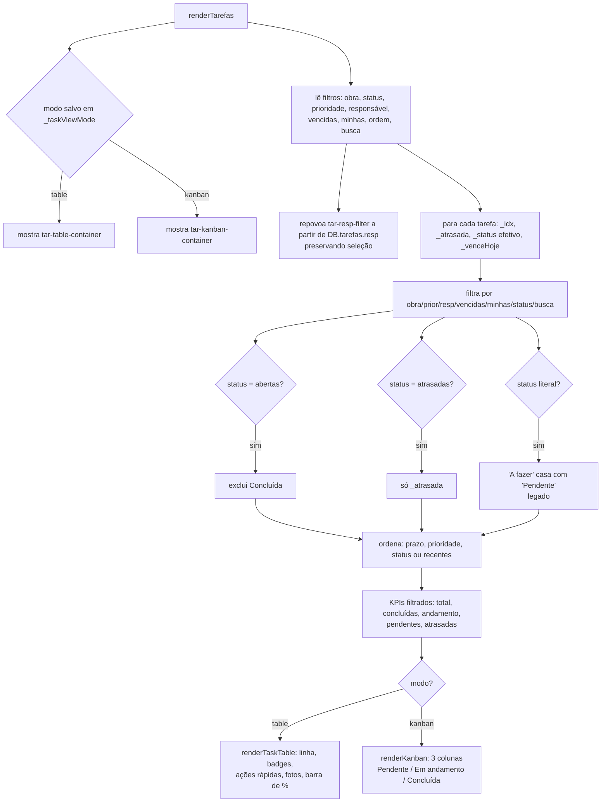
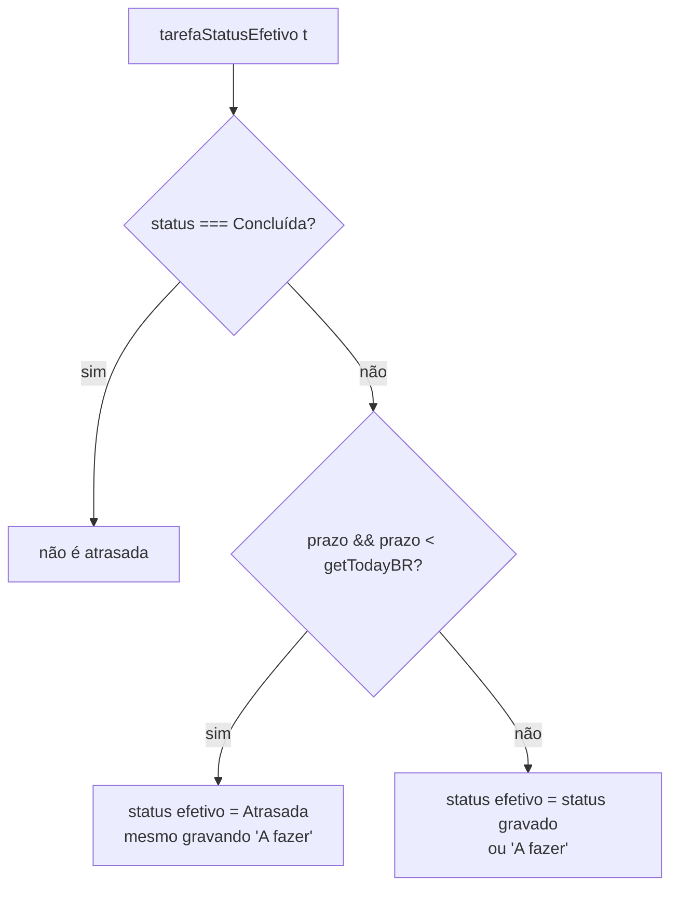
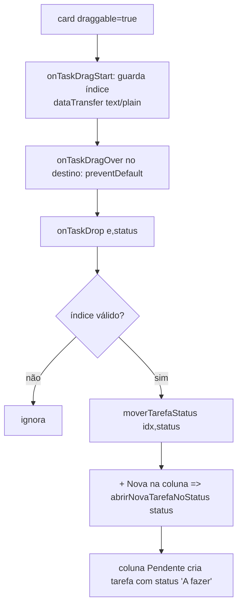
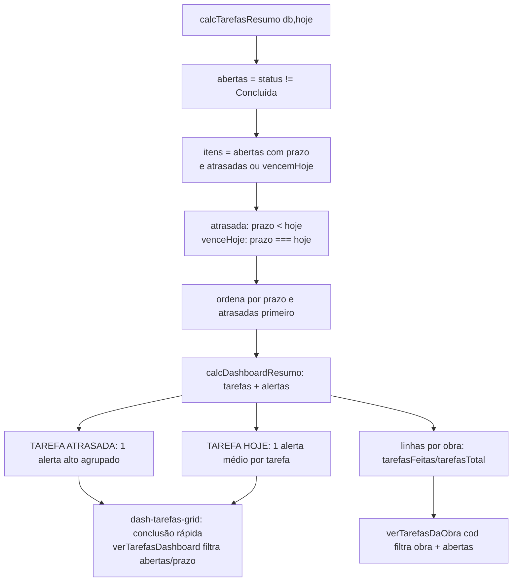
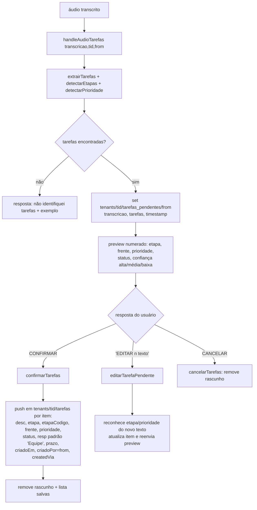
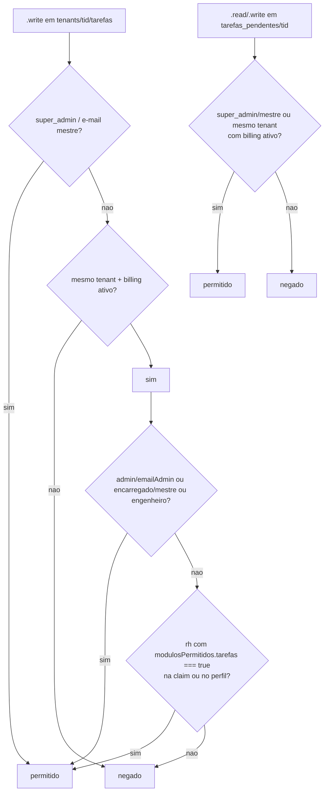

# Fluxograma — Módulo `tarefas`

> 🟢 CONFIRMADO — `public/pages/tarefas.html`, `public/modals/modal-tarefa.html`, `public/js/app_core.js`, `public/js/data_core.js`, `public/js/utils.module.js`, `functions/whatsapp/parser-tarefas.js`, `database.rules.json`, `tests/tarefas-dashboard.test.js`, `tests/tarefas-fotos.test.js`, `tests/security/rules.test.js`, `tests/security/tenant-isolation.test.js`.

## 1. Cadastro e edição

```mermaid
flowchart TD
    A[obras/dashboard: + Nova Tarefa] --> B[openModal modal-tarefa]
    B --> C[tf-cod = nextCod DB.tarefas 'TF'<br/>campo somente leitura]
    C --> D[prepararSelectsDeObra: obras no escopo<br/>se única obra, select travado]
    D --> E[preenche: obra, etapa, frente, desc, resp,<br/>prior, status, criacao, prazo, conclusao, perc, obs]
    E --> F[saveTarefa]
    F --> G{editIdx >= 0?}
    G -- não --> H[DB.tarefas.push data]
    G -- sim --> I[DB.tarefas[editIdx] = data]
    H & I --> J[closeModal + persistDB + renderTarefas]
    J --> K[persistDB: update multi-path<br/>mergeScopedDb se usuário restrito]
    K --> L[renderDashboard se painel de tarefas visível]
```

`editTarefa(idx)` abre o mesmo modal, grava `#tf-edit-idx`, restaura os campos e repovoa `window._tarefaPhotos` com `taskPhotoList(t)`.

## 2. Renderização, filtros e KPIs



Busca usa `onTaskSearch()` com debounce de **220 ms**; `limparFiltrosTarefas()` zera selects, checks e busca.

### Status efetivo



`getTodayBR()` usa `America/Sao_Paulo` (YYYY-MM-DD). Aliases legados: `Pendente` ≡ `A fazer`; `mestre` ≡ `encarregado` na sessão.

## 3. Ações rápidas e desfazer

```mermaid
flowchart TD
    A[concluir / reabrir / iniciar / mover] --> B[snapshotTarefas:<br/>cópia profunda de DB.tarefas]
    B --> C{qual ação?}
    C -- toggleTarefaConcluida --> D{status === Concluída?}
    D -- sim --> D1[status='A fazer', conclusao='', perc=0]
    D -- não --> D2[status='Concluída', conclusao=getTodayBR(), perc=100]
    C -- iniciarTarefa --> E{status em Em andamento/Concluída/Pausada?}
    E -- não --> E1[status='Em andamento'; perc min=10]
    C -- moverTarefaStatus --> F{status efetivo já é o destino?}
    F -- sim --> F1[ignora]
    F -- não --> F2[grava status; Concluída=>perc 100<br/>senão limpa conclusao]
    F2 --> F3[se perc anterior >=100 e novo status != Concluída => 90]
    F3 --> F4[Em andamento com perc<10 => 10]
    D1 & D2 & E1 & F4 --> G[persistDB + renderTarefas<br/>renderDashboard se presente]
    G --> H[toastComDesfazer: botão 'Desfazer' por 6s]
    H --> I{desfazerAcao?}
    I -- sim --> J[DB.tarefas = snapshot + persistDB + re-render]
```

`concluirTarefaRapida` é um atalho para `toggleTarefaConcluida` quando ainda não está concluída. `opts.semSnapshot`/`opts.semToast` permitem reutilizar o movimento sem gerar novo snapshot/toast.

## 4. Kanban (drag & drop)



Colunas usam o status **efetivo**: `A fazer`/`Pendente`/`Atrasada`/`Pausada` caem em `Pendente`.

## 5. Fotos/evidências

```mermaid
flowchart TD
    A[tf-file: image/* multiple] --> B[handleTarefaPhotos]
    B --> C{-vagas = 6 - fotos atuais}
    C --> D[limita seleção a vagas<br/>toast se excedeu]
    D --> E[optimizeImageFile maxDim=1280 quality=0.75]
    E --> F{uploadEvidenceFile}
    F -- Storage ok --> G[URL em tenants/tid/evidencias/arquivo]
    F -- Storage falha --> H{optimize gerou dataUrl?}
    H -- sim --> G
    H -- não --> H1[toast de erro e aborta lote]
    G --> I[window._tarefaPhotos.push url + re-render preview]
    I --> J[saveTarefa grava photos[] e photoUrl=photos[0]<br/>para leitores legados]
    J --> K[taskPhotoList normaliza photos/photoUrl/foto<br/>aceita http(s) ou data:image]
    K --> L[taskPhotoCaption: desc ou 'Tarefa'<br/>'desc · Foto n/N' se >1]
    L --> M[openTarefaFotos: galeria compartilhada<br/>com medições + setas do teclado]
```

Limite: `MAX_TAREFA_FOTOS = 6`. Na impressão de relatórios, a seção pode quebrar entre páginas, mas cada card de tarefa é mantido inteiro.

## 6. Resumo para dashboard



## 7. WhatsApp — rascunho de tarefas por áudio



🔴 Fato: `functions/whatsapp/parser-tarefas.js` está implementado, mas não há chamador em `functions/`. 🟢 Decisão P2: ativar o fluxo de prévia/confirmação no webhook.

## 8. Autorização nas rules


