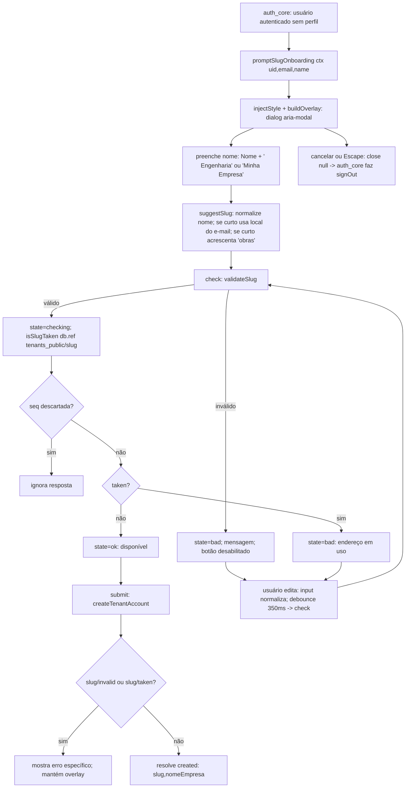
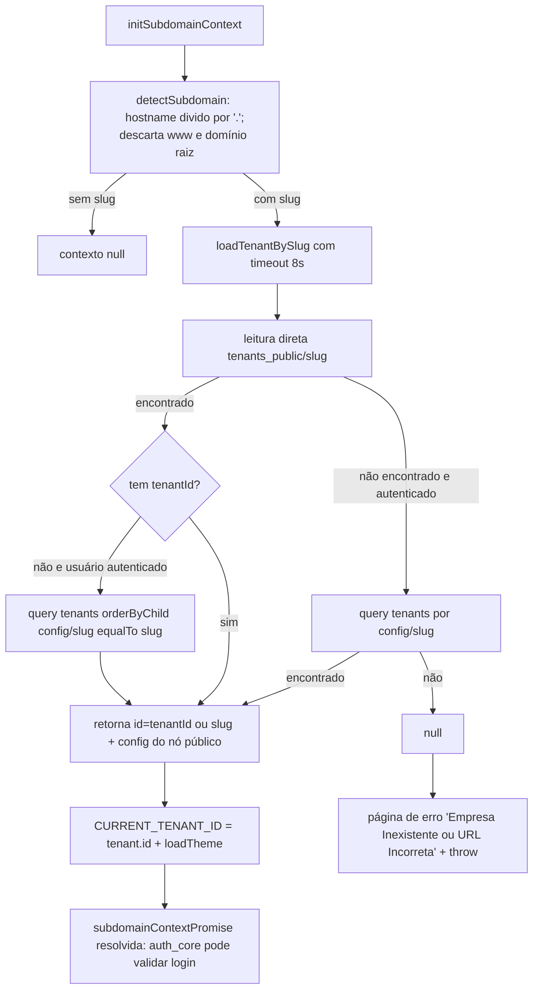
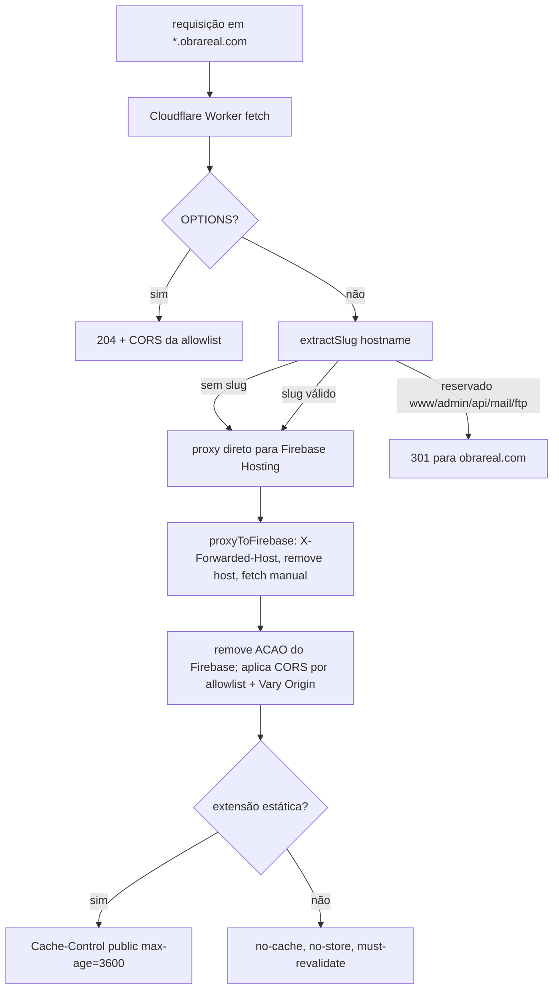

# Fluxograma — Módulo `tenants-e-slug`

> 🟢 CONFIRMADO — `public/js/slug.js`, `public/js/slug_onboarding.js`, `public/js/data_core.js`, `cloudflare-worker/worker.js`, `database.rules.json`, `functions/index.js`.

## 1. Onboarding: escolha do endereço (`promptSlugOnboarding`)



## 2. Criação atômica da conta (`ObraSlug.createTenantAccount`)

```mermaid
flowchart TD
    A[createTenantAccount db,params] --> B[validateSlug]
    B -- inválido --> C[throw slug/invalid]
    B -- ok --> D[buildAccountUpdates]
    D --> D1[tenants/slug: nomeEmpresa, slug, subdominioSlug, emailAdmin, status ativo,<br/>plano free_trial, trialExpiracao now+30d, origem self_signup, criadoPorUid,<br/>config: esquemaCores emerald, limiteObras 1, limiteUsuarios 1, limiteTrabalhadores 9999]
    D --> D2[tenants_public/slug: slug, tenantId=slug, nomeEmpresa, esquemaCores]
    D --> D3[users/email com .=>,: uid,email,tenantId=slug,role admin,nome,origem self_signup]
    D1 & D2 & D3 --> E[db.ref().update updates — único update multi-path]
    E -- sucesso --> F[retorna slug e nomeEmpresa]
    E -- PERMISSION_DENIED --> G[isSlugTaken: leitura direta tenants_public/slug]
    G -- existe --> H[throw slug/taken: perdeu corrida]
    G -- não existe --> I[repassa erro original]
```

## 3. Resolução do tenant pelo subdomínio





## 4. Troca de subdomínio (`updateSubdomainSlug`, Pro+)

```mermaid
flowchart TD
    A[updateSubdomainSlug] --> B{hasFeature subdominio?}
    B -- não --> C[modal de upgrade / alerta Pro+]
    B -- sim --> D[newSlug = minúsculas, a-z0-9-, >=3]
    D --> E[oldSlug = DB.subdominioSlug || DB.config.slug || tenantId]
    E --> F[leitura tenants_public/newSlug]
    F --> G{pertence a outro tenant?}
    G -- sim --> H[alerta: em uso]
    G -- não --> I[updates: tenants/id/subdominioSlug e config/slug]
    I --> J{nó antigo pertence a este tenant?}
    J -- sim --> J1[updates tenants_public/oldSlug = null]
    J -- não --> K[checa chave legada tenants_public/tenantId sem tenantId e remove]
    J1 & K --> L[updates tenants_public/newSlug com slug,tenantId,nomeEmpresa,esquemaCores,logoUrl]
    L --> M[db.ref().update multi-path]
    M --> N[toast sucesso]
    M --> O[backend enforceSubdomainPlan reverte se plano não permite]
```
