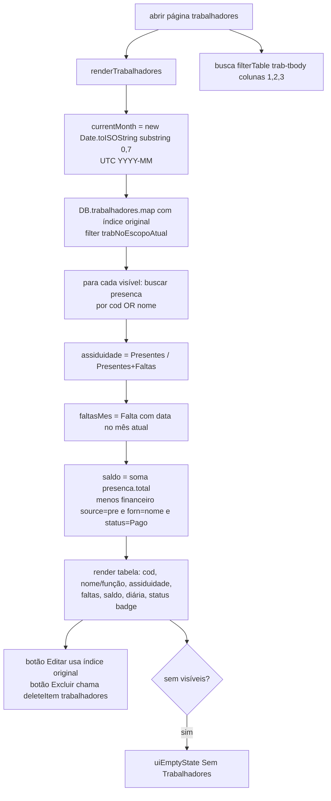
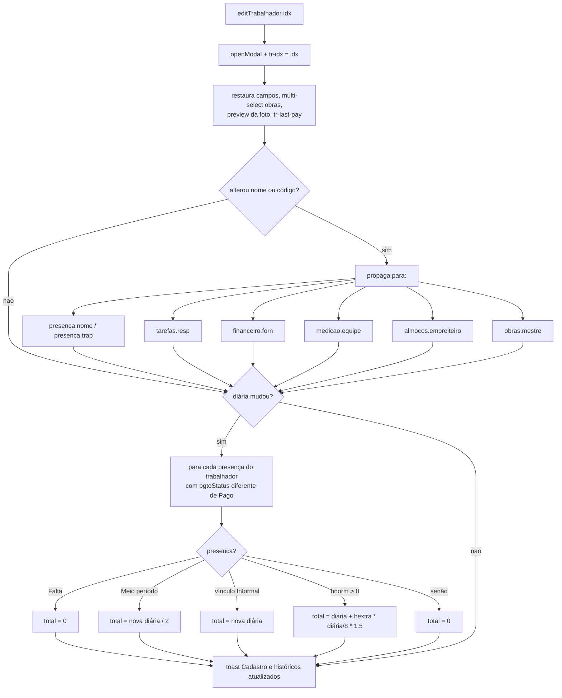
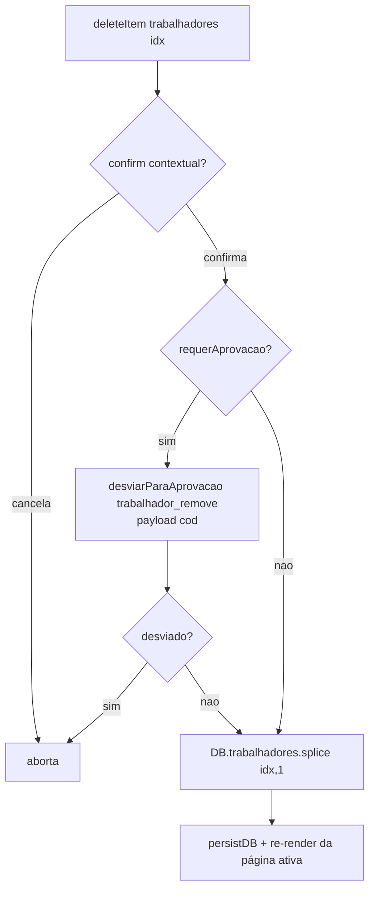
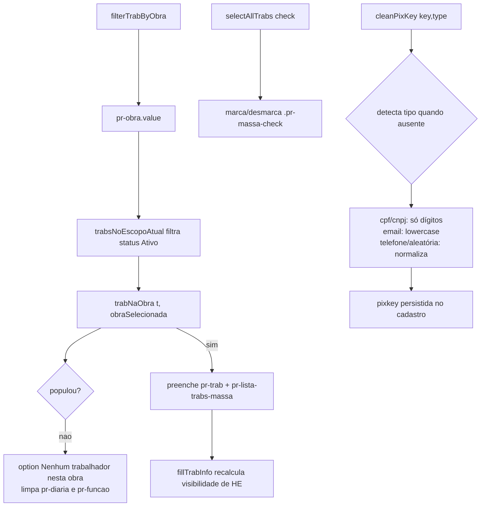
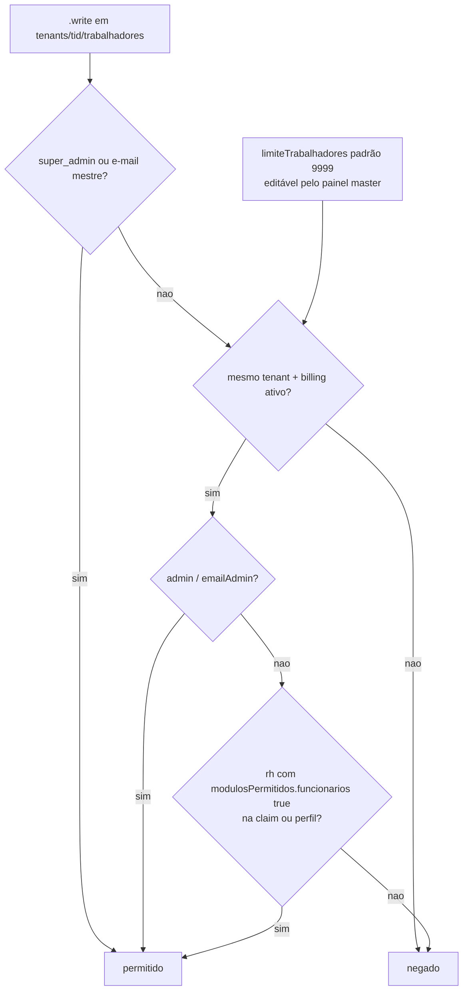

# Fluxograma — Módulo `trabalhadores`

> 🟢 CONFIRMADO — `public/pages/trabalhadores.html`, `public/modals/modal-trabalhador.html`, `public/js/app_core.js`, `public/js/utils.module.js`, `public/js/pix_logic.js`, `public/js/data_core.js`, `database.rules.json`, `tests/aprovacoes-ui.test.js`, `tests/aprovacoes-api.test.js`, `tests/obra-select-modal.test.js`, `tests/rh-customizavel.test.js`, `tests/escopo-obras-paginas.test.js`, `tests/security/rules.test.js`.

## 1. Listagem e indicadores



🟡 O mês é calculado em UTC (`toISOString()`), não em `America/Sao_Paulo` como `getTodayBR()`.

## 2. Escopo por obra

```mermaid
flowchart TD
    A[trabNoEscopoAtual t] --> B[escopoObrasDaSessao]
    B --> C{window.trabNoEscopo existe?} -- nao --> D[true — sem restrição]
    C -- sim --> E{permitidas é array?} -- nao --> D
    E -- sim --> F{permitidas vazio?} -- sim --> G[false — falha fechada]
    F -- nao --> H[parseObrasTrabalhador t]
    H --> I{obras vazias?} -- sim --> J[true — legado sem restrição]
    H -- nao --> K[alguma obra em permitidas?] -- sim --> L[true]
    K -- nao --> M[false]
    N[parseObrasTrabalhador] --> O{raw é array?} -- sim --> P[map String + trim + remove vazios]
    O -- nao --> Q[split /[,;]/ + trim + remove vazios]
    Q --> R[comparação exata: OB1 não casa com OB10]
```

`trabsNoEscopoAtual(lista)` é a versão em lote; `trabNaObra(t, cod)` é usada no formulário de presença e considera trabalhador sem obra como irrestrito.

## 3. Modal e vínculo com obras

```mermaid
flowchart TD
    A[openModal modal-trabalhador] --> B[tr-idx = -1 via reset de modal]
    A --> C[prepararSelectsDeObra]
    C --> D[obras visíveis = DB.obras filtradas por obraNoEscopoAtual]
    D --> E[preenche select multiple tr-obras<br/>com cod — nome]
    E --> F{escopo tem 1 código?} -- sim --> G[seleciona e desabilita tr-obras]
    F -- nao --> H[seleção múltipla Ctrl/Cmd+clique]
    G & H --> I[syncTrabObrasHint: N obra(s) selecionada(s)]
    A --> J[campos: cod, nome, cpf, função, vínculo,<br/>equipe, diária, pgto, PIX, contato,<br/>status, admissão, endereço, cidade, foto]
    J --> K[tr-last-pay somente leitura<br/>preenchido em editTrabalhador]
```

`lerObrasDoFormTrabalhador()` lê `selectedOptions` e devolve `'OB1, OB2'`; se o elemento não for `multiple`, usa `el.value` (compatibilidade com campo de texto legado).

## 4. Cadastro e desvio para aprovação

```mermaid
flowchart TD
    A[saveTrabalhador] --> B[tr-idx => editIdx]
    B --> C{cod preenchido?} -- nao --> C1[toast Informe o código + return]
    C -- sim --> D{cod já existe em outro registro?} -- sim --> D1[toast Código já existe + return]
    D -- nao --> E[lerObrasDoFormTrabalhador + parseObrasTrabalhador]
    E --> F{alguma obra fora do escopo?} -- sim --> F1[toast só pode vincular às obras do acesso + return]
    F -- nao --> G[monta data: 19 campos<br/>pixkey normalizada por cleanPixKey<br/>foto do hidden ou anterior]
    G --> H{desviarParaAprovacao disponível?}
    H -- sim --> I{editIdx >= 0?}
    I -- sim --> I1[toast Alteração de cadastro exige aprovação + return]
    I -- nao --> J[desviarParaAprovacao trabalhador_add<br/>payload trabalhador: data]
    J --> K{desviado?} -- sim --> K1[closeModal + return]
    K -- nao --> L[escrita direta]
    H -- nao --> L
    L --> M{editIdx >= 0?}
    M -- sim --> N[DB.trabalhadores[editIdx] = data + cascata]
    M -- nao --> O[DB.trabalhadores.push data<br/>toast Novo trabalhador cadastrado]
    N & O --> P[renderTrabalhadores + renderPresenca<br/>renderDashboard + renderFinanceiro]
    P --> Q[await persistDB true]
    Q --> R{erro?} -- sim --> R1[toast Salvo localmente. Erro na nuvem: code]
```

🔴 Com o desvio ativo, **toda edição é bloqueada**; a cascata e o recálculo retroativo de diária ficam inalcançáveis no fluxo normal.

## 5. Edição com cascata e recálculo retroativo



`tr-last-pay` consulta `financeiro` por `f.trab === t.cod` com `status === 'Pago'` ou `pgtoStatus === 'Pago'`, ordenado por data decrescente.

## 6. Exclusão



Nota: o payload do desvio de remoção contém apenas `cod`; o de criação contém o cadastro completo (CPF, chave PIX e endereço inclusos).

## 7. Uso em presença e PIX



## 8. Autorização nas rules



Diferente de `tarefas`/`presenca`, **encarregado, mestre e engenheiro não têm escrita direta** em `trabalhadores`: no canteiro a criação passa por `trabalhador_add`.
