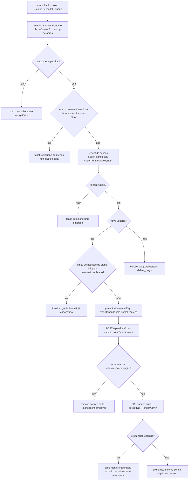
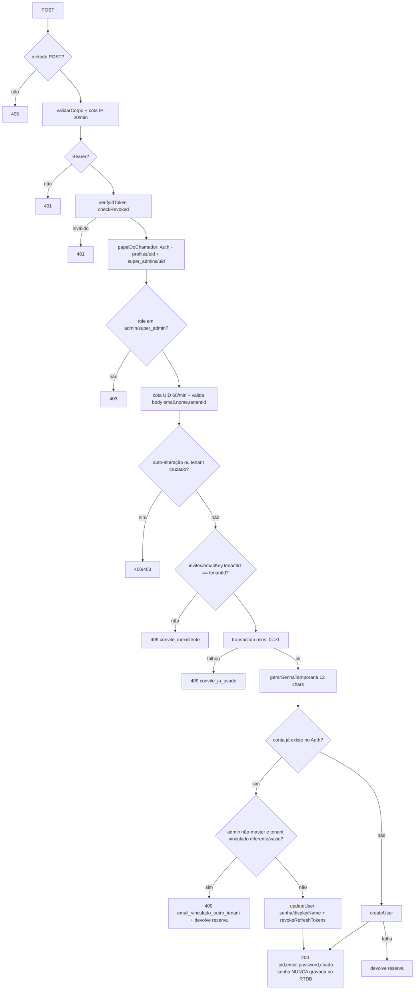
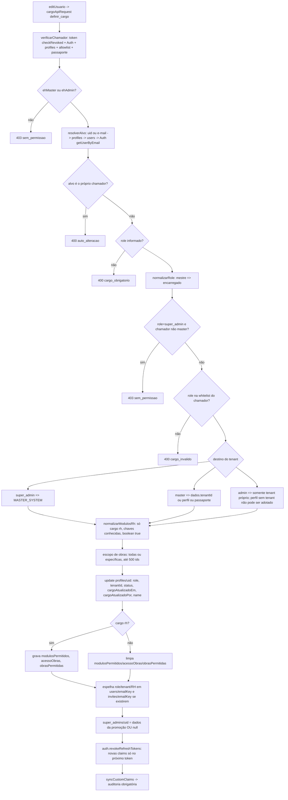
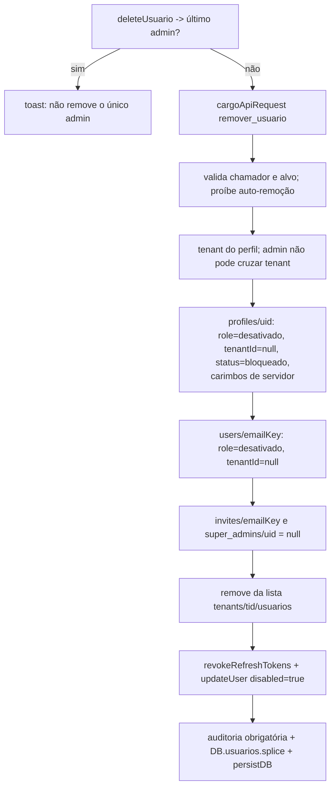
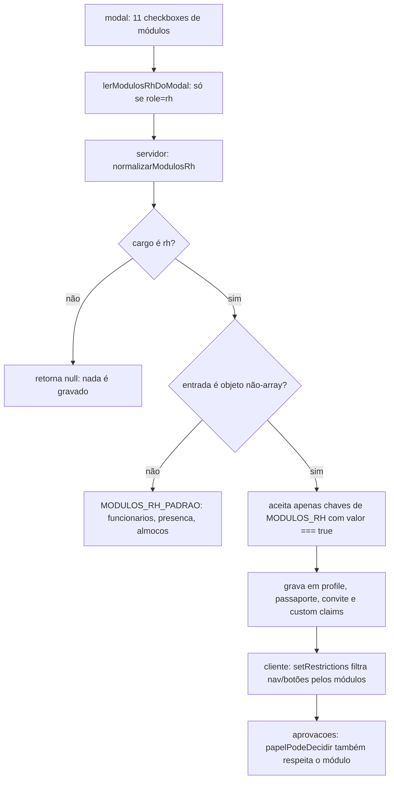
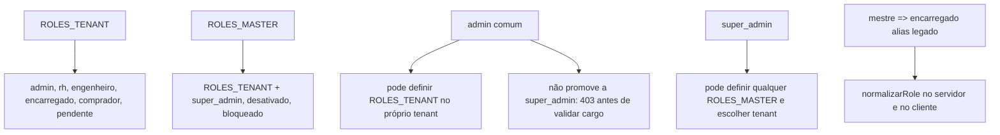

# Fluxograma — Módulo `usuarios-e-cargos`

> 🟢 CONFIRMADO — `functions/cargos.js`, `functions/usuarios.js`, `functions/claims.js`, `functions/index.js`, `public/js/app_core.js`, `public/modals/modal-usuario.html`, `public/modals/modal-credenciais-usuario.html`, `tests/rh-customizavel.test.js`, `tests/security/privilege-escalation.test.js`.

## 1. Criação de usuário e credencial

### API `criarUsuarioTenant` (`POST /api/admin/criar-usuario`)

## 2. Definição de cargo (`POST /api/admin/cargo`)

## 3. Remoção de usuário (`POST /api/admin/cargo`, `remover_usuario`)

## 4. Cargo RH — normalização e propagação

## 5. Hierarquia de papéis

