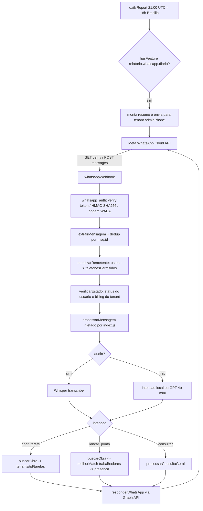
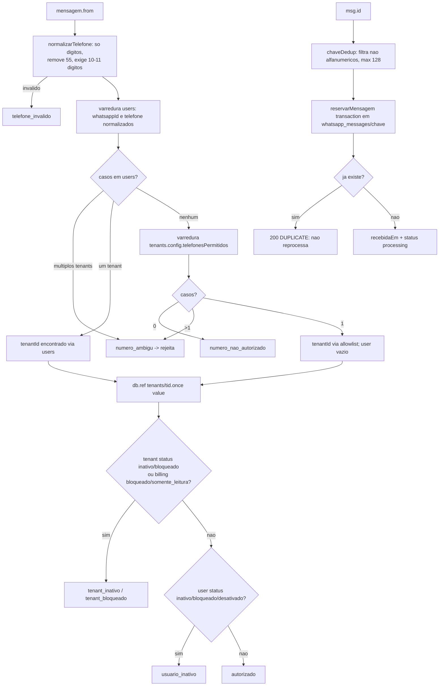
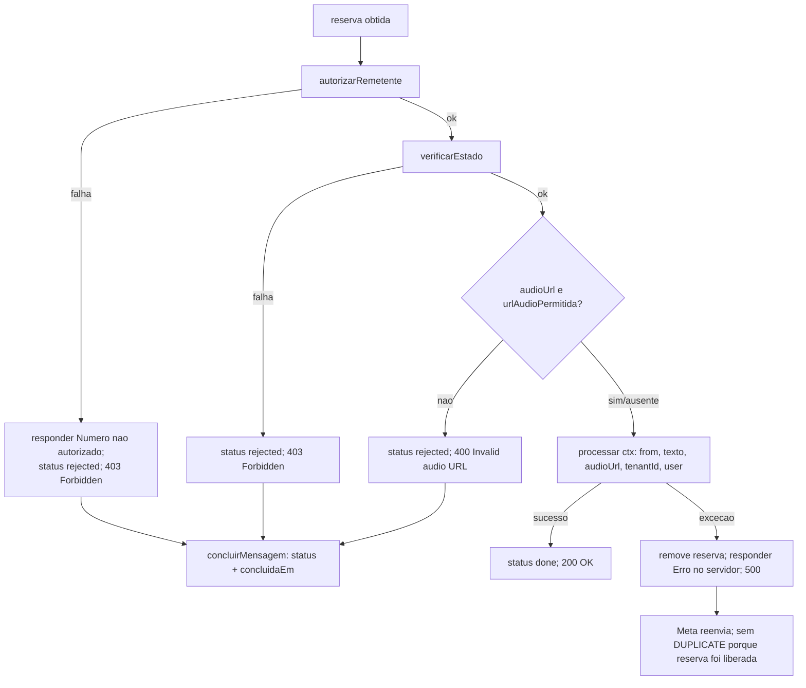
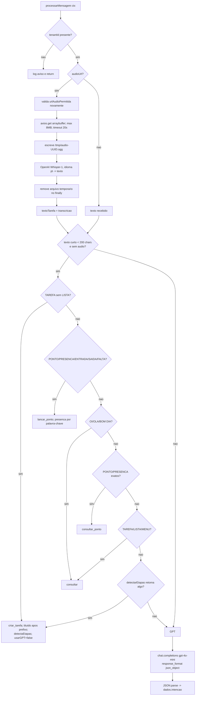
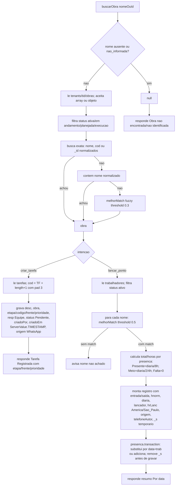
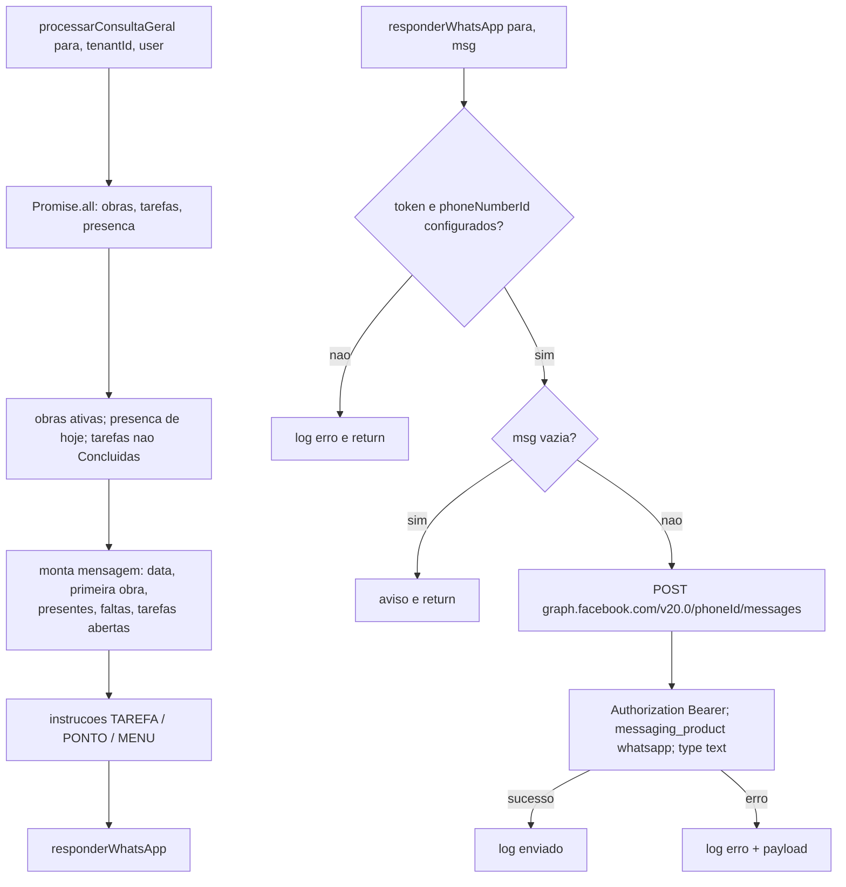
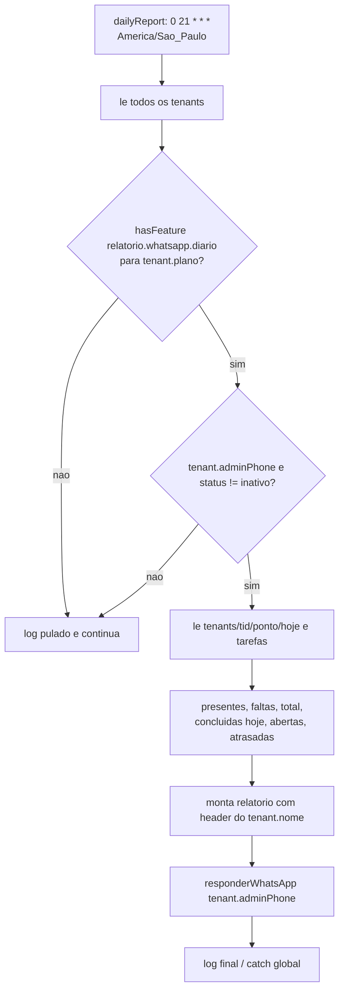
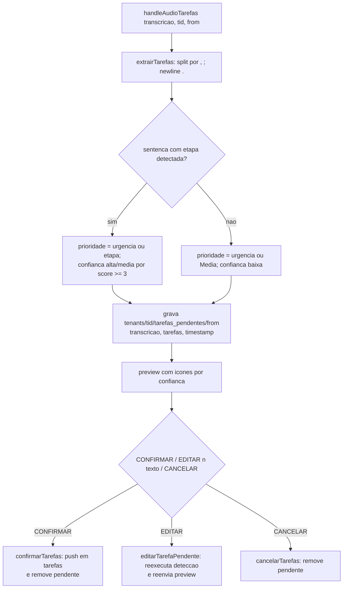
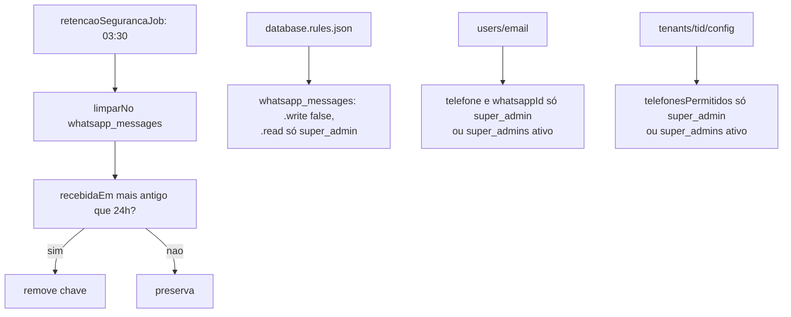

# Fluxograma — Módulo `whatsapp-bot`

> 🟢 CONFIRMADO — `functions/whatsapp_auth.js` (`seguroEqual` 27–31; `validarVerifyToken` 33–36; `validarAssinatura` 39–46; `normalizarTelefone` 49–53; `validarOrigem` 60–65; `extrairMensagem` 68–89; `urlAudioPermitida` 92–100; `autorizarRemetente` 107–139; `verificarEstado` 142–154; `reservarMensagem` 161–174; `handleWhatsappWebhook` 189–271), `functions/index.js:30-35,53-126,128-148,155-404,406-446,448-512,515-538`, `functions/whatsapp/obra-etapas.js:1-290`, `functions/whatsapp/parser-tarefas.js:1-142`, `functions/retencao.js:1-60`, `database.rules.json:74-76,211-222,241-267`, `tests/whatsapp-auth.test.js`, `tests/abuso.test.js:124-131`, `tests/plan-features.test.js:34-39,134`, `docs/wiki/whatsapp-bot/plano-implementacao-whatsapp.md`.

## 1. Visão geral



🟢 A porta de entrada é validada por HMAC-SHA256 da Meta e por origem WABA/`phone_number_id`, mas **a autorização do tenant** é feita depois, com Admin SDK, em `whatsapp_auth.js` (`whatsapp_auth.js:6-17`). 🟢 A lógica de negócio é injetada em `index.js` (`processar` e `responder`), mantendo a camada de autenticação testável (`whatsapp_auth.js:185-188`). 🟢 O envio de respostas e do relatório usa a Graph API v20.0 (`index.js:423-438`). 🟡 O módulo `parser-tarefas.js` (prévia → CONFIRMAR/EDITAR/CANCELAR) existe, mas não está conectado ao `processarMensagem` atual.

## 2. Handshake e validação criptográfica

```mermaid
flowchart TD
    A[req GET] --> B{hub.mode = subscribe<br/>e hub.verify_token seguroEqual?}
    B -- nao --> C[403 Token invalido]
    B -- sim --> D[200 hub.challenge]
    E[req method != GET e != POST] --> F[405 Method not allowed]
    G[req POST] --> H{rawBody Buffer e<br/>x-hub-signature-256 presente?}
    H -- nao --> I[401 Invalid signature]
    H -- sim --> J[HMAC-SHA256 sha256=... com appSecret]
    J --> K{seguroEqual?}
    K -- nao --> I
    K -- sim --> L[extrairMensagem]
    L --> M{object = whatsapp_business_account<br/>e entry/changes/messages[0].from?}
    M -- nao --> N[404 Not Found: ignora ramo page]
    M -- sim --> O[entry.id, metadata.phone_number_id,<br/>msg.id, texto/button, audio.id]
    O --> P{wabaId/phoneNumberId configurados?<br/>devem conferir exatamente}
    P -- nao --> Q[origem aceita: compatibilidade legada]
    P -- divergente --> R[403 Origin not allowed]
    P -- conferem --> S[origem aceita]
```

🟢 `seguroEqual` faz hash SHA-256 antes de `timingSafeEqual`, escondendo o tamanho das strings (`whatsapp_auth.js:26-31`). 🟢 O HMAC é calculado sobre o corpo **cru** (`req.rawBody`), não sobre o objeto parseado (`whatsapp_auth.js:38-46`). 🟢 Apenas `whatsapp_business_account` é aceito — o ramo `page` do Messenger é ignorado, fechando um vetor de SSRF (`whatsapp_auth.js:67-89`; `tests/whatsapp-auth.test.js:135-140`). 🟢 WABA/phone_number_id não configurados são tolerados, mas quando configurados a conferência é exata (`whatsapp_auth.js:55-65`).

## 3. Identidade do remetente e deduplicação



🟢 Matching é exato por DDD+número, nunca por substring (`whatsapp_auth.js:48-53`; `tests/whatsapp-auth.test.js:180-183`). 🟢 Empate entre tenants é ambiguidade e resulta em rejeição — nunca "primeiro que casou" (`whatsapp_auth.js:120-124,137`). 🟢 A allowlist `config.telefonesPermitidos` é só fallback quando `users` não casou (`whatsapp_auth.js:126-138`). 🟢 `verificarEstado` acopla o bot ao billing: `bloqueado` e `somente_leitura` impedem escrita via bot (`whatsapp_auth.js:141-154`). 🟢 A reserva por `msg.id` usa transação atômica; segunda entrega responde `200 DUPLICATE` (`whatsapp_auth.js:160-174`; `tests/whatsapp-auth.test.js:300-312`). 🟢 Sem `msgId`, a reserva é ignorada para compatibilidade com legados (`whatsapp_auth.js:163`).

## 4. Handler HTTP — ACK e tratamento de falhas



🟢 ACK positivo só acontece depois de processar; falha devolve 5xx para a Meta reenviar e a reserva é removida no `catch` (`whatsapp_auth.js:249-270`; `tests/whatsapp-auth.test.js:314-327`). 🟢 `concluirMensagem` engole erro de gravação para não falhar a resposta — a limpeza programada remove a reserva presa (`whatsapp_auth.js:176-183`). 🟢 Remetente não autorizado recebe mensagem explicativa antes do 403 (`whatsapp_auth.js:222-232`). 🟡 A resposta "número não autorizado" é enviada para qualquer número que passe assinatura/origem, permitindo uso do bot como canal de mensagem única.

## 5. Processamento — áudio e detecção de intenção



🟢 Intenções locais evitam chamada ao GPT para comandos curtos (`index.js:198-234`). 🟢 Áudio é limitado a 8 MB (`LIMITE_AUDIO`) e 20 s de download, transcrito com `whisper-1` em português (`index.js:169-194`). 🟢 `urlAudioPermitida` só aceita `https://graph.facebook.com` ou `*.fbcdn.net`, defesa em profundidade além da checagem no handler (`whatsapp_auth.js:91-100`; `index.js:169-174`). 🟢 O prompt do GPT fixa data atual em `America/Sao_Paulo` e formato JSON rígido (`index.js:236-271`). 🟡 A intenção `consultar_ponto` é detectada mas não tem branch de tratamento em `processarMensagem` (`index.js:221-223`). 🟡 `dados` do GPT não é validado contra schema antes de acessar `.tarefa`/`.ponto`.

## 6. Resolução de obra e gravação de tarefa/ponto



🟢 Busca de obra tem três níveis (exata → contém → fuzzy 0.3) e considera só obras ativas (`index.js:276-310`). 🟢 Código da tarefa é sequencial `TF001`, derivado do tamanho da lista (`index.js:318`). 🟢 Lançamento de ponto usa transação para não duplicar `data + trab`, atualizando registros existentes (`index.js:378-394`). 🟢 Horários padrão: entrada 07:00, saída 17:00 (12:00 no meio período, 00:00 em falta) (`index.js:367-375`). 🟡 `norm(o.cod)` em `buscarObra` chama `.normalize()` diretamente; códigos numéricos podem lançar erro (`index.js:92-95,296`). 🟡 `cod` sequencial por `lista.length + 1` pode colidir após exclusões. 🟡 A resposta de ponto é enviada mesmo quando nenhum trabalhador foi encontrado (`resultados` com avisos).

## 7. Consulta geral e envio de mensagens



🟢 Consulta agrega três coleções em paralelo e usa `getHojeBR()` (`index.js:515-538`). 🟢 `responderWhatsApp` usa `META_ACCESS_TOKEN` e `META_PHONE_NUMBER_ID` como secrets e não envia mensagem vazia (`index.js:406-446`). 🟡 O nome da empresa é fixo como `'Empresa'` na consulta geral (`index.js:529`). 🟡 Erros da Graph API são apenas logados — o fluxo não tem retry nem dead-letter.

## 8. Relatório diário (feature gate)



🟢 O agendamento `0 21 * * *` em UTC corresponde a 18h em Brasília (`index.js:448-455`). 🟢 A matriz de features é a mesma do front: somente Pro+ recebe o relatório (`index.js:466-472`; `tests/plan-features.test.js:34-39,134`). 🟢 `maxInstances: 1` evita envio duplicado do relatório (`index.js:454`). 🟡 O relatório lê `tenants/<tid>/ponto/<hoje>`, enquanto `processarMensagem` grava em `tenants/<tid>/presenca` — as fontes divergem e os contadores podem ficar zerados para LANÇAMENTOS via bot. 🟡 `billingState` não é checado no relatório, apenas `status === 'inativo'`.

## 9. Parser de tarefas (prévia/confirmação) — código presente, não conectado



🟢 `ETAPAS` tem 10 categorias com sinônimos e prioridade padrão; `detectarEtapas` pontua por número de palavras batidas e ordena decrescente (`obra-etapas.js:1-238`). 🟢 `PALAVRAS_URGENCIA` força prioridade Alta (`obra-etapas.js:187-207`). 🟡 `handleAudioTarefas`, `confirmarTarefas`, `editarTarefaPendente` e `cancelarTarefas` não são importados por `index.js` — o fluxo ativo grava tarefa diretamente, sem prévia nem confirmação. 🟡 `tarefas_pendentes/<from>` usa o telefone como chave, sem normalização — o mesmo remetente com formatos diferentes gera pendências distintas. 🟡 `criadoEm` em `confirmarTarefas` usa `toISOString().split('T')[0]` (UTC), divergente do `getHojeBR()` usado no fluxo ativo.

## 10. Retenção e regras de proteção



🟢 `whatsapp_messages` tem retenção de 24h, coerente com o uso apenas como dedup (`retencao.js:11-22`; `index.js:913-918`). 🟢 Rules impedem que o cliente altere identidade do bot: `telefone`, `whatsappId` e `telefonesPermitidos` exigem super_admin (`database.rules.json:74-76,261-266`; `tests/abuso.test.js:124-131`). 🟢 `whatsapp_messages` é somente leitura para super_admin e fechado para escrita pelo cliente (`database.rules.json:219-222`). 🟡 A limpeza usa `recebidaEm`; uma reserva `processing` presa é removida após 24h, não por lease curto como no webhook da Kiwify.
