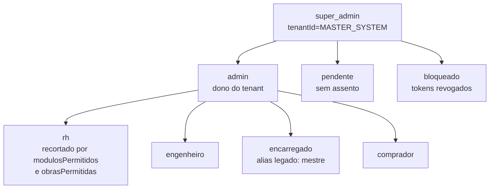

# Matriz de Permissões (RBAC/ACL) — Obra Real

> Gerado pelo **Detetive** (Fase 3). `doc_level = completo`.
> Fontes: `database.rules.json` (292 linhas), `storage.rules`, `functions/claims.js`, `functions/super_admin.js`, `functions/cargos.js`, `functions/usuarios.js`, `functions/aprovacoes-api.js`, `functions/index.js`, `docs/security/*`, `tests/security/*`.
> 🟢 CONFIRMADO · 🟡 INFERIDO · 🔴 LACUNA. Legenda da matriz: **L** = leitura, **E** = escrita, **A** = aprovação, **—** = negado, **S** = somente via servidor/Admin SDK.

## 1. Papéis e hierarquia

| Papel | Definição de negócio | Origem da autoridade |
|---|---|---|
| `super_admin` | Operador global do SaaS (Master). Pode mudar plano, limites, bloquear tenants/usuários, consultar Kiwify. | `super_admins/<uid>` → e-mail mestre → migração legada (`claims.js:35-71`) |
| `admin` | Administrador da empresa; dono do tenant, gestão de usuários, configuração, finanças e orçamento. | `profiles/<uid>/role` + claim + `emailAdmin` do tenant |
| `rh` | Perfil de RH com módulos habilitados e, opcionalmente, escopo de obras. | `modulosPermitidos`, `acessoObras`, `obrasPermitidas` (`index.js:788-806`) |
| `engenheiro` | Planejamento e medição; prepara dados, não aprova a maioria dos tipos. | claim + perfil |
| `encarregado` | Execução de obra: ponto, tarefas, almoços, fotos, canteiro. | claim + perfil; `mestre` é alias legado |
| `comprador` | Compras e estoque; **não** escreve financeiro nem `movEstoque`. | claim + perfil |
| `pendente` | Aguardando assento/aprovação; sem `tenantId` nas claims. | `status='pendente'` |
| `bloqueado` | Acesso revogado; `revokeRefreshTokens` na transição. | `status='bloqueado'` |

🟢 Hierarquia para decisão de aprovação usa o **maior** papel entre claim e perfil, para que uma claim desatualizada não rebaixe um admin e um perfil desatualizado não rebaixe uma claim vigente (`aprovacoes-api.js:47,58`). 🟢 `role` ausente em `definir_cargo` é erro `cargo_obrigatorio` — nunca cai para `admin` por padrão (`code-analysis.md:215`).

## 2. Matriz por nó do Realtime Database (sem bloqueio de cobrança)

| Nó / caminho | super_admin | admin | rh (módulo) | engenheiro | encarregado/mestre | comprador |
|---|:---:|:---:|:---:|:---:|:---:|:---:|
| `profiles` (lista) | L/E | — | — | — | — | — |
| `profiles/<uid>` próprio | L/E | L/E¹ | L/E¹ | L/E¹ | L/E¹ | L/E¹ |
| `tenants/<tid>` | L/E | L/E² | L | L | L | L |
| `tenants/<tid>/config` | L/E | L/E³ | — | — | — | — |
| `tenants/<tid>/config/telefonesPermitidos` | L/E | — | — | — | — | — |
| `tenants_public/<slug>` | L/E | L/E (dono/slug) | L | L | L | L |
| `users/<email>` | L/E | L/E no tenant | L no tenant | L no tenant | L no tenant | L no tenant |
| `invites/<email>` | L/E | L/E no tenant | — | — | — | — |
| `presenca`, `tarefas`, `almocos` | L/E | L/E | L/E se módulo | L/E | L/E | — |
| `obras`, `medicao` | L/E | L/E | L/E se módulo | L/E | L (fotos em medição) | — |
| `estoque`, `canteiro`, `compras` | L/E | L/E | L/E se módulo | prepara (via aprovação) | prepara (via aprovação) | L/E |
| `comprasPrivadas/<tid>` | L | L | L se módulo | — | — | L |
| `movEstoque` | L/E | L/E | L/E se módulo | via aprovação | via aprovação | — |
| `financeiro`, `orcamento` | L/E | L/E | L/E se módulo | prepara orçamento | — | — |
| `aprovacoes/<id>` | A (via API) | A (via API) | A se `aprovacoes` + módulo do tipo | A só `movimentacao_estoque` com `notificarAdmin` | solicita | solicita |
| `auditoria`, `notificacoes`, `tarefas_pendentes` | L | L no tenant | L no tenant | L no tenant | L no tenant | L no tenant |
| `admin_audit`, `admin_ops`, `rate_limits`, `billing_events`, `webhook_debug`, `whatsapp_messages`, `super_admins` | L, `.write:false` | — | — | — | — | — |

¹ `uid/email/role/tenantId/status` são imutáveis para o cliente; promoção só via Admin SDK.
² Leitura exige `profiles/<uid>/tenantId === $tenantId` **ou** `emailAdmin` igual ao e-mail do token.
³ Escrita negada quando `billingState` é `somente_leitura` ou `bloqueado`.

🟢 Regras comuns a todos os nós de tenant: `auth.token.tenantId === $tenantId` (via perfil), `billingState !== 'bloqueado'` para leitura e `!== 'somente_leitura'` para escrita (`database.rules.json:30-161`). 🟢 RH entra nas regras apenas quando `auth.token.modulosPermitidos.<modulo> === true` ou o perfil espelha `true`; com `acessoObras='especificas'`, a obra precisa constar em `obrasPermitidas` (`database.rules.json:79-128`).

## 3. Cloud Storage 🟢

| Regra | Valor | Origem |
|---|---|---|
| Caminho permitido | `tenants/<tenantId>/...` — fora disso, negado | `storage.rules:33-45` |
| Autoridade | somente `request.auth.token` (o Storage **não** lê o RTDB) | `storage.rules:4-6` |
| Membro do tenant | `token.tenantId == tenantId` e papel em `admin`, `rh`, `engenheiro`, `encarregado`, `mestre`, `comprador` | `storage.rules:7-16` |
| Super Admin | `token.role == 'super_admin'` **e** `token.tenantId == 'MASTER_SYSTEM'` | `storage.rules:18-22` |
| Arquivo | 1 byte a 10 MB, `image/*` ou `application/pdf` | `storage.rules:24-31` |

🟢 Como o Storage não consulta o banco, revogação imediata depende de `revokeRefreshTokens` em **todos** os caminhos de mudança de cargo/tenant (`docs/security/tenant-isolation.md:39-41`). 🟡 `mestre` segue aceito como alias legado (`storage.rules:14`).

## 4. Permissões por decisão de aprovação 🟢

| Tipo de aprovação | admin | super_admin | rh (com módulo) | engenheiro | encarregado |
|---|:---:|:---:|:---:|:---:|:---:|
| `compra_criacao` (`compras`) | A | A | A se `aprovacoes`+`compras` | — | solicita |
| `movimentacao_estoque` | A | A | A se módulo | A **somente** com `notificarAdmin === true` | solicita |
| `financeiro_lancamento` / `financeiro_status` | A | A | A se módulo | — | solicita |
| `orcamento_fechamento` | A | A | A se módulo | solicita | — |
| `medicao_fechamento` | A | A | — (mesmo com módulo) | solicita | — |
| `trabalhador_add` | A | A | A se módulo | solicita | solicita |
| `almoco_lancamento` | A | A | A se módulo | solicita | solicita |
| demais tipos | A | A | A se `aprovacoes` + módulo do tipo | — | solicita |

🟢 `emailAdmin` do tenant conta como admin na API (preserva a rule antiga), mas não cria `ehAdmin` no cliente (`code-analysis.md:287`). 🟢 `podeAplicar` revalida decisor e autoridade na aplicação, não só na decisão (`code-analysis.md:289`).

## 5. APIs administrativas e defesa em profundidade 🟢

| Rota / função | Autorização | Controles antes do efeito |
|---|---|---|
| `/api/admin/conta` (`adminAccountApi`) | `verifyIdToken(token, true)` + perfil + allowlist + passaporte | método, 16 KB, cotas IP/UID/ação/Kiwify, `admin_ops`, auditoria obrigatória |
| `/api/admin/cargo` (`gerenciarCargo`) | `verificarChamador`: token com checagem de revogação + perfil + allowlist | cotas, proibição de autoalteração, reserva/auditoria em ações destrutivas |
| `/api/admin/aprovacao` (`decidirAprovacaoApi`) | hierarquia maior entre claim/perfil + módulos + escopo de obra | transação de decisão (`409 ja_decidida`), auditoria obrigatória |
| `/api/admin/criar-usuario` (`criarUsuarioTenant`) | perfil no RTDB é autoridade (`papelDoChamador`) | convite consumido por transação em `usos`, devolvido se falhar |
| `/api/kiwify` (`kiwifyWebhook`) | HMAC-SHA1 do corpo cru | dedup `orderId+eventType`, `payloadHash` sem status, lease 2 min |
| `/api/whatsapp` (`whatsappWebhook`) | HMAC-SHA256, token de verificação, WABA allowlist | dedup transacional, telefone/estado/URL, ACK após processar |

| Controle | Valor / comportamento | Origem |
|---|---|---|
| Corpo máximo | 16 KB ⇒ `413 payload_muito_grande` | `abuso.js:5,15-28` |
| Cotas | `admin:ip` 60/min, `admin:uid` 120/min, `admin:acao` 30/min, `admin:kiwify` 30/min, `criar:ip` 20/min, `criar:uid` 60/min | `super_admin.js:365,405`; `usuarios.js:72,95` |
| Hash de IP | SHA-256(`obrareal:cargo:<ip>`), 32 hex | `abuso.js:33-41` |
| Ações destrutivas | `excluir_usuario`, `bloquear_tenant`, `bloquear_usuario`, `remover_usuario`, `definir_plano`, `definir_cargo` | `auditoria.js:15-18` |
| Fail-closed | falha de auditoria obrigatória ⇒ `503 auditoria_falhou` com `requestId` | `auditoria.js:63-67`; `super_admin.js:462-468` |
| Idempotência | reentrega com mesmo `requestId` ⇒ `200 {idempotente:true}` quando efeito aplicado | `auditoria.js:74-106` |
| CORS | `cors:false` em APIs admin e webhooks | `docs/security/cors.md:41-45` |

🟢 Nenhum papel vem do cliente: toda autoridade é reconfirmada no banco e nas claims. 🟢 `verifyIdToken(token, true)` invalida imediatamente tokens emitidos antes de bloqueio/rebaixamento (`super_admin.js:53-55`). 🟡 `syncCustomClaims` engole erro de `getUser` e não tem retry — claims podem ficar defasadas até nova escrita no perfil.

## 6. Limites de plano que alteram permissões 🟢

| Limite / feature | Regra | Origem |
|---|---|---|
| `billingState='bloqueado'` | nenhuma feature disponível, leitura/escrita negadas | `plan_features.js:104-109`; `database.rules.json:50-52` |
| `billingState='somente_leitura'` | leitura liberada, escrita negada | `database.rules.json:50-52` |
| Assentos | perfil novo acima do limite vira `pendente` | `index.js:716-720` |
| Obras | `enforceObrasLimit` complementa o limite do plano | `docs/plans/features.md:59-60` |
| RH | máx. 50 `obrasPermitidas` nas claims | `index.js:802-805` |
| `subdominio` | alteração do slug só em Pro+; criação do slug é universal | `docs/plans/features.md:37-52` |
| `pix.folha` | somente Ilimitado | `docs/plans/features.md:23` |
| `relatorio.whatsapp.diario` | Pro+ e `hasFeature` no job | `docs/plans/features.md:21,56-57` |

## 7. Lacunas e superfícies de risco

- 🔴 Fato: `tarefas_pendentes` tem rules na raiz, parser grava em `tenants/<tid>/tarefas_pendentes` (`code-analysis.md:478`). 🟢 Decisão P4: nó removido — gravação direta em `tarefas`.
- 🔴 Fato: histórico Git antigo contém `node_modules` e a chave Web pública do Firebase. 🟢 Decisão P18: reescrever o histórico para remover esses artefatos (fora do escopo de escrita do Reversa).
- 🟡 Alias `mestre` amplia a superfície de papéis em Storage e RTDB.
- 🟡 `EMAIL_MESTRA` é exceção replicada em várias rules; remoção exige deploy coordenado functions+rules.
- 🟡 Emulador de Security Rules falha por configuração de projeto; as asserções estáticas são substituto temporário.
- 🟡 Fato: `renderCompras` não filtra por obra na UI; `filterDbByObras` atua só no carregamento. 🟢 Decisão P16: aplicar `acessoObras`/filtro de obra.
- 🟡 Botões de editar/excluir orçamento não são escondidos por papel — a segurança depende das rules.
- 🟡 `deploy.yml` publica somente Hosting: uma mudança de rules/functions pode ficar fora de sincronia com o front.
- 🟡 `admin_ops` depende da limpeza de 24 h; não há lease curto como o da Kiwify.

**Próximo artefato:** [`adrs/`](adrs/)
