# Máquinas de Estado — Obra Real

> Gerado pelo **Detetive** (Fase 3). `doc_level = completo`.
> 🟢 CONFIRMADO no código/rules/testes · 🟡 INFERIDO de padrões e documentação · 🔴 LACUNA/contradição.
> Convenção: `*` = estado **derivado** em leitura (não persistido). `?` = estado observado em documento legado, não confirmado no fluxo ativo.

## 1. `billingState` do tenant 🟢

**Origem:** `functions/billing.js:39-175` (`calcularBillingState`, `atualizarBillingStatesJob`), `functions/kiwify.js:379-439`, `functions/super_admin.js:267-328`, `database.rules.json:50-52`, `data-dictionary.md §86-89`.

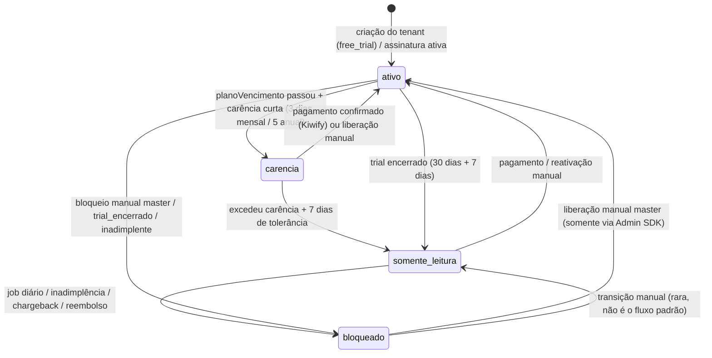

| Estado | Leitura | Escrita | Gatilho típico | Origem |
|---|---|---|---|---|
| `ativo` | sim | sim | padrão | `billing.js:39-137` |
| `carencia` | sim | sim | vencimento recente | `billing.js` |
| `somente_leitura` | sim | **não** | trial encerrado / carência esgotada | `database.rules.json:50-52` |
| `bloqueado` | não (exceto o próprio `billingState`) | não | inadimplência, chargeback, reembolso, bloqueio manual | `data-dictionary.md:1355` |

🟢 A transição é calculada por **função pura**, aplicada por job diário (04:00, `America/Sao_Paulo`) e por ações manuais do Master. 🟡 `status` do tenant não é atualizado pelo job: `status='bloqueado_pagamento'` pode coexistir com `billingState='ativo'`. 🟡 Até 24 h de defasagem entre vencimento e aplicação. 🟡 `hasFeature` devolve `false` para qualquer feature quando `billingState='bloqueado'`.

## 2. `status` do tenant (campo legado de cobrança) 🟡

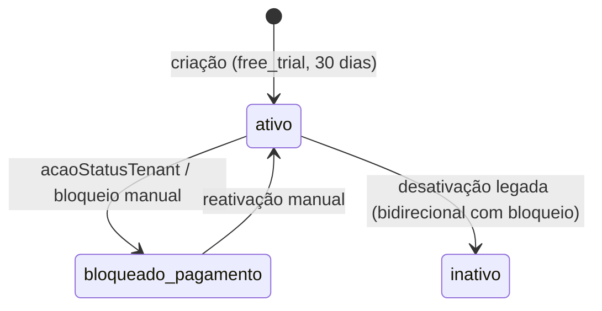

🟢 Valores observados: `ativo`, `carencia`, `bloqueado`, `bloqueado_pagamento`, `inativo` (`kiwify.js:379,399,425,437`; `super_admin.js:286,319`; `whatsapp_auth.js:144`). 🟡 O campo é usado no bot e em checagens antigas, mas o acesso efetivo é governado por `billingState`. 🔴 `cancelamentoAgendado` não desbloqueia `bloqueado_pagamento` (`code-analysis.md:1455`).

## 3. Perfil do usuário (`profiles/<uid>`) 🟢

```mermaid
stateDiagram-v2
    [*] --> pendente: convite / assento excedido / criação pelo admin
    [*] --> ativo: auto-onboarding aprovado pelo próprio usuário (status inicial)
    pendente --> ativo: admin define cargo (definir_cargo)
    ativo --> ativo: troca de cargo (admin/rh/engenheiro/encarregado/comprador)
    ativo --> pendente: nova conta acima do limite de assentos
    ativo --> bloqueado: bloquear_usuario / remover_usuario / desativado
    pendente --> bloqueado: bloqueio explícito
    bloqueado --> ativo: desbloqueio pelo Master (claims recalculadas)
    ativo --> [*]: exclusão (Auth.deleteUser; fallback: disabled + claims null)
```

| Transição | Gatilho | Efeito nas claims | Origem |
|---|---|---|---|
| novo perfil | `onValueWritten profiles/{uid}` | `role` normalizado (`mestre`→`encarregado`), `tenantId` do perfil | `index.js:699-703` |
| `pendente`/`bloqueado` | `status` no perfil | `{role: status, tenantId: null}`; bloqueado revoga tokens | `index.js:706-712` |
| assento excedido | perfil **novo** + limite do plano | vira `pendente` | `index.js:716-720` |
| escalação bloqueada | `role='super_admin'` sem autoridade | perfil reescrito para `admin` + `cargoAtualizadoPor`; revoke se era master | `index.js:741-758` |
| RH | papel + módulos | `modulosPermitidos`, `acessoObras`, até 50 `obrasPermitidas` | `index.js:788-806` |
| perfil removido | nó apagado | `Auth.deleteUser`; falha ⇒ `disabled:true` + claims `null` | `index.js:684-697` |

🟢 `role` e `tenantId` são imutáveis para o cliente nas rules; toda alteração passa por `/api/admin/cargo` (`cargos.js`) ou pela trigger. 🟡 `users/<email>` e `invites/<email>` espelham o papel, mas não são autoridade. 🟡 `mestre` segue como alias legado em rules.

## 4. Aprovação (`tenants/<tid>/aprovacoes/<id>`) 🟢

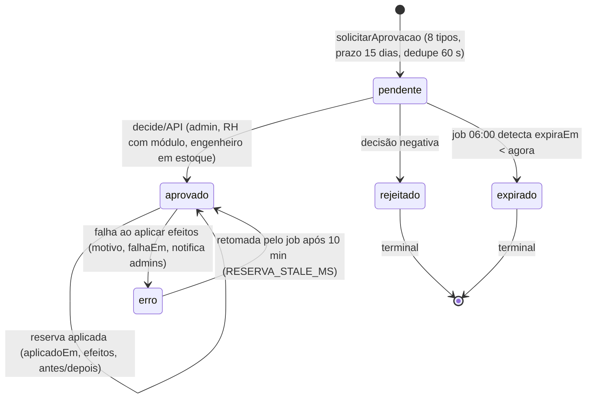

| Estado | Significado | Verificação |
|---|---|---|
| `pendente` | aguardando decisão; prazo 15 dias | `database.rules.json:140-142` |
| `aprovado` | decisão positiva gravada; efeitos aplicados por trigger | `aprovacoes.js:594` |
| `rejeitado` | decisão negativa; nenhum efeito | `aprovacoes-api.js` |
| `expirado` | job de prazos marcou sem decisão | `aprovacoes.js:651` |
| `erro` | efeito falhou; retomável | `code-analysis.md:293` |

🟢 Decisão concorrente ⇒ `409 ja_decidida`; aplicação é reservada transacionalmente e revalida autoridade no momento de aplicar (`podeAplicar`). 🟢 Um único `update()` multi-path grava `aplicadoEm` + efeitos + auditoria. 🟡 Alertas 7/12/15 dias são gravados em `alertas` para dedupe.

## 5. Tarefa e status efetivo 🟢

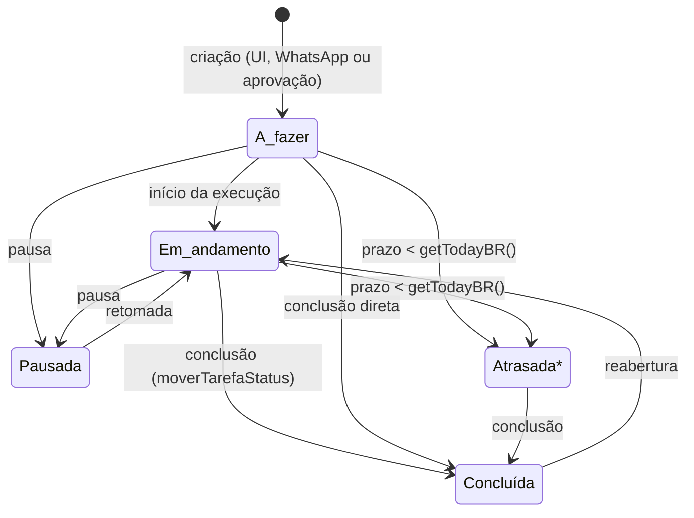

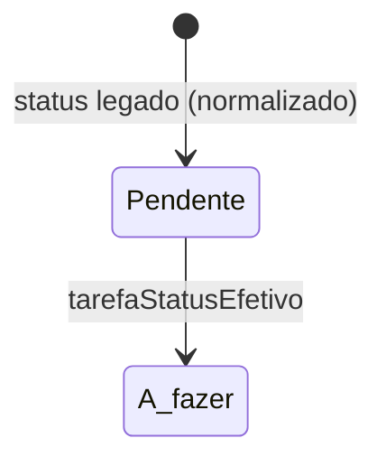

🟢 `Atrasada` é **somente derivado** — `tarefaStatusEfetivo` compara com `getTodayBR()` em leitura (`data-dictionary.md §44-45`). 🟢 Dashboard agrupa atrasadas em um alerta com até 2 exemplos; `TAREFA HOJE` gera um alerta por tarefa. 🟡 `Pendente` aparece como legado; `Concluída` é o único status que reduz `abertas`. 🔴 WhatsApp grava tarefa diretamente, sem o fluxo de prévia/confirmação do parser desconectado.

## 6. Obra 🟢

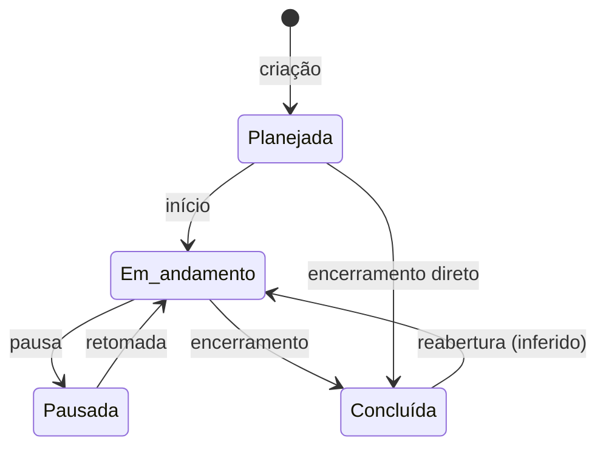

🟢 `obrasAtivas` conta `status === 'Em andamento'`; commit `633a2df` incluiu `Planejada` na contagem do dashboard (histórico revela mudança de requisito). 🟡 Reabertura de `Concluída` não tem regra explícita nas rules revisadas.

## 7. Presença / ponto 🟢

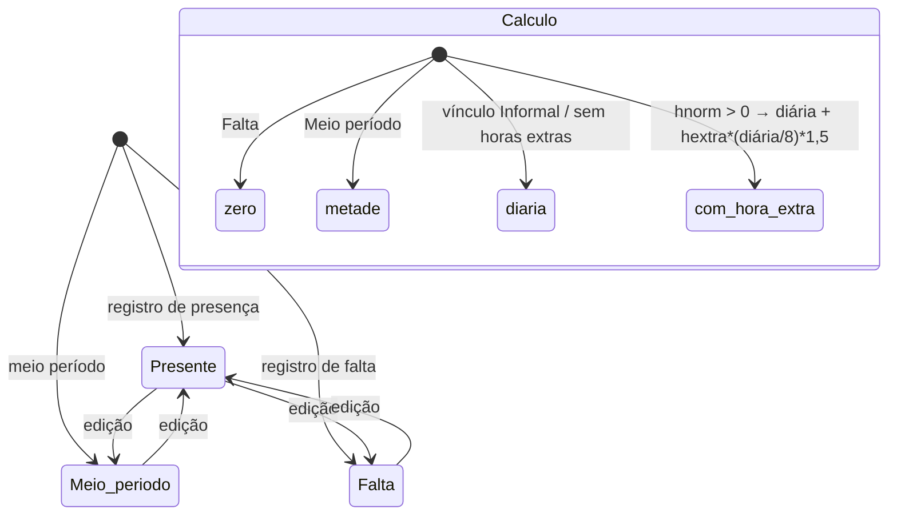

🟢 O recálculo é **retroativo para registros não pagos** quando a diária do trabalhador muda (commit `1ab48d9`). 🟢 O saldo considera somente `financeiro.real` com `source='pre'`, `forn=nome` e `status='Pago'`. 🔴 Fato: `dailyReport` lê `tenants/<tid>/ponto/<hoje>` enquanto o bot grava em `presenca`. 🟢 Decisão P3: `presenca` é o nó canônico (ajuste pendente).

## 8. Pagamento — financeiro e almoço 🟢

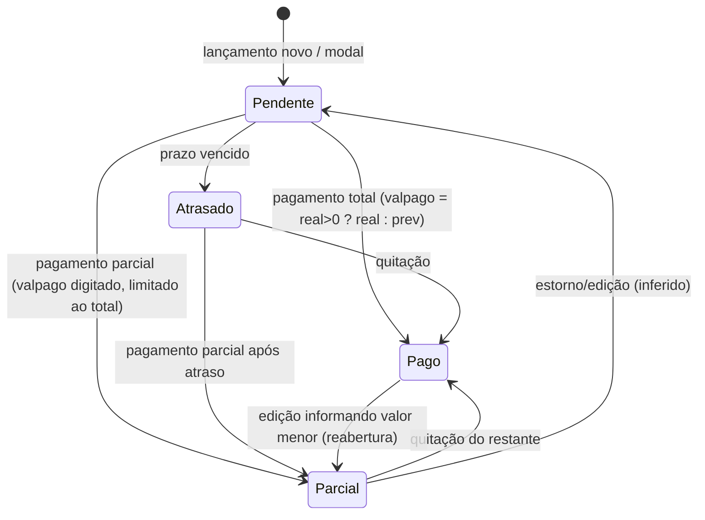

| Status | `valpago` / devido | Origem |
|---|---|---|
| `Pago` | `valpago = real > 0 ? real : prev`; devido = 0 | `code-analysis.md:979`; `data-dictionary.md §49` |
| `Parcial` | valor digitado, limitado ao total; mostra "Falta Pagar" | `code-analysis.md:979` |
| `Pendente` | `valpago = 0`; devido = total | `code-analysis.md:979` |
| `Atrasado` | `valpago = 0`; devido = total (com alerta) | `code-analysis.md:976` |

🟢 `jaPago`: `Pago → total`, `Parcial → min(valpago,total)`, demais → 0. 🟢 Mudança de status com desvio ativo vai por `financeiro_status`; demais casos por `financeiro_lancamento` (`code-analysis.md:979`). 🟡 `pix.folha` só existe no plano Ilimitado (`docs/plans/features.md:23`).

## 9. Compra 🟢

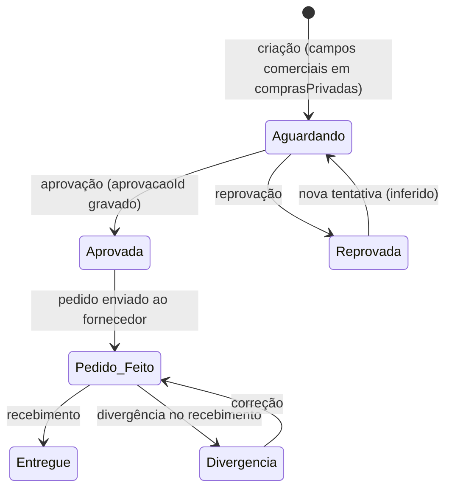

🟢 `aprovacaoId` só aparece em compras aprovadas. 🟢 Engenheiro/encarregado/mestre não leem `comprasPrivadas` (rules). 🟡 `renderCompras` não filtra linhas por obra; o filtro depende do carregamento do DB.

## 10. Movimentação de estoque e status derivado 🟢

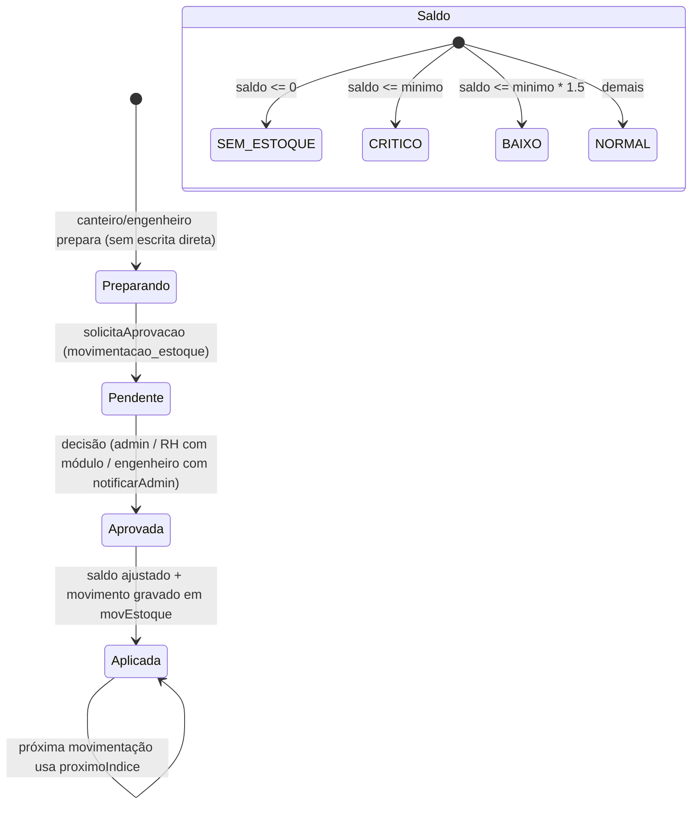

🟢 Entrada/retorno somam; saída/transferência exigem saldo; transferência gera duas movimentações e cria o item no destino (`MAT-<epoch>` quando não existe). 🟢 `antes`/`depois` do material são gravados para auditoria. 🟡 `saveEstoque` usa normalizador local divergente do `normalizarNome` testado.

## 11. Evento Kiwify 🟢

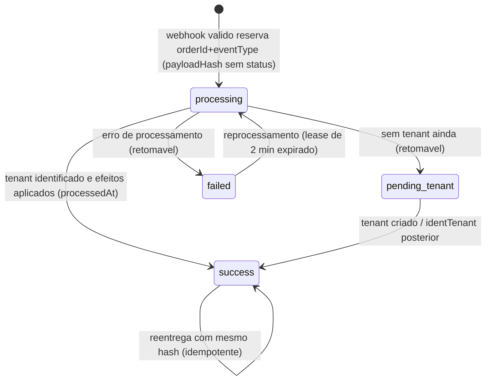

🟢 Assinatura HMAC-SHA1 inválida ⇒ `401` + `webhook_debug` sem PII. 🟢 `order_status` fora da chave e do hash evita duplo efeito para a mesma ordem com status diferente. 🟡 Identificação do tenant usa quatro caminhos (referência/slug → `emailAdmin` → perfil → convite).

## 12. Mensagem WhatsApp (dedup) 🟢

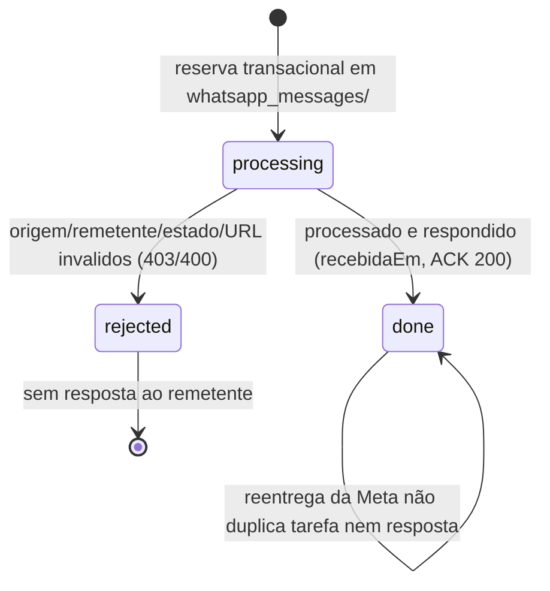

🟢 ACK 200 é enviado **depois** do processamento — uma falha não é reconhecida como sucesso. 🟢 Retenção de 24 h por `recebidaEm`. 🔴 Erro da Graph API ao responder é apenas logado (sem retry/fila/dead-letter; P5 sem decisão). 🔴 Fato: `consultar_ponto` detectada sem handler; 🟢 decisão P1. 🟢 Decisão P4: `tarefas_pendentes` removido; gravação direta em `tarefas`.

## 13. Onboarding de slug (UI, não persistido) 🟢

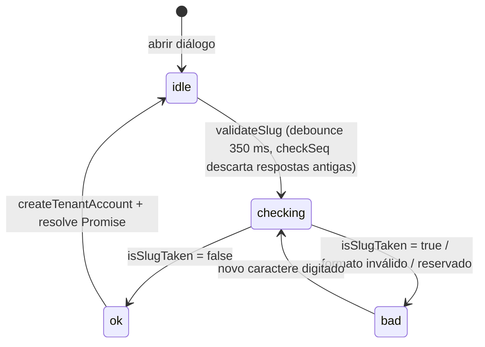

🟢 `validateSlug` → `isSlugTaken` (leitura direta) → `createTenantAccount` → `handleAuthSuccess`. 🟢 `buildAccountUpdates` grava `tenants`, `tenants_public` e `users` num único `update()` multi-path com `trialExpiracao = now + 30 dias`.

## 14. Matriz resumida de estados persistentes

| Entidade | Nó | Estados | Terminal? | Dono da transição |
|---|---|---|---|---|
| Billing do tenant | `tenants/<tid>/billingState` | `ativo`, `carencia`, `somente_leitura`, `bloqueado` | não | job + Admin SDK |
| Perfil | `profiles/<uid>/status` | `ativo`, `pendente`, `bloqueado` | não | trigger + API admin |
| Aprovação | `tenants/<tid>/aprovacoes/<id>/status` | `pendente`, `aprovado`, `rejeitado`, `expirado`, `erro` | sim (salvo `erro`) | API + trigger + job |
| Tarefa | `tarefas[].status` | `A fazer`, `Em andamento`, `Concluída`, `Pausada` (+ `Pendente`) | não | cliente + bot |
| Obra | `obras[].status` | `Planejada`, `Em andamento`, `Concluída`, `Pausada` | não | cliente |
| Presença | `presenca` | `Presente`, `Falta`, `Meio período` | não | cliente + bot |
| Pagamento | `financeiro[].status` | `Pago`, `Parcial`, `Pendente`, `Atrasado` | não | cliente + trigger |
| Compra | `compras[].status` | `Aguardando`, `Aprovada`, `Pedido Feito`, `Entregue`, `Reprovada`, `Divergência` | não | cliente + trigger |
| Evento Kiwify | `billing_events/<id>/status` | `processing`, `success`, `pending_tenant`, `failed` | sim (`success`) | webhook + retomada |
| Mensagem WhatsApp | `whatsapp_messages/<id>/status` | `processing`, `done`, `rejected` | sim | webhook |

**Próximo artefato:** [`permissions.md`](permissions.md)
